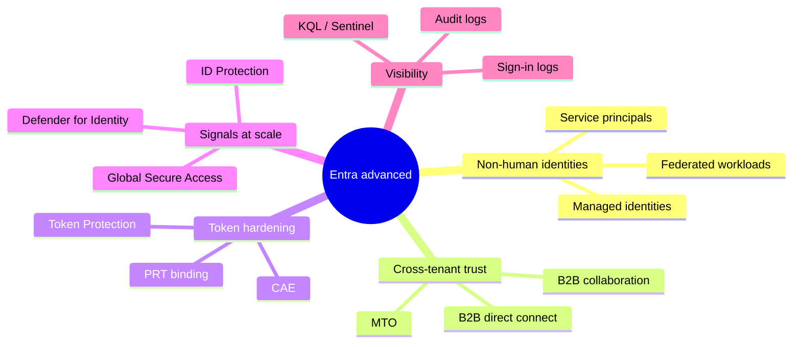
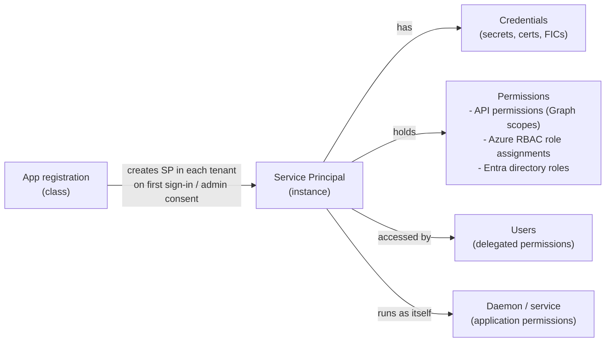
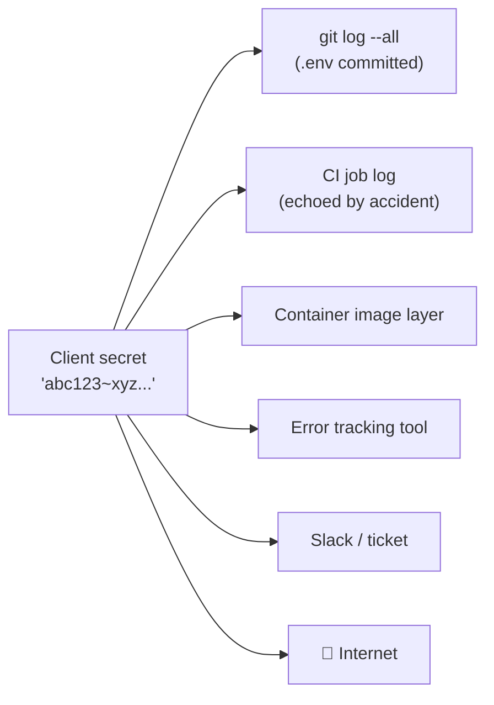
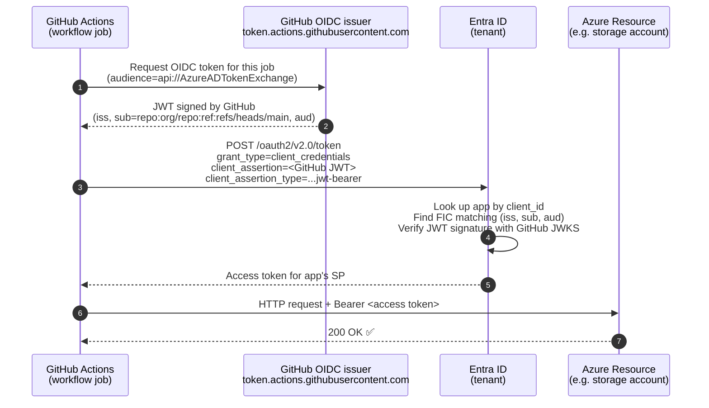
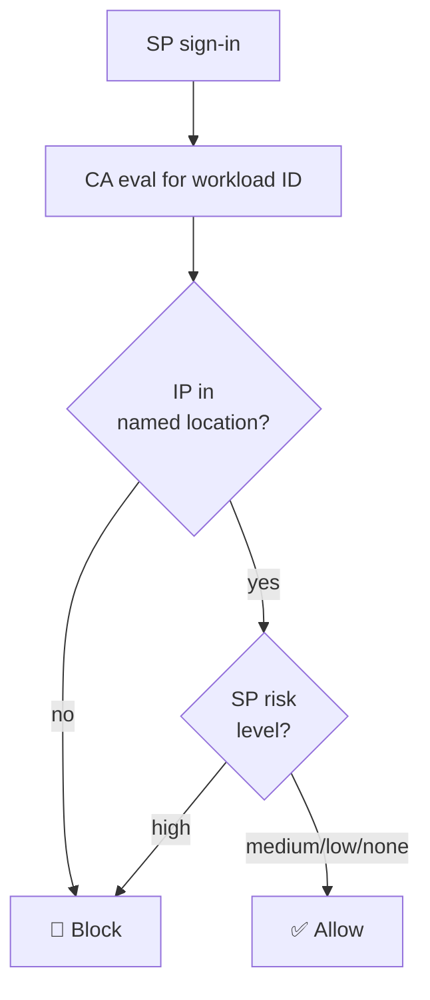
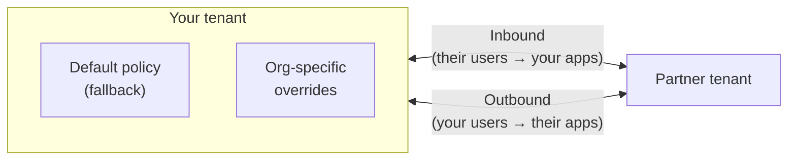
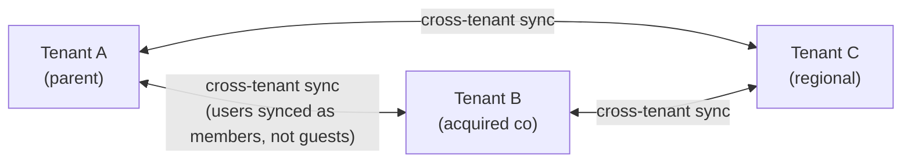
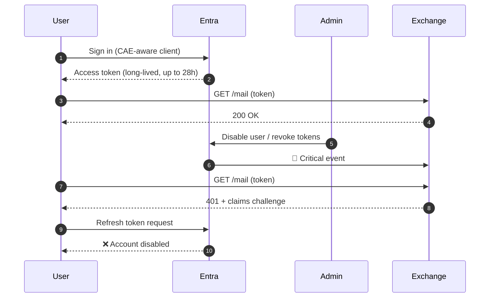
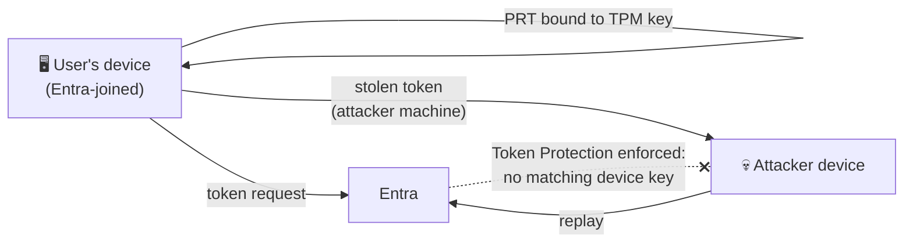
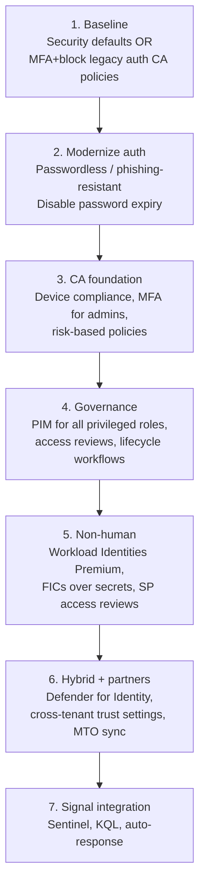

# Entra ID — Advanced security

> **TL;DR** — Once the fundamentals (MFA, CA, Identity Protection, PIM) are in place, Entra security becomes about **everything that isn't a human**: service principals, managed identities, cross-tenant partners, long-lived tokens, hybrid signals from on-prem AD, and the logs that tie it all together. This note covers **workload identities**, **cross-tenant access**, **token protection / CAE**, **Zero Trust alignment**, **Permissions Management (CIEM)**, **Defender for Identity**, **Global Secure Access**, and **logs & KQL**.

> Prereqs (read these first): [Basics](entra-id-basics.md) · [Conditional Access](entra-id-conditional-access.md) · [Identity Protection](entra-id-identity-protection.md) · [PIM & Governance](entra-id-pim-governance.md).

---

## Table of contents

1. [Why "advanced" Entra security is mostly about non-humans](#1-why-advanced-entra-security-is-mostly-about-non-humans)
2. [The non-human identity surface](#2-the-non-human-identity-surface)
3. [Workload identities: apps, SPs, managed identities](#3-workload-identities-apps-sps-managed-identities)
4. [Credentials: secrets, certificates, federated credentials](#4-credentials-secrets-certificates-federated-credentials)
5. [Workload identity federation (OIDC) in depth](#5-workload-identity-federation-oidc-in-depth)
6. [Protecting workload identities (Workload Identities Premium)](#6-protecting-workload-identities-workload-identities-premium)
7. [Cross-tenant access settings](#7-cross-tenant-access-settings)
8. [Multi-tenant organizations (MTO) & cross-tenant sync](#8-multi-tenant-organizations-mto--cross-tenant-sync)
9. [External ID (customers) — the post-B2C world](#9-external-id-customers--the-post-b2c-world)
10. [Token protection and CAE deep dive](#10-token-protection-and-cae-deep-dive)
11. [Zero Trust alignment — identity pillar](#11-zero-trust-alignment--identity-pillar)
12. [CIEM: Permissions Management → Defender for Cloud](#12-ciem-permissions-management--defender-for-cloud)
13. [Microsoft Defender for Identity (MDI)](#13-microsoft-defender-for-identity-mdi)
14. [Global Secure Access (Entra Internet / Private Access)](#14-global-secure-access-entra-internet--private-access)
15. [Logs, monitoring, and KQL you actually need](#15-logs-monitoring-and-kql-you-actually-need)
16. [Deployment guardrails: tenant-wide restrictions](#16-deployment-guardrails-tenant-wide-restrictions)
17. [Cheat sheet](#17-cheat-sheet)
18. [Further reading](#18-further-reading)

---

## 1. Why "advanced" Entra security is mostly about non-humans

Humans get all the attention: MFA, phishing-resistant keys, Conditional Access. But in a mature tenant, the overwhelming majority of sign-ins are **not** humans:

- A CI/CD pipeline deploying code.
- A function app reading a Key Vault secret.
- An external partner's app accessing SharePoint.
- An AI copilot calling Microsoft Graph on a user's behalf.

These identities **can't do MFA**, often have **long-lived secrets**, rarely have **owners who notice when they leak**, and are the preferred foothold in modern cloud breaches (SolarWinds, Midnight Blizzard — both abused service principals). The advanced stack is built around them.



---

## 2. The non-human identity surface

| Object | What it is | Where it lives |
|---|---|---|
| **Application (App Registration)** | A **global definition** of an app: redirect URIs, API permissions, exposed scopes, branding. Multi-tenant apps live once, used many places. | Tenant that **owns** the app |
| **Service Principal (SP)** | The **local instance** of an app inside your tenant: credentials, role assignments, consent record, group memberships. | Every tenant the app runs in |
| **Managed Identity (MI)** | An SP that **Azure creates and rotates for you**. No secrets to manage. Only works on Azure resources. | Tenant backing the Azure subscription |
| **Federated Identity Credential (FIC)** | A trust statement on an app/MI that says "trust OIDC tokens from `issuer=X, subject=Y`" — no password at all. | On the app registration / UAMI |
| **First-party Microsoft app SP** | SPs for Microsoft services (`Microsoft Graph`, `Office 365 Exchange Online`, etc.) that appear in your tenant automatically. | Your tenant (read-only mostly) |

> 💡 **App vs SP mental model:** the app registration is the **class**, each service principal is an **instance** in a tenant. Delete the SP → app can't sign into that tenant. Delete the app registration → SPs in every tenant eventually break.

### Managed identity flavors

| | **System-assigned** | **User-assigned** |
|---|---|---|
| Lifecycle | Tied to the Azure resource (deleted when the VM/App is deleted) | Independent object, reusable across many resources |
| Naming | Same as the resource | Custom |
| Use when | 1:1 identity per resource | Many resources share a role; CI/CD pipelines; federated credentials |

---

## 3. Workload identities: apps, SPs, managed identities

### The permission model



### Delegated vs application permissions

| | **Delegated** (`Scope`) | **Application** (`Role`) |
|---|---|---|
| Who acts | **User + app together** — app does only what the user can do | **App alone** (daemon, background job) |
| User present? | Yes (interactive sign-in or OBO) | No |
| Example | `Mail.Read` — app reads *this user's* mail | `Mail.Read` — app reads *everyone's* mail |
| Consent | User can consent (unless admin restricted) | **Admin consent required** |
| Blast radius | Limited to the signed-in user | **Tenant-wide** — treat as highly privileged |

> ⚠️ `Mail.ReadWrite` (application) on Graph = read/write every mailbox in the tenant. Always review *application* permissions carefully.

### Admin consent workflow

Enable so users can *request* consent instead of being blocked:

1. Entra admin center → **Enterprise applications → Consent and permissions → Admin consent requests**.
2. Pick reviewers (small group with `Cloud Application Administrator` ideally, not Global Admin).
3. Users hit "needs admin approval" → request → reviewer approves/denies with a reason.

Combine with **user consent settings** = *"Allow user consent for apps from verified publishers, for selected permissions"* (low-risk Graph scopes only). Everything else needs admin approval.

---

## 4. Credentials: secrets, certificates, federated credentials

Three ways an SP can prove who it is:

| Type | What it is | Lifetime | Rotation story | Risk |
|---|---|---|---|---|
| **Client secret** | A string (`~40 chars`) stored on the app | Max 24 months | Manual, or via Graph; expiry is a ticking bomb | ⚠️ Leaks constantly (git, logs, CI env dumps) |
| **Certificate** | X.509 cert; app holds private key, Entra holds public | Up to the cert's lifetime | Manual cert renewal; can pre-stage | ✅ Harder to exfiltrate, but still a bearer key on disk |
| **Federated Identity Credential (FIC)** | An **OIDC trust**: Entra trusts tokens issued by `issuer` with `subject` matching a pattern | None — no stored secret | **No rotation needed** | ✅✅ Best option when the workload runs somewhere that has an OIDC issuer |

**If you only remember one thing:** prefer **managed identity** on Azure; prefer **federated credential** everywhere else; use secrets **only** when neither works, and in that case make them **short-lived and alerted on expiry**.

### Where client secrets leak



---

## 5. Workload identity federation (OIDC) in depth

Instead of your pipeline carrying a secret, **Entra trusts the OIDC token your pipeline's platform issues**. GitHub Actions, GitLab, AKS, other clouds all have OIDC issuers.



### The FIC fields

| Field | Example | Meaning |
|---|---|---|
| `issuer` | `https://token.actions.githubusercontent.com` | Who issues the OIDC token |
| `subject` | `repo:contoso/web:ref:refs/heads/main` | **The exact caller identity** — must match the JWT `sub` claim |
| `audience` | `api://AzureADTokenExchange` | Always this value for Entra |
| `name` | `prod-deploy-main` | Human label |

### GitHub `subject` claim patterns

| Scenario | `subject` value |
|---|---|
| Push to a specific branch | `repo:org/repo:ref:refs/heads/main` |
| Pull request builds | `repo:org/repo:pull_request` |
| Specific environment | `repo:org/repo:environment:production` |
| Tag releases | `repo:org/repo:ref:refs/tags/v1.2.3` |

> ⚠️ **Mind the scope.** `repo:org/repo:pull_request` means *any* PR against the repo gets this credential. Attackers can open a PR with a malicious workflow — gate with GitHub environment protection rules **and** scope the FIC to that environment.

> 📅 **2026 migration:** GitHub is moving `subject` from mutable names (based on repo name) to **immutable repo IDs**. From **July 15, 2026**, new/renamed/transferred repos get the immutable format automatically. Existing repos keep the old format until you opt in.

### Minimal GitHub Actions workflow

```yaml
permissions:
  id-token: write      # allow OIDC token issuance
  contents: read

jobs:
  deploy:
    runs-on: ubuntu-latest
    environment: production
    steps:
      - uses: azure/login@v2
        with:
          client-id: ${{ secrets.AZURE_CLIENT_ID }}        # App registration client ID
          tenant-id: ${{ secrets.AZURE_TENANT_ID }}
          subscription-id: ${{ secrets.AZURE_SUB_ID }}
          # No client-secret! OIDC token is used.
      - run: az storage blob list ...
```

Also works on **AKS** (projected service account tokens), **GitLab CI**, **Bitbucket Pipelines**, **Terraform Cloud**, **AWS workloads calling Azure** — anywhere there's an OIDC issuer you can trust.

---

## 6. Protecting workload identities (Workload Identities Premium)

Standard Entra gives you app/SP objects. **Workload Identities Premium** (separate SKU) adds:

| Feature | What it does |
|---|---|
| **Conditional Access for workload identities** | Block SP sign-ins by **location** (named IP ranges) or **service principal risk**. The only CA controls that apply to non-interactive SP flows. Single-tenant SPs only — multi-tenant apps, Microsoft apps, and managed identities are out of scope. |
| **Identity Protection for workload identities** | Risk detections on SPs: leaked credentials, suspicious sign-ins, anomalous API traffic, malicious/suspicious apps, Microsoft threat intelligence. Feeds "SP risk" back into CA. Managed identities are not in scope. |
| **Access reviews for service principals** | Periodic review of SPs (including managed identities) assigned to privileged directory roles. |
| **App health recommendations** | Surfaces unused/inactive workload identities and their risk levels, with remediation guidance. |
| **Application authentication methods policy** | Tenant-wide limits on credential types and lifetime (e.g. "no secrets > 90 days"). Included in the Free tier. |

### CA for workload identities — quirks

- Must assign policies **directly to the SP**, not to a group containing the SP. Group assignment is silently ignored.
- **Block access is the only available grant control** — service principals can't do MFA or satisfy device-compliance controls. You block based on conditions.
- Conditions supported: **Location** (named IPs), **Service principal risk** level, **authentication contexts**.



### SP risk detections

| Detection | Trigger |
|---|---|
| **Leaked credentials** | Microsoft found the SP's secret/cert on a paste site, GitHub, or dark-web breach data |
| **Suspicious sign-ins** | SP sign-in deviates from the learned baseline (IP/ASN, target resource, user agent, credential type) |
| **Anomalous service principal activity** | Unusual admin changes made by, or applied to, an SP (e.g. suspicious directory changes) |
| **Malicious application** | Microsoft disabled the app for violating the terms of service (`DisabledDueToViolationOfServicesAgreement`) |
| **Suspicious application** | App flagged as potentially violating terms of service but not yet disabled |
| **Suspicious API traffic** | Abnormal Microsoft Graph traffic or directory enumeration — possible reconnaissance or data exfiltration |
| **Microsoft Entra threat intelligence** | Activity matches known attack patterns from Microsoft threat research |
| **Admin confirmed service principal compromised** | An admin marked the SP as compromised via the portal or Graph API |

---

## 7. Cross-tenant access settings

Controls **how your tenant collaborates** with other Entra tenants, independent of CA. Lives under **Entra ID → External Identities → Cross-tenant access settings**.



### The two collaboration models

| | **B2B Collaboration** | **B2B Direct Connect** |
|---|---|---|
| What the partner sees | A **guest user object** in your tenant | **No guest object** — authenticated in their home tenant only |
| Works for | Any Entra-integrated app (SaaS, custom, Azure portal) | Currently **Teams Shared Channels** only |
| Invitation | Email invite + redemption | None — resource access granted directly |
| Lifecycle | You manage guest users | Fully controlled by partner tenant |
| UX | Guest sees your tenant in their account picker | Transparent — stays in home tenant |

### Trust settings (per direction, per partner)

When set, your CA policies will **honor claims from the partner tenant**:

| Trust setting | Effect | Use when |
|---|---|---|
| **Trust multifactor authentication from Microsoft Entra tenants** | Guest's MFA at *their* IdP satisfies your "require MFA" CA | Partner you trust to enforce MFA |
| **Trust compliant devices** | Guest on a device their Intune marks compliant satisfies your "compliant device" CA | Partner you trust with device management |
| **Trust Microsoft Entra hybrid joined devices** | Guest on a hybrid-joined device satisfies hybrid-join CA | Hybrid AD + cloud merger scenarios |

> 💡 **Without trust settings**, a guest will get **re-prompted for MFA in your tenant** (duplicate MFA) or **blocked by your compliant-device policy** (they don't have Intune in your tenant).

### Tenant restrictions v2

The *outbound* side: stop your users from signing into **other** tenants from your corporate network/devices. Prevents data exfil to shadow tenants.

- Enforced by Entra when configured, and by **Global Secure Access** when deployed.
- Example: block all outbound sign-ins except to `contoso.onmicrosoft.com` and three partner tenants.

---

## 8. Multi-tenant organizations (MTO) & cross-tenant sync

For orgs with **multiple Entra tenants of their own** (acquisitions, regional entities), MTO + cross-tenant synchronization gives a single-org feel:



- **Cross-tenant sync** is a one-way (per direction) sync service that provisions B2B users automatically. Each direction is a separate configuration in the source tenant.
- Users synced into an MTO tenant arrive as **members**, not guests → cleaner UX, no invitation email (requires automatic redemption to be enabled on both sides).
- Only **users** are in scope — devices, contacts, and group memberships aren't synchronized.
- After the initial sync, provisioning cycles run approximately every **40 minutes** as long as the provisioning service is running.
- Target-tenant licensing uses the **External ID MAU billing model**, and source-tenant users need Microsoft Entra ID P1.
- As of August 2025, cross-tenant sync also works **across Microsoft clouds** (public preview) — requires Entra ID Governance or Entra Suite.

---

## 9. External ID (customers) — the post-B2C world

Microsoft's CIAM story has split into two distinct tenant types:

| | **Workforce tenant** | **External tenant (External ID for customers)** |
|---|---|---|
| Who | Employees, contractors, B2B guests | End-customers of your app |
| Branding | Microsoft default + optional branding | Full custom-branded sign-in |
| Sign-up | Admin-driven | **Self-service** with local accounts + social IdPs |
| User flows | — | Yes: sign-up, sign-in, password reset, email OTP |
| Replaces | — | **Azure AD B2C** (closed to new customers **May 1, 2025**; supported until at least **May 2030**) |

**Migration:**
- *Standard migration* — lift users to a new external tenant, then cut over applications (optionally with JIT password migration, now GA).
- *High-Scale Compatibility (HSC)* mode — for very large tenants, coexist and migrate apps in phases while keeping the B2C service running.

> ⚠️ **B2C lifecycle dates to watch (current as of 2026-11):**
> - **May 1, 2025** — Azure AD B2C closed to new customers; new B2C tenants can only be created on the **P1** tier.
> - **March 15, 2026** — **Azure AD B2C P2 tier retired.** Azure AD External Identities P2 (Identity Protection in B2C: Risky users / Risk detections reports) is already withdrawn from B2C tenants. All P2 B2C tenants are moved to P1 billing by end of March 2026.
> - **At least May 2030** — base B2C service remains supported (SLAs, security updates) while customers migrate.

> 💡 If you're building a new consumer app on Microsoft identity today → **External ID**, not B2C.

---

## 10. Token protection and CAE deep dive

### Continuous Access Evaluation (CAE)

The old model: Entra issues an access token valid for 1 hour. Terminate a user → attacker keeps using the token for up to 60 min.

CAE flips this: **resource providers subscribe to critical events in Entra**. Entra pushes the event → resource rejects the next request → client prompted to get a new token.



**Events that trigger CAE revocation**

| Event | Latency |
|---|---|
| User deleted or disabled | ~0 (near real-time, up to 15 min) |
| Password changed or reset | Same |
| MFA enabled for user | Same |
| Admin revokes all refresh tokens | Same |
| Entra ID Protection detects **high user risk** | Same |
| **IP location policy change** | **Instant** (enforced at each API call) |

**Requirements for CAE to work end-to-end**

1. **CAE-capable resource**: Microsoft Graph, Exchange Online, SharePoint Online, Teams. (Microsoft is adding more.)
2. **CAE-capable client**: must understand the claims challenge and refresh. Modern Microsoft 365 apps, MSAL ≥ required version, etc.
3. **Token lifetime extends to ~28h** because revocation is now event-driven.

### Token Protection (sign-in session binding)

Stops **token theft replay** (pass-the-cookie, pass-the-token) by cryptographically binding the Primary Refresh Token (PRT) to the device.



Enable via **Conditional Access session control → Require token protection for sign-in sessions**. Deploy in **report-only** first — not all clients/platforms support it yet.

**Platform coverage (as of 2026-11):**

| Platform | Native apps | Browser-based apps |
|---|---|---|
| Windows | **GA** (Teams, SharePoint, Exchange) | **Preview** — only for web apps accessing Azure Resource Manager |
| iOS / iPadOS | **GA** (Teams, SharePoint, Exchange) | Not supported |
| macOS | **GA** (Teams, SharePoint, Exchange) | **Preview** — only for web apps accessing Azure Resource Manager |

> ⚠️ Apple's native **Mail and Calendar** apps don't support Token Protection — users on those apps will be blocked when the policy is enforced. Communicate before enforcing on iOS/macOS.

---

## 11. Zero Trust alignment — identity pillar

Microsoft's Zero Trust guidance maps to three principles, each with Entra controls:

| Principle | Entra controls |
|---|---|
| **Verify explicitly** | MFA / phishing-resistant auth, Conditional Access, Identity Protection risk, device compliance, Token Protection, CAE |
| **Use least-privilege access** | PIM for Entra & Azure roles, access reviews, entitlement management, Permissions Management (CIEM), app role assignments over broad Graph scopes |
| **Assume breach** | Diagnostic logs → Sentinel, Defender for Identity on-prem, CAE revocation, named locations + tenant restrictions, workload identity CA |

### A reasonable deployment order



---

## 12. CIEM: Permissions Management → Defender for Cloud

**Microsoft Entra Permissions Management (MEPM)** was Microsoft's standalone CIEM across Azure, AWS and GCP — permission heatmaps, right-sizing recommendations, unused-access reports.

> ⚠️ **Status (2026):** The standalone **MEPM SKU is retired.** Timeline:
> - **April 1, 2025** — closed to new EA/direct customers (May 1 for CSP).
> - **September 30, 2025** — existing customers lose access.
> - **October 1, 2025** — product retired, support discontinued.
>
> Microsoft partnered with **Delinea (Privilege Control for Cloud Entitlements — PCCE)** as the recommended third-party alternative.
>
> **For Microsoft-native multicloud CIEM**, use the CIEM capabilities already in **Microsoft Defender for Cloud** under the **Defender CSPM** plan. Per Microsoft, "the deprecation of MEPM doesn't affect any existing CIEM capabilities in Microsoft Defender for Cloud."

### CIEM in Defender for Cloud (current state)

| Capability | What it shows |
|---|---|
| **Overprovisioned identity detection** | Identities whose granted permissions exceed actual usage (activity-based logic, 90-day lookback) |
| **Inactive identity detection** | Based on unused role assignments (not sign-in activity); new identities (< 90 days old) are excluded |
| **Right-sizing recommendations** | Minimal permission set the identity actually needs |
| **Lateral-movement attack paths** | Correlates identity risk with attack-path analysis in Cloud Security Explorer |
| **Multicloud coverage** | Entra users/SPs, AWS IAM users/roles/groups, GCP IAM users/SAs/groups (AWS/GCP need CloudTrail/Cloud Logging ingestion for full fidelity) |

> ⚠️ **PCI is deprecated.** The **Permissions Creep Index (PCI)** metric that MEPM was known for is being removed from Defender for Cloud recommendations and replaced by activity-based CIEM logic (announced December 2025). From **August 6, 2026**, Defender for Cloud also stops publishing the detailed list of unused AWS/GCP permission actions — use AWS IAM "Last Accessed" or Google Cloud policy insights for that detail.

---

## 13. Microsoft Defender for Identity (MDI)

The **on-prem / hybrid signal source** that flows into Entra Identity Protection and Defender XDR. Install sensors on **domain controllers** and **AD FS / AD CS / Entra Connect** servers; they parse network traffic and security event logs.

### What MDI detects (identity-centric attacker TTPs)

| Kill-chain phase | Example detections |
|---|---|
| **Reconnaissance** | Enumeration via SAMR, LDAP, DNS zone transfer, SPN discovery |
| **Credential theft** | Overpass-the-hash, Kerberoasting, AS-REP roasting, DCSync, DCShadow |
| **Lateral movement** | Remote code execution via WMI/PsExec, suspicious NTLM relay |
| **Domain dominance** | Golden ticket, silver ticket, skeleton key, malicious replication |

### Honeytokens

Create a **honeytoken account** (looks like a privileged user, actually dormant). Any authentication attempt, LDAP query, or group-membership change on it fires an alert → **a ~100% true-positive detection** of recon activity.

```
MDI → Defender XDR → Entra ID Protection (unified risk) → CA risk policies
```

The chain: an on-prem lateral-movement detection ends up raising the user's Entra risk level, which a CA risk policy then blocks on the next cloud sign-in.

---

## 14. Global Secure Access (Entra Internet / Private Access)

Microsoft's **Security Service Edge (SSE)**. Two complementary products under one umbrella:

| | **Internet Access** | **Private Access** |
|---|---|---|
| Replaces | Secure Web Gateway, URL filtering | VPN concentrator, ZTNA broker |
| Target traffic | Internet / SaaS | Private apps on-prem or private network |
| Key feature | Universal tenant restrictions, SWG rules, cloud firewall (branch) | Agentless/agent-based ZTNA, per-app CA, MFA for legacy apps (even Kerberos/LDAP) |
| Client | Global Secure Access client (Windows, macOS, iOS, Android, Linux) | Same client; or connectors on-prem |

### Why it matters for identity

- **Per-application Conditional Access for private apps** — including legacy Kerberos/LDAP apps that never spoke OIDC. CA finally applies to the on-prem HR portal.
- **Universal tenant restrictions enforcement** — your laptop can't log into a random Entra tenant from a coffee shop.
- **Universal Continuous Access Evaluation** — CAE-style instant revocation extended to network access, not just API tokens.
- **Compliant network check** — a CA signal you can require on any resource, independent of IP ranges.

### Private Access for Domain Controllers (GA January 2026)

Brings **MFA to Kerberos sign-ins to on-prem apps** by publishing DC traffic through a GSA **Private Access Sensor** installed on each DC. Users on Entra-joined / hybrid-joined devices with the Global Secure Access client authenticate via Entra MFA before their Kerberos ticket is issued for the target SPN.

Requirements worth knowing before you deploy:
- Client device must be **Entra-joined or hybrid-joined** Windows 10/11, running the Global Secure Access client.
- A **Private Access Sensor** installed on each DC (inbound TCP `1337` opened on the DC firewall) and a Private Network Connector with line of sight to the DC.
- Sensor starts in **Audit** mode by default — explicitly flip to **Enforce** mode per sensor to actually gate Kerberos.
- MFA to the DC's own SPN works but should be tested last — if a Conditional Access rule misfires, you can lock yourself out of administering the DC.

---

## 15. Logs, monitoring, and KQL you actually need

### The four identity log streams

| Log | What it captures | Retention |
|---|---|---|
| **Sign-in logs** | Every authentication attempt (success/fail) | 7 days (Free), 30 days (P1/P2) |
| **Audit logs** | Config changes (user created, role assigned, CA policy edited, app consented) | 7 days (Free), 30 days (P1/P2) |
| **Provisioning logs** | SCIM / cross-tenant / HR provisioning events | 30 days (needs P1/P2 to retain) |
| **Identity Protection risk reports** | Risky users, risky sign-ins, risk detections (users, service principals, agents) | Risky sign-ins: 7d Free, 30d P1/P2. Stream to Log Analytics / Storage / Event Hub for longer retention. |

### Sign-in sub-types (easy to miss)

| Sub-log | What it is | Why you care |
|---|---|---|
| **Interactive user** | Human typed username / clicked a passkey | The "normal" sign-ins |
| **Non-interactive user** | App refreshing tokens on user's behalf | Bulk of volume — don't filter out when hunting |
| **Service principal** | App auth with client secret / cert / FIC | **Prime hunting ground** for compromised SPs |
| **Managed identity** | Azure resource auth via MSI endpoint | Should **only** come from Azure IP ranges |

Route them all → Diagnostic settings → Log Analytics (query + alert), Event Hub (SIEM streaming), Storage (long-term archive).

### KQL queries every identity engineer should bookmark

```kusto
// 1. Legacy authentication attempts (ROPC, IMAP, POP, SMTP auth) in last 7 days
SigninLogs
| where TimeGenerated > ago(7d)
| where ClientAppUsed in (
    "Exchange ActiveSync", "IMAP", "POP", "SMTP", "Other clients",
    "Authenticated SMTP", "AutoDiscover")
| summarize count() by UserPrincipalName, ClientAppUsed, bin(TimeGenerated, 1d)
```

```kusto
// 2. Service principal sign-ins failing from unusual countries
AADServicePrincipalSignInLogs
| where TimeGenerated > ago(24h)
| where ResultType != 0
| summarize failures = count(), countries = make_set(LocationDetails.countryOrRegion)
    by ServicePrincipalName, AppId
| where array_length(countries) > 1
| order by failures desc
```

```kusto
// 3. High-risk sign-ins that still succeeded (should be ~0 if risk policies on)
SigninLogs
| where RiskLevelDuringSignIn == "high"
| where ResultType == 0
| project TimeGenerated, UserPrincipalName, IPAddress, AppDisplayName,
          RiskEventTypes_V2, ConditionalAccessStatus
```

```kusto
// 4. New admin role assignments (audit log)
AuditLogs
| where TimeGenerated > ago(7d)
| where OperationName == "Add member to role"
| extend role = tostring(TargetResources[0].modifiedProperties[1].newValue)
| extend member = tostring(TargetResources[2].userPrincipalName)
| project TimeGenerated, member, role, InitiatedBy
```

```kusto
// 5. Consent grants to risky apps
AuditLogs
| where OperationName == "Consent to application"
| extend perms = tostring(TargetResources[0].modifiedProperties[4].newValue)
| where perms contains "Mail.ReadWrite" or perms contains "Files.ReadWrite.All"
       or perms contains "User.ReadWrite.All"
| project TimeGenerated, InitiatedBy, perms
```

```kusto
// 6. Impossible travel (crude): same user, 2 countries < 1h apart
SigninLogs
| where TimeGenerated > ago(1d)
| where ResultType == 0
| extend country = tostring(LocationDetails.countryOrRegion)
| summarize countries = make_set(country), ips = make_set(IPAddress)
    by UserPrincipalName, bin(TimeGenerated, 1h)
| where array_length(countries) > 1
```

> 💡 For deeper hunting, use **Microsoft Sentinel**'s built-in `IdentityInfo`, `BehaviorAnalytics`, and the Entra solution's analytic rules — they do a lot of the correlation for you.

---

## 16. Deployment guardrails: tenant-wide restrictions

A grab-bag of often-forgotten knobs that are **set once and forgotten** — review them during any tenant hardening pass.

| Setting | Where | What to set |
|---|---|---|
| **Users can register applications** | Entra → User settings | **No** (admins or dedicated group only) |
| **Users can create tenants** | Entra → User settings | **No** (prevents shadow tenants) |
| **Guest invite permissions** | Entra → External collaboration settings | **Member users** or *Admins and users in guest-inviter role* only |
| **Collaboration restrictions** | External collab settings | **Allow invitations to specified domains** (allow-list) |
| **Device registration quota per user** | Device settings | Lower from 50 → 5 typically |
| **Users may join devices to Entra ID** | Device settings | **Selected** (via a group) — not *All* |
| **LinkedIn account connections** | User settings | Disable in regulated environments |
| **Security operator read access to sign-in logs** | Diagnostic settings | Stream to Log Analytics + Sentinel |
| **Legacy auth (SMTP/IMAP/POP/EAS)** | CA policy | **Block** (now default in new tenants, verify in old ones) |
| **Default user role permissions** | User settings → *User settings* | Restrict "Users can read other users" if your threat model needs it |

---

## 17. Cheat sheet

```text
NON-HUMAN IDENTITIES
  App registration  = class (global definition)
  Service principal = instance (per tenant, holds creds + roles)
  Managed identity  = SP Azure creates & rotates for you
  FIC (federated)   = OIDC trust → no secret at all (prefer this!)

PERMISSIONS
  Delegated (Scope) = user + app   (less blast)
  Application (Role)= app alone    (admin consent, TENANT-WIDE blast)

CROSS-TENANT
  B2B Collaboration  = guest user object in your tenant
  B2B Direct Connect = no guest object (Teams Shared Channels)
  Trust settings     = accept partner's MFA / compliant / hybrid claims
  Tenant Restrictions v2 = stop your users from signing into OTHER tenants
  MTO + Cross-tenant sync = parent org with many tenants → members, not guests

TOKEN HARDENING
  CAE   = near-real-time token revocation on critical events (up to 28h token life)
  Token Protection = PRT cryptographically bound to device (anti-replay)
  CAE events = disable, password reset, MFA enabled, admin revoke, high risk, IP change

CIEM
  Entra Permissions Management (standalone) → retired Oct 1, 2025 (Delinea PCCE = recommended 3P)
  Microsoft-native CIEM = Defender for Cloud (Defender CSPM) — unchanged by MEPM retirement
  PCI metric is deprecated; activity-based CIEM logic replaces it

MDI
  On-prem sensor → detects Kerberoast, DCSync, golden/silver, lateral movement
  Honeytoken account = ~100% TP recon tripwire

GSA (SSE)
  Internet Access = SWG + cloud firewall + universal tenant restrictions
  Private Access  = ZTNA; per-app CA for on-prem (incl. legacy Kerberos)

LOGS
  Sign-in (4 sub-types: interactive / non-interactive / SP / MI)
  Audit, Provisioning, ID Protection risk
  → Log Analytics (query), Event Hub (SIEM), Storage (archive)

KQL CHECKS
  Legacy auth · SP sign-ins · high-risk succeeded · new admin roles
  Consent grants with mailbox/file-wide scopes · impossible travel
```

---

## 18. Further reading

**Workload identities & federation**
- Workload identities overview — <https://learn.microsoft.com/entra/workload-id/workload-identities-overview>
- Workload identity federation — <https://learn.microsoft.com/entra/workload-id/workload-identity-federation>
- Create a federated credential — <https://learn.microsoft.com/entra/workload-id/workload-identity-federation-create-trust>
- GitHub Actions + Azure OIDC — <https://learn.microsoft.com/azure/developer/github/connect-from-azure-openid-connect>
- Immutable GitHub subjects (July 2026) — <https://learn.microsoft.com/entra/workload-id/workload-identities-github-immutable-subjects>
- Conditional Access for workload identities — <https://learn.microsoft.com/entra/identity/conditional-access/workload-identity>
- Securing workload identities with ID Protection — <https://learn.microsoft.com/entra/id-protection/concept-workload-identity-risk>

**Cross-tenant & External ID**
- Cross-tenant access overview — <https://learn.microsoft.com/entra/external-id/cross-tenant-access-overview>
- Cross-tenant access settings (B2B collab) — <https://learn.microsoft.com/entra/external-id/cross-tenant-access-settings-b2b-collaboration>
- B2B direct connect — <https://learn.microsoft.com/entra/external-id/b2b-direct-connect-overview>
- Authentication and CA for B2B users — <https://learn.microsoft.com/entra/external-id/authentication-conditional-access>
- Multitenant organizations — <https://learn.microsoft.com/entra/identity/multi-tenant-organizations/overview>
- Cross-tenant synchronization — <https://learn.microsoft.com/entra/identity/multi-tenant-organizations/cross-tenant-synchronization-configure>
- Migrate Azure AD B2C → External ID — <https://learn.microsoft.com/entra/external-id/customers/migrate-from-b2c-to-external-id>
- Azure AD B2C end-of-sale FAQ — <https://learn.microsoft.com/azure/active-directory-b2c/faq#azure-ad-b2c-end-of-sale>

**Token protection & CAE**
- Continuous Access Evaluation — <https://learn.microsoft.com/entra/identity/conditional-access/concept-continuous-access-evaluation>
- CAE for workload identities — <https://learn.microsoft.com/entra/identity/conditional-access/concept-continuous-access-evaluation-workload>
- Token Protection concept — <https://learn.microsoft.com/entra/identity/conditional-access/concept-token-protection>
- Protecting tokens in Entra — <https://learn.microsoft.com/entra/identity/devices/protecting-tokens-microsoft-entra-id>
- Token Protection deployment (Windows / Web / Apple) — <https://learn.microsoft.com/entra/identity/conditional-access/deployment-guide-token-protection-windows>

**Zero Trust & architecture**
- Identity pillar deployment — <https://learn.microsoft.com/security/zero-trust/deploy/identity>
- Protect identities and secrets — <https://learn.microsoft.com/entra/fundamentals/zero-trust-protect-identities>
- Zero Trust workshop (identity) — <https://learn.microsoft.com/security/zero-trust/workshop-zero-trust-identity>
- Best practices to secure with Entra ID — <https://learn.microsoft.com/entra/architecture/secure-best-practices>

**CIEM / Permissions Management**
- CIEM in Defender for Cloud — <https://learn.microsoft.com/azure/defender-for-cloud/permissions-management>
- Enable CIEM — <https://learn.microsoft.com/azure/defender-for-cloud/enable-permissions-management>

**Defender for Identity**
- MDI overview — <https://learn.microsoft.com/defender-for-identity/what-is>
- MDI classic security alerts — <https://learn.microsoft.com/defender-for-identity/alerts-mdi-classic>
- Pilot and deploy MDI — <https://learn.microsoft.com/defender-xdr/pilot-deploy-defender-identity>

**Global Secure Access**
- GSA quickstart — <https://learn.microsoft.com/entra/global-secure-access/quickstart-access-admin-center>
- GSA deployment guide — <https://learn.microsoft.com/entra/architecture/gsa-deployment-guide-intro>
- Universal Continuous Evaluation — <https://learn.microsoft.com/entra/global-secure-access/concept-universal-continuous-access-evaluation>
- Private Access for Active Directory domain controllers — <https://learn.microsoft.com/entra/global-secure-access/how-to-configure-domain-controllers>
- Kerberos SSO with Private Access — <https://learn.microsoft.com/entra/global-secure-access/how-to-configure-kerberos-sso>

**Logs & KQL**
- Send Entra logs to Sentinel — <https://learn.microsoft.com/azure/sentinel/connect-azure-active-directory>
- Access activity logs — <https://learn.microsoft.com/entra/identity/monitoring-health/howto-access-activity-logs>
- Analyze with Log Analytics — <https://learn.microsoft.com/entra/identity/monitoring-health/howto-analyze-activity-logs-log-analytics>
- Export ID Protection risk data — <https://learn.microsoft.com/entra/id-protection/howto-export-risk-data>

**Related learning bits:** [Entra ID basics](entra-id-basics.md) · [Conditional Access](entra-id-conditional-access.md) · [Identity Protection](entra-id-identity-protection.md) · [PIM & Governance](entra-id-pim-governance.md) · [SAML 2.0](saml.md)
