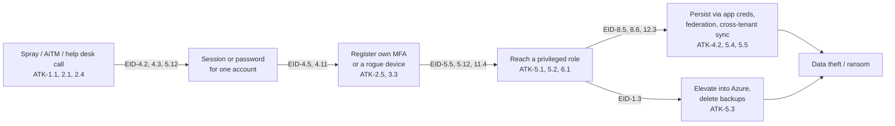

# Entra ID — Attacks, Misconfigurations & the Controls That Stop Them

> **TL;DR** — The threat-led companion to [`entra-id-security-controls.md`](entra-id-security-controls.md). That file lists controls by **setting**. This one starts from the **attack**: how it works, who has used it in the real world, which controls break it, and what it looks like in the logs. Every control reference (`EID-x.y`) points back to the baseline, so you can go from "this happened to someone" to "this is the toggle". Most real Entra compromises in 2023–2025 didn't need a zero-day. They walked through **one missing control**: an account without MFA, a phishable MFA method, an over-permissioned app, an open device-code flow, or a synced admin.

---

## Table of contents

1. [How to read this file](#1-how-to-read-this-file)
2. [Attack summary](#2-attack-summary)
3. [Category 1 — Credential attacks](#3-category-1--credential-attacks)
4. [Category 2 — Phishing & MFA bypass](#4-category-2--phishing--mfa-bypass)
5. [Category 3 — Token theft & session hijacking](#5-category-3--token-theft--session-hijacking)
6. [Category 4 — Application & consent abuse](#6-category-4--application--consent-abuse)
7. [Category 5 — Privilege escalation & tenant persistence](#7-category-5--privilege-escalation--tenant-persistence)
8. [Category 6 — Hybrid identity attacks](#8-category-6--hybrid-identity-attacks)
9. [Category 7 — External identities & cross-tenant](#9-category-7--external-identities--cross-tenant)
10. [Category 8 — Workload identities](#10-category-8--workload-identities)
11. [Category 9 — Defense evasion](#11-category-9--defense-evasion)
12. [Category 10 — Platform-level flaws (not tenant-configurable)](#12-category-10--platform-level-flaws-not-tenant-configurable)
13. [Common misconfigurations](#13-common-misconfigurations)
14. [The settings that break the most attack chains](#14-the-settings-that-break-the-most-attack-chains)
15. [A typical kill chain, and where it breaks](#15-a-typical-kill-chain-and-where-it-breaks)
16. [Further reading & sources](#16-further-reading--sources)

---

## 1. How to read this file

| Column | Meaning |
|---|---|
| **ID** | `ATK-<category>.<n>` |
| **Attack** | Name of the technique, with its [MITRE ATT&CK](https://attack.mitre.org/matrices/enterprise/cloud/) ID |
| **How it works** | The mechanics, in two or three sentences |
| **Seen in the wild** | Named public incidents or campaigns. Dates are when the activity was **reported** |
| **Controls to enable** | Baseline controls (`EID-x.y`) first, then anything outside Entra (Intune, Defender, process) |
| **Detect** | Log signal, risk detection or audit event to alert on |

> **Defense in depth, not one silver bullet.** Most rows list several controls. The first one breaks the attack; the rest limit damage when the first fails or has an exception.

---

## 2. Attack summary

| ID | Attack | MITRE | Controls that break it |
|---|---|---|---|
| **1 — Credential attacks** ||||
| ATK-1.1 | Password spray | T1110.003 | EID-4.2, 4.1, 3.1, 6.2 |
| ATK-1.2 | Legacy / basic authentication abuse | T1078.004 | EID-4.1, 1.1 |
| ATK-1.3 | Leaked & infostealer credentials (stuffing) | T1110.004 | EID-4.2, 11.1, 6.1, 4.15 |
| ATK-1.4 | Forgotten accounts & test tenants without MFA | T1078.004 | EID-4.2, 12.4, 4.13, 7.2 |
| **2 — Phishing & MFA bypass** ||||
| ATK-2.1 | Adversary-in-the-middle (AiTM) phishing | T1557, T1539 | EID-4.3, 4.15, 4.16, 4.12 |
| ATK-2.2 | MFA fatigue / push bombing | T1621 | EID-2.2, 2.7, 4.15 |
| ATK-2.3 | SIM swap & SMS/voice interception | T1111 | EID-2.3, 2.6, 4.3 |
| ATK-2.4 | Help desk social engineering (MFA/password reset) | T1656 | EID-5.12, 2.5, 4.5, 12.3 |
| ATK-2.5 | Attacker registers their own MFA method | T1098.005 | EID-4.5, 2.5, 12.3 |
| ATK-2.6 | Device code phishing | T1528 | EID-4.6, 4.11, 4.16 |
| ATK-2.7 | OAuth auth-code phishing with first-party clients | T1528 | EID-4.16, 4.11, 4.12 |
| ATK-2.8 | Teams / external chat phishing & vishing | T1566.003 | EID-9.5, 9.6, 2.7 |
| **3 — Token theft & session hijacking** ||||
| ATK-3.1 | Session cookie & token theft (infostealers) | T1539, T1550.004 | EID-4.12, 4.14, 4.16, 4.18 |
| ATK-3.2 | Primary Refresh Token (PRT) theft | T1528 | EID-4.12, 10.3, 10.4, 4.8 |
| ATK-3.3 | Rogue device registration for persistence | T1098.005 | EID-4.11, 10.1, 10.2, 4.16 |
| ATK-3.4 | Refresh-token survival after password reset | T1550.001 | EID-4.14, 6.1, 12.5 |
| **4 — Application & consent abuse** ||||
| ATK-4.1 | Illicit consent grant (consent phishing) | T1528 | EID-8.1, 8.2, 8.3 |
| ATK-4.2 | Credentials added to an existing app (OAuth backdoor) | T1098.001 | EID-8.5, 8.6, 8.4, 12.3 |
| ATK-4.3 | Abuse of unused, over-permissioned legacy apps | T1078.004 | EID-8.5, 8.8 |
| ATK-4.4 | Users or compromised accounts create malicious apps | T1136.003 | EID-7.1, 7.5 |
| ATK-4.5 | App owner → app identity escalation | T1098.001 | EID-8.6 |
| ATK-4.6 | nOAuth (mutable claim used as identifier) | T1078.004 | App-dev fix (`oid` + `tid`) |
| **5 — Privilege escalation & persistence** ||||
| ATK-5.1 | Standing Global Admin compromise | T1078.004 | EID-5.1, 5.5, 4.3, 5.4 |
| ATK-5.2 | Escalation through privileged Entra roles | T1098.003 | EID-5.2, 5.10, 5.11, 5.12 |
| ATK-5.3 | GA → Azure root via "Elevate access" | T1098.003 | EID-1.3, 12.3 |
| ATK-5.4 | Federated-domain backdoor | T1484.002 | EID-5.2, 12.3, 11.1 |
| ATK-5.5 | Cross-tenant sync backdoor | T1098 | EID-9.5, 12.3 |
| ATK-5.6 | Group-membership tampering (CA exclusions, RBAC groups) | T1098 | EID-5.11, 4.13 |
| **6 — Hybrid identity** ||||
| ATK-6.1 | Entra Connect server / sync account abuse | T1556.007 | EID-11.2, 11.4, 5.4 |
| ATK-6.2 | Golden SAML (AD FS signing key theft) | T1606.002 | EID-11.1, 12.6, 12.3 |
| ATK-6.3 | Soft/hard-match takeover of cloud accounts | T1078.004 | EID-11.3 |
| ATK-6.4 | Seamless SSO / PTA agent abuse | T1556.007 | EID-11.2, 12.6 |
| ATK-6.5 | On-prem AD compromise → synced admin | T1078.002 | EID-11.4, 5.4 |
| **7 — External identities & cross-tenant** ||||
| ATK-7.1 | Guest directory reconnaissance | T1087.004 | EID-9.1 |
| ATK-7.2 | Guest invitation abuse / stale guests | T1078.004 | EID-9.2, 9.3, 9.4, 9.7 |
| ATK-7.3 | Data exfiltration to attacker or personal tenants | T1537 | EID-9.6 |
| ATK-7.4 | Compromised partner via trusted MFA claims | T1199 | EID-9.5, 4.9 |
| ATK-7.5 | Service-provider / multi-tenant supply chain | T1199 | EID-8.5, 9.5 |
| **8 — Workload identities** ||||
| ATK-8.1 | Leaked client secrets & certificates | T1552.001 | EID-8.7, 8.4 |
| ATK-8.2 | Service principal sign-in from attacker infrastructure | T1078.004 | EID-8.9, 6.5 |
| ATK-8.3 | Managed identity abuse from a compromised resource | T1528 | Azure RBAC least privilege, EID-8.5 |
| **9 — Defense evasion** ||||
| ATK-9.1 | Log tampering & short retention | T1562.008 | EID-12.1, 12.3 |
| ATK-9.2 | CA policy tampering & exclusion creep | T1556.009 | EID-4.13, 12.3, 5.6 |
| ATK-9.3 | Low-and-slow sign-ins from residential proxies | T1090.002 | EID-4.2, 6.2, 4.17 |
| **10 — Platform-level flaws** ||||
| ATK-10.1 | Forged tokens from a stolen signing key (Storm-0558) | T1606 | Logging (EID-12.1) |
| ATK-10.2 | Cross-tenant actor-token impersonation (CVE-2025-55241) | T1550.001 | Microsoft-side fix; logging |

---

## 3. Category 1 — Credential attacks

The cheapest attacks and still the most common. They only work where a password alone is enough.

| ID | Attack | How it works | Seen in the wild | Controls to enable | Detect |
|---|---|---|---|---|---|
| **ATK-1.1** | Password spray `T1110.003` | Try a few common passwords against many accounts, slowly, from rotating IPs, so smart lockout never triggers for any one account. | • **Midnight Blizzard → Microsoft** (Jan 2024): low-volume spray from residential proxies hit a legacy test-tenant account without MFA • **UNK_SneakyStrike** (Proofpoint, Dec 2024–2025): TeamFiltration tool, 80,000+ accounts in ~100 tenants, rotating AWS regions • **Peach Sandstorm** (2023): mass spray against defense and satellite sectors | • **EID-4.2** MFA for all users, all resources • **EID-4.1** block legacy auth • **EID-3.1** custom banned passwords • **EID-3.2** smart lockout ≤ 10 • **EID-6.2** sign-in risk → MFA • **EID-4.15** passwordless removes the password | • ID Protection: *Password spray* detection • Many `50126` (bad password) errors across users from one IP / ASN • Sign-ins from TeamFiltration user agents |
| **ATK-1.2** | Legacy / basic auth abuse `T1078.004` | POP, IMAP, SMTP AUTH and old Office clients can't do MFA, so a valid password works even when MFA is "on". The usual target of sprays. | • Most password-spray traffic Microsoft sees uses legacy protocols • Common in BEC mailbox takeovers | • **EID-4.1** block legacy auth (time-boxed exceptions only) • **EID-1.1** Security Defaults or CA baseline | • Sign-ins with *Client app = Other clients / EAS* • Successful legacy sign-ins outside the exception group |
| **ATK-1.3** | Leaked & infostealer credentials `T1110.004` | Passwords from breach dumps or infostealer logs are replayed. Reused passwords work instantly; no guessing needed. | • Infostealers (Lumma, RedLine) feed credential markets; Microsoft's DCU disrupted Lumma in May 2025 • 2024 Snowflake customer breaches: infostealer creds on accounts without MFA (not Entra, same pattern) | • **EID-4.2** MFA everywhere • **EID-11.1** password hash sync, which enables *Leaked credentials* detection • **EID-6.1** high user risk → remediation • **EID-4.15** passwordless | • ID Protection: *Leaked credentials* (user risk) • Success from a new country / ASN for a dormant user |
| **ATK-1.4** | Forgotten accounts & test tenants `T1078.004` | Test, legacy, service and "temporary" accounts sit outside the MFA policy, or in a second tenant nobody hardened. One of them becomes the beachhead. | • **Midnight Blizzard → Microsoft** (2024): initial access was a *legacy non-production test tenant* account with no MFA | • **EID-4.2** with **no** exclusions except break-glass • **EID-4.13** review exclusions and report-only policies • **EID-12.4** disable inactive accounts • **EID-7.2** stop shadow-tenant creation • Apply this whole baseline to **every** tenant you own, including dev and test | • Accounts with no MFA registered (**User registration details**) • Sign-ins that matched no CA policy (*Not applied*) |

---

## 4. Category 2 — Phishing & MFA bypass

Once everyone has MFA, attackers phish **the MFA itself**, or the people who can reset it.

| ID | Attack | How it works | Seen in the wild | Controls to enable | Detect |
|---|---|---|---|---|---|
| **ATK-2.1** | Adversary-in-the-middle (AiTM) phishing `T1557` `T1539` | A reverse proxy (Evilginx, Tycoon 2FA, EvilProxy) sits between the user and the real Microsoft sign-in page. The user completes real MFA; the proxy keeps the **session cookie** and replays it. Push, OTP and SMS all fall to this. | • **Void Blizzard** (Microsoft, May 2025): Evilginx on a typosquatted Entra domain (`micsrosoftonline[.]com`) against 20+ NGOs • **Storm-1167** (2023): AiTM → BEC fraud chains • Tycoon 2FA phishing-as-a-service, widespread in 2024–2025 | • **EID-4.3** phishing-resistant MFA for admins • **EID-4.15** passwordless strength for users (passkeys are origin-bound) • **EID-4.16 / 4.8** compliant device: a replayed cookie from the attacker's machine fails • **EID-4.12** token protection • **EID-6.2** sign-in risk policy • **EID-4.14** CAE to cut sessions fast | • ID Protection: *Attacker in the Middle*, *Anomalous token*, *Unfamiliar sign-in properties* • Successful sign-in, then the same session from a new IP/ASN minutes later • New inbox rules right after sign-in |
| **ATK-2.2** | MFA fatigue / push bombing `T1621` | With a valid password, the attacker triggers push prompts until the user approves one, often with a "this is IT" call. | • **Uber** (Sept 2022, Lapsus$): repeated pushes plus a WhatsApp message posing as IT • Lapsus$ campaigns 2022 | • **EID-2.2** number matching and app/location context (now always on) • **EID-2.7** *Report suspicious activity* → high user risk • **EID-2.6** system-preferred MFA • **EID-4.15** passwordless (no password to start the prompts) | • Many MFA denials (`500121`) for one user in a short window • *User reported suspicious activity* risk detection |
| **ATK-2.3** | SIM swap & SMS/voice interception `T1111` | The attacker ports the victim's number to their own SIM (carrier social engineering) and receives SMS codes and voice calls. | • **Scattered Spider / Octo Tempest** (2022–2025): SIM swaps against telecom and enterprise staff | • **EID-2.3** SMS & voice off (or limited to an exception group) • **EID-2.6** system-preferred MFA • **EID-4.3** phishing-resistant MFA for admins | • Authentication method = SMS for privileged or VIP users • Phone number changed in security info |
| **ATK-2.4** | Help desk social engineering `T1656` | The attacker phones the service desk as the victim (often using OSINT on LinkedIn) and asks for a password or MFA reset, then registers their own method. | • **MGM Resorts** (Sept 2023, Scattered Spider): a 10-minute help desk call led to tenant-wide ransomware • **UK retail incidents** (2025, Scattered Spider): help desk impersonation reported as initial access | • **Process:** strong identity verification before any reset (video call, manager approval, Entra Verified ID / Face Check) • **EID-2.5** reset by issuing a short, one-time TAP, never a password read over the phone • **EID-5.12** restricted management AU, so help desk **can't** reset admins/VIPs • **EID-4.5** register security info only with MFA / trusted location • **EID-12.3** alert on method changes for privileged users | • Audit: *Reset password (by admin)* then *User registered security info* then sign-in from a new device • Help desk resets out of hours or for privileged users |
| **ATK-2.5** | Attacker registers own MFA method `T1098.005` | After stealing a password, the attacker adds their own Authenticator or phone, so access survives a later password reset. | • Standard Scattered Spider and BEC post-compromise step | • **EID-4.5** registering security info requires MFA (or TAP) • **EID-2.5** TAP-only onboarding • **EID-12.3** alert on *User registered security info* for admins | • Audit: *User registered security info* from a new IP/country • New method added shortly after a risky sign-in |
| **ATK-2.6** | Device code phishing `T1528` | The attacker starts a device-code sign-in and sends the victim the code (e.g. a fake Teams meeting invite). The victim enters it at `microsoft.com/devicelogin` and signs in with real MFA, and the **attacker's** session receives the tokens. With the Microsoft Authentication Broker client ID they can register a device and get a **PRT**. | • **Storm-2372** (Microsoft, Feb 2025; active since Aug 2024): fake Teams invites; then switched to the Authentication Broker client ID to register devices and obtain PRTs | • **EID-4.6** block device code flow and authentication transfer • **EID-4.11** MFA to register / join devices • **EID-4.16** require compliant device: a fresh rogue device isn't compliant • **EID-6.2** sign-in risk | • Sign-ins with `AuthenticationProtocol == "deviceCode"` • *Register device* audit soon after a device-code sign-in • Graph mail access from the new device |
| **ATK-2.7** | OAuth auth-code phishing with first-party clients `T1528` | The victim is talked into signing in to a legitimate Microsoft OAuth URL (e.g. the VS Code client) and pasting back the resulting URL or code. The attacker redeems it for tokens, registers a device and requests a PRT. Real Microsoft page, so phishing-resistant MFA **alone** doesn't stop it. | • **UTA0352 / UTA0355** (Volexity, Apr 2025): Russian actors targeting NGOs over Signal/WhatsApp, VS Code client, device registration, PRT | • **EID-4.16** require compliant device for data access • **EID-4.11** MFA to register devices • **EID-4.12** token protection • **EID-10.1 / 10.2** limit device join and registration | • Device registration from an unusual IP soon after sign-in • Sign-ins by first-party developer clients (VS Code, Azure CLI) for users who never use them |
| **ATK-2.8** | Teams / external chat phishing & vishing `T1566.003` | Attackers message users from external tenants on Teams posing as IT or security, and push them to approve MFA, share a code, or install remote-support tools. | • **Midnight Blizzard** (Aug 2023): Teams messages from compromised tenants to harvest MFA codes • **Storm-1811** (2024): Teams "help desk" vishing → Quick Assist → ransomware | • **Teams admin center:** restrict external access to allowed domains; block unmanaged Teams accounts • **EID-9.5** cross-tenant defaults locked down • **EID-2.7** users report odd prompts • **EID-4.15** passwordless (no code to share) | • Teams external chats from new or `onmicrosoft.com` tenants • Remote-support tool launched right after an external chat |

---

## 5. Category 3 — Token theft & session hijacking

Once a token exists, MFA has already happened. These attacks steal or abuse the token.

| ID | Attack | How it works | Seen in the wild | Controls to enable | Detect |
|---|---|---|---|---|---|
| **ATK-3.1** | Session cookie & token theft (infostealers) `T1539` `T1550.004` | Malware on the endpoint copies browser cookies and cached tokens, and the attacker imports them elsewhere. No password or MFA needed. | • Lumma, RedLine and similar infostealers sell "session logs"; Microsoft DCU disrupted Lumma infrastructure in May 2025 | • **EID-4.12** token protection (binds tokens to the device) • **EID-4.16 / 4.8** compliant devices only • **EID-4.14** CAE: revocation and IP enforcement within minutes • **EID-4.7 / 4.18** short sessions, no persistent browser on unmanaged devices • Defender for Endpoint on all devices | • ID Protection: *Anomalous token*, *Token issuer anomaly* • Same session ID from two distant IPs |
| **ATK-3.2** | Primary Refresh Token theft (pass-the-PRT) `T1528` | The PRT is the device's SSO master token. With local admin, tools such as Mimikatz or ROADtools extract it or its session key and mint SSO cookies for any app. | • Widely used by red teams; post-exploitation step in Storm-2372 and UTA0352 chains (via device registration) | • **EID-4.12** token protection • **TPM 2.0** on all Windows devices (PRT keys in hardware) • **EID-10.3** no local admins; **EID-10.4** LAPS • **EID-4.8** admins on PAWs | • Defender for Endpoint: *Possible attempt to access PRT* • PRT-based sign-ins from devices not in Intune |
| **ATK-3.3** | Rogue device registration for persistence `T1098.005` | A registered device gets a PRT and can look "known". Attackers register one right after initial access so they keep access after a password reset. | • **Storm-2372** (2025) and **UTA0352** (2025) both registered actor-controlled devices | • **EID-4.11** MFA to register or join devices • **EID-10.1** only selected users can join • **EID-10.2** device cap ≤ 20 • **EID-4.16** require compliant device for data | • Audit: *Register device* / *Add device* from a new IP • Devices registered but never enrolled in Intune |
| **ATK-3.4** | Refresh tokens surviving a password reset `T1550.001` | Resetting a password doesn't instantly kill every token. Without revocation, the attacker keeps reading mail for the token's remaining life. | • Common gap in incident response: password reset done, sessions not revoked | • **EID-4.14** CAE (password reset is a critical event for Exchange, SharePoint, Teams, Graph) • **EID-6.1** risk remediation revokes sessions • **EID-12.5** leaver workflow revokes sessions • IR runbook: **Revoke sessions** + remove attacker MFA methods + check devices and apps | • Sign-ins with old session IDs after the reset time |

---

## 6. Category 4 — Application & consent abuse

Apps hold tokens that **survive password resets and don't need MFA**. That makes them the favorite persistence mechanism.

| ID | Attack | How it works | Seen in the wild | Controls to enable | Detect |
|---|---|---|---|---|---|
| **ATK-4.1** | Illicit consent grant (consent phishing) `T1528` | The user gets a link to a real Microsoft consent prompt for an attacker's multi-tenant app ("PDF Viewer") asking for `Mail.Read`, `Files.ReadWrite.All`, `offline_access`. One click, and the app reads data indefinitely. | • Long-running consent phishing campaigns tracked by Microsoft (2020–2024) • **Storm-1283 / Storm-1286** (Microsoft, Dec 2023): OAuth apps abused for crypto-mining, spam and BEC | • **EID-8.1** user consent off, or verified publishers + low-impact only • **EID-8.2** admin consent workflow • **EID-8.3** no group-owner consent • **EID-8.5** quarterly review of granted permissions | • Audit: *Consent to application*, especially `offline_access` + mail/files scopes • New enterprise app from an unverified publisher |
| **ATK-4.2** | OAuth backdoor: credentials added to an existing app `T1098.001` | With an app-admin role or app ownership, the attacker adds a secret or certificate to an app that **already** holds powerful permissions, then signs in **as the app**. No user, no MFA, no CA (unless workload ID CA). | • **Midnight Blizzard → Microsoft** (2024): a legacy test OAuth app was used to grant attacker apps Exchange `full_access_as_app` and read executive mail • **Nobelium / SolarWinds** (2020): credentials added to apps and service principals • **Silk Typhoon** (Microsoft, Mar 2025): added passwords to existing consented apps to pull mail and SharePoint data | • **EID-8.6** no user owners on Tier-0 apps • **EID-8.5** review high-privilege apps; remove unused permissions (esp. EWS `full_access_as_app`) • **EID-8.4** block new secrets; certificates or federation only • **EID-5.2** limit Application / Cloud App Admin • **EID-12.3** alert on credential changes | • Audit: *Add service principal credentials*, *Update application – Certificates and secrets management* • Service principal sign-ins from new IPs (`AADServicePrincipalSignInLogs`) |
| **ATK-4.3** | Abuse of unused, over-permissioned legacy apps `T1078.004` | Old test or migration apps keep tenant-wide permissions long after anyone remembers them. Nobody watches their sign-ins. | • **Midnight Blizzard → Microsoft** (2024): the elevated app was a *legacy test* app | • **EID-8.5** quarterly review; delete apps unused for 90+ days (**Recommendations → Remove unused applications**) • **EID-8.8** assignment required on sensitive apps | • Apps with high-impact permissions and no sign-in for 90 days • Sudden activity from a long-dormant app |
| **ATK-4.4** | Users or compromised accounts create malicious apps `T1136.003` | Default settings let any user register apps. A compromised user builds a multi-tenant app for phishing or automation inside **your** tenant. | • **Storm-1283** (2023): compromised user account used to create OAuth apps for crypto-mining VMs | • **EID-7.1** users can't register applications • **EID-7.5** users can't create agent blueprints | • Audit: *Add application* by a non-developer user |
| **ATK-4.5** | App owner → app identity escalation `T1098.001` | Owners of an app registration can add credentials to it. If the app holds `RoleManagement.ReadWrite.Directory`, the owner is effectively a Global Admin. | • Common finding in BloodHound / AzureHound attack-path reviews | • **EID-8.6** no individual owners on Tier-0 apps • Manage those apps through Cloud App Admins under PIM (**EID-5.5**) | • *Add owner to application* on a privileged app |
| **ATK-4.6** | nOAuth (mutable claim as identifier) `T1078.004` | A multi-tenant SaaS app that identifies users by the `email` claim can be fooled: an attacker sets that email in their own tenant and signs in as the victim. | • Disclosed by Descope (June 2023) across several SaaS apps | • **For apps you build:** identify users by `oid` + `tid`, never `email` or `upn` • Review third-party SaaS that uses "Sign in with Microsoft" | • App-side: one account linked to multiple `tid` values |

---

## 7. Category 5 — Privilege escalation & tenant persistence

| ID | Attack | How it works | Seen in the wild | Controls to enable | Detect |
|---|---|---|---|---|---|
| **ATK-5.1** | Standing Global Admin compromise `T1078.004` | A permanently active GA that also reads mail is one phish away from total tenant control. | • **Storm-0501** (Microsoft, 2024–2025): found a synced, non-human **Global Admin without MFA** and took over the tenant | • **EID-5.1** 2–4 GAs • **EID-5.5** PIM eligible only • **EID-4.3** phishing-resistant MFA • **EID-5.4** dedicated cloud-only admin accounts | • PIM alert: *Roles are being assigned outside of PIM* • GA sign-in without phishing-resistant method |
| **ATK-5.2** | Escalation through privileged roles `T1098.003` | Many roles can reach GA indirectly: Privileged Auth Admin resets a GA's MFA; Helpdesk Admin resets a GA's password; App Admin backdoors a Graph-privileged app. | • Documented escalation paths in Microsoft's privileged-roles guidance and AzureHound research | • **EID-5.2** < 10 privileged assignments • **EID-5.10** least-privileged and AU-scoped roles • **EID-5.11** role-assignable groups • **EID-5.12** restricted management AUs for admins/VIPs | • Audit: *Add member to role* for any PRIVILEGED role • Password or method reset **on** an admin account |
| **ATK-5.3** | GA → Azure root via "Elevate access" `T1098.003` | A GA can grant themselves User Access Administrator at `/`, then Owner on every subscription, then delete data, backups and keys. | • **Storm-0501** (Microsoft, Aug 2025): cloud-based ransomware: elevated into Azure, exfiltrated data, deleted backups, demanded ransom | • **EID-1.3** keep *Access management for Azure resources* = **No** • **EID-5.5 / 5.7** PIM + approval for GA • Azure: immutable backups and resource locks | • Azure Activity log: `Microsoft.Authorization/elevateAccess/action` • Role assignments at scope `/` |
| **ATK-5.4** | Federated-domain backdoor `T1484.002` | The attacker adds a domain, or converts one to **federated** with an IdP they control, then mints tokens for any user in that domain, with MFA claims included. | • **Scattered Spider / Octo Tempest** (2023): added federated identity providers for persistence • **Nobelium** (2020–2021): federation trust abuse | • **EID-5.2** limit Hybrid Identity Admin and Domain Name Admin • **EID-12.3** alert on domain and federation changes • **EID-11.1** prefer cloud auth (PHS) over federation | • Audit: *Set domain authentication*, *Set federation settings on domain*, *Add unverified domain* |
| **ATK-5.5** | Cross-tenant sync backdoor `T1098` | With enough rights, an attacker configures your tenant to accept **inbound** cross-tenant sync from their tenant, then pushes users in whenever they like. | • Published by security researchers (2023) as a post-compromise persistence technique | • **EID-9.5** default inbound locked down; cross-tenant sync only for named partners • **EID-12.3** alert on cross-tenant access setting changes | • Audit: *Update cross-tenant access settings*, *Create partner cross-tenant identity sync setting* |
| **ATK-5.6** | Group-membership tampering `T1098` | A normal security group used for a CA exclusion or an Azure RBAC role can be edited by Group/User Admins or its owners. Add yourself, and you're excluded or privileged. | • Common finding in CA and RBAC assessments | • **EID-5.11** role-assignable groups for anything privileged • **EID-4.13** CA exclusion groups owned and reviewed | • Audit: *Add member to group* on CA-exclusion or RBAC groups |

---

## 8. Category 6 — Hybrid identity attacks

On-prem AD compromise becomes cloud compromise through whatever connects them.

| ID | Attack | How it works | Seen in the wild | Controls to enable | Detect |
|---|---|---|---|---|---|
| **ATK-6.1** | Entra Connect server / sync account abuse `T1556.007` | The Connect server holds sync credentials and can write to Entra. An attacker who owns it, or owns AD, resets a synced user's password on-prem and it syncs to the cloud, or extracts the sync account's credentials. | • **Storm-0501** (Microsoft, 2024–2025): pivoted from on-prem through Entra Connect, reset a synced identity's password, used a synced GA without MFA • **Silk Typhoon** (2025): Microsoft advised checking Entra Connect servers for anomalies | • **EID-11.2** Connect server = Tier 0 (TPM, restricted admins, MDE/MDI) • **EID-11.4** no synced accounts in privileged roles • **EID-5.4** cloud-only admins • **EID-4.2** sync and service accounts are not excluded from MFA unless strictly required • Keep Entra Connect current (app-based auth from v2.5.3.0) | • Password changes on privileged synced users • `Directory Synchronization Accounts` sign-ins from unexpected hosts • MDI alerts on the Connect server |
| **ATK-6.2** | Golden SAML `T1606.002` | Steal the AD FS token-signing certificate and forge SAML tokens for any user, with any claims (including MFA), without touching Entra sign-in. | • **Nobelium / SolarWinds** (2020) | • **EID-11.1** move to cloud authentication (PHS) and decommission AD FS • **EID-12.6** Defender for Identity on AD FS servers • Until then: AD FS as Tier 0, HSM-backed keys | • Sign-ins with federated tokens that have no matching AD FS event • MDI: *Suspected AD FS DKM key read* |
| **ATK-6.3** | Soft/hard-match takeover `T1078.004` | Create an AD user whose UPN or ImmutableId matches a cloud-only admin; sync merges it and the on-prem attacker now controls the cloud admin. | • Public research; Microsoft added blocking options and now blocks hard-match takeover of admins by default | • **EID-11.3** `BlockSoftMatch` and `BlockCloudObjectTakeoverThroughHardMatch` = `true` | • Audit: cloud-only account becomes `onPremisesSyncEnabled = true` |
| **ATK-6.4** | Seamless SSO / PTA agent abuse `T1556.007` | Seamless SSO's `AZUREADSSOACC` computer key lets an attacker with AD access forge Kerberos tickets for any synced user. A compromised PTA agent can accept any password. | • Documented in AADInternals research; standard in hybrid red-team playbooks | • **EID-11.2** PTA agent servers = Tier 0 • Roll the `AZUREADSSOACC` Kerberos key at least every 30 days, or disable Seamless SSO on Entra-joined estates • **EID-12.6** MDI | • New PTA agent registered • MDI: Kerberos anomalies against `AZUREADSSOACC` |
| **ATK-6.5** | On-prem AD compromise → synced admin `T1078.002` | If a cloud admin account is synced from AD, Domain Admin in AD equals Global Admin in Entra. | • Repeated in hybrid ransomware cases, including Storm-0501 | • **EID-11.4** no synced privileged accounts • **EID-5.4** dedicated cloud-only admins | • Any privileged role holder with `onPremisesSyncEnabled = true` |

---

## 9. Category 7 — External identities & cross-tenant

| ID | Attack | How it works | Seen in the wild | Controls to enable | Detect |
|---|---|---|---|---|---|
| **ATK-7.1** | Guest directory reconnaissance `T1087.004` | With default guest permissions, any guest can enumerate users, groups and memberships, which maps out targets and admin groups. | • Standard first step after compromising a partner account | • **EID-9.1** guest access restricted to own directory objects | • Graph directory queries by guest accounts (`MicrosoftGraphActivityLogs`) |
| **ATK-7.2** | Guest invitation abuse & stale guests `T1078.004` | Any user, or guest, can invite more guests by default. Old guests from finished projects keep access to Teams and SharePoint. | • Common in data-exposure incidents and audits | • **EID-9.2** invites by admins / Guest Inviter only • **EID-9.3** domain allowlist • **EID-9.4** no self-service sign-up • **EID-9.7** quarterly guest reviews • **EID-4.9** MFA for guests | • Audit: *Invite external user* by non-admins • Guests with no sign-in for 90+ days |
| **ATK-7.3** | Exfiltration to attacker or personal tenants `T1537` | A user (or attacker on a corporate device) signs in to another tenant and uploads data there. Your DLP sees "a Microsoft URL". | • Insider and post-compromise exfiltration pattern | • **EID-9.6** tenant restrictions v2 | • TRv2 block events in sign-in logs |
| **ATK-7.4** | Compromised partner via trusted MFA claims `T1199` | If you trust a partner's MFA and device claims, their weak MFA becomes yours. | • Supply-chain identity compromises (2023–2025) | • **EID-9.5** trust MFA claims per vetted partner only, never in defaults • **EID-4.9** MFA strength for guests | • Guest sign-ins satisfied by *MFA from home tenant* for untrusted partners |
| **ATK-7.5** | Service-provider / multi-tenant supply chain `T1199` | Attackers compromise an IT provider or SaaS vendor, then use its delegated admin or multi-tenant app access in every customer tenant. | • **Silk Typhoon** (Microsoft, Mar 2025): targeted IT supply chain and multi-tenant apps to reach downstream customers • **Nobelium** (2021): resellers and CSPs | • **EID-8.5** review third-party apps and their permissions • **M365 admin center → Partner relationships:** remove legacy DAP; use time-bound, least-privilege GDAP • **EID-9.5** per-partner cross-tenant settings | • Sign-ins by partner admin agents • New consent to a vendor app with high privileges |

---

## 10. Category 8 — Workload identities

| ID | Attack | How it works | Seen in the wild | Controls to enable | Detect |
|---|---|---|---|---|---|
| **ATK-8.1** | Leaked client secrets & certificates `T1552.001` | Secrets end up in Git repos, CI variables, container images and config files. Anyone who finds one signs in as the app, with no MFA. | • **Silk Typhoon** (2025): abused stolen API keys and credentials • Constant stream of secrets found by GitHub secret scanning | • **EID-8.7** managed identities / workload identity federation (no secret) • **EID-8.4** block new secrets; short lifetimes • Secret scanning on all repos | • Service principal sign-in from an IP outside your CI ranges • *Add service principal credentials* outside change windows |
| **ATK-8.2** | Service principal sign-in from attacker infrastructure `T1078.004` | A stolen app credential is used from the attacker's network. Without workload-ID CA, nothing checks location or risk. | • Midnight Blizzard (2024) and Silk Typhoon (2025) both operated through app identities | • **EID-8.9** CA for workload identities (location + risk) • **EID-6.5** triage *Risky workload identities* | • ID Protection: *Suspicious sign-ins* / *Leaked credentials* for service principals |
| **ATK-8.3** | Managed identity abuse from a compromised resource `T1528` | Code running on a compromised VM, Function or Logic App asks the metadata endpoint for a token and inherits every role the managed identity holds. | • Common cloud post-exploitation step | • Least-privilege Azure RBAC for managed identities (no subscription Owner/Contributor by default) • **EID-8.5** review Graph permissions held by managed identities | • `AADManagedIdentitySignInLogs` for unusual resources • Defender for Cloud alerts on IMDS token use |

---

## 11. Category 9 — Defense evasion

| ID | Attack | How it works | Seen in the wild | Controls to enable | Detect |
|---|---|---|---|---|---|
| **ATK-9.1** | Log tampering & short retention `T1562.008` | The attacker deletes diagnostic settings, or simply waits: Entra keeps sign-in logs for only 30 days (7 on Free), so the evidence ages out before anyone looks. | • Many investigations stall because non-interactive and service principal sign-ins were never exported | • **EID-12.1** export all categories, ≥ 1 year, to a workspace admins can't easily delete • **EID-12.3** alert on diagnostic-setting changes | • Audit: *Update / Delete diagnostic setting* |
| **ATK-9.2** | CA policy tampering & exclusion creep `T1556.009` | An attacker with CA Admin or Security Admin turns a policy to report-only or adds themselves to an exclusion. Over time, admins do the same thing by accident. | • Observed in post-compromise activity; standard red-team step | • **EID-4.13** CA hygiene and reviewed exclusions • **EID-12.3** alert on CA changes • **EID-5.6 / 5.7** PIM with justification (and approval) for CA and Security Admin | • Audit: *Update conditional access policy*, *Delete conditional access policy* |
| **ATK-9.3** | Low-and-slow sign-ins via residential proxies & anonymizers `T1090.002` | Attackers route through residential proxies or Tor so sign-ins look like home users in the "right" country, slipping past country blocks and lockout. | • **Midnight Blizzard** (2024): residential proxy network for spray and access | • **EID-4.2** MFA everywhere (location doesn't matter if MFA is required) • **EID-6.2** sign-in risk (*Anonymous IP*, *Unfamiliar sign-in properties*) • **EID-4.17** anonymizer blocking for sensitive apps • **EID-4.10** is noise reduction only | • ID Protection: *Anonymous IP address*, *Malicious IP address* |

---

## 12. Category 10 — Platform-level flaws (not tenant-configurable)

You can't fix these with a setting. What you control is **detection, blast radius and logging**.

| ID | Attack | How it works | Seen in the wild | Controls to enable | Detect |
|---|---|---|---|---|---|
| **ATK-10.1** | Forged tokens from a stolen signing key `T1606` | An attacker who obtains a Microsoft signing key can forge tokens that validation accepts. | • **Storm-0558** (2023): a stolen MSA consumer signing key was used to forge tokens and read Exchange Online mail of US government agencies | • **EID-12.1** keep long log retention • Microsoft Purview Audit with `MailItemsAccessed` (now in standard audit) • **EID-4.16** device-bound access limits some replay paths | • Mail access with no matching sign-in event • Unusual `MailItemsAccessed` volume |
| **ATK-10.2** | Cross-tenant actor-token impersonation `T1550.001` | Undocumented service-to-service "actor tokens" plus a validation bug in the legacy **Azure AD Graph** API let a token from one tenant impersonate any user, including GA, in another tenant. Bypassed CA, and token requests weren't logged. | • **CVE-2025-55241** (reported by Dirk-jan Mollema, Jul 2025; fixed by Microsoft within days, published Sep 2025). No known in-the-wild exploitation | • No tenant setting; Microsoft fixed it service-side • Move apps off **Azure AD Graph** to Microsoft Graph (retired) • **EID-12.1** export `MicrosoftGraphActivityLogs` and audit logs | • Audit entries modified by a user who has no matching sign-in |

---

## 13. Common misconfigurations

Real incidents rarely need an exotic technique. They need **one** of these.

| Misconfiguration | Why it's dangerous | Real-world example | Fix |
|---|---|---|---|
| Accounts excluded from MFA "temporarily" (service, test, migration accounts) | The one account without MFA is the one that gets sprayed | Midnight Blizzard (2024): test-tenant account | EID-4.2, 4.13 |
| Security Defaults off and no CA baseline | No MFA at all beyond Microsoft's admin-portal enforcement | Common in small tenants after a "temporary" disable | EID-1.1 |
| Legacy authentication still allowed | Password alone works, MFA never asked | Ongoing BEC campaigns | EID-4.1 |
| SMS / voice as the only MFA for admins | SIM swap and AiTM bypass | Scattered Spider (2022–2025) | EID-2.3, 4.3 |
| Push / OTP MFA for admins instead of phishing-resistant | AiTM proxies relay it | Void Blizzard (2025), Tycoon 2FA | EID-4.3, 2.1 |
| Device code flow open to everyone | Device code phishing → tokens → PRT | Storm-2372 (2025) | EID-4.6 |
| Help desk can reset admin passwords and MFA | Social engineering bypasses every technical control | MGM (2023) | EID-5.12, 2.5 |
| Permanently active Global Admins (> 4) | Each is a full-tenant target | Storm-0501 (synced GA without MFA) | EID-5.1, 5.5 |
| Admin roles on synced or mail-enabled accounts | AD compromise or phishing = cloud admin | Storm-0501 (2024–2025) | EID-5.4, 11.4 |
| Users can consent to any app | Consent phishing persists past password resets | Storm-1283/1286 (2023) | EID-8.1, 8.2 |
| Users can register applications | Compromised users build backdoor apps | Storm-1283 (2023) | EID-7.1 |
| Unused apps keep high-privilege permissions | Forgotten OAuth backdoor | Midnight Blizzard (2024): legacy test app | EID-8.5 |
| Apps with Tier-0 permissions have user owners | Owner = de facto GA | AzureHound attack paths | EID-8.6 |
| Long-lived client secrets in code and CI | Leaked secret = app sign-in without MFA | Silk Typhoon (2025) | EID-8.7, 8.4 |
| "Access management for Azure resources" left on | GA silently owns every subscription | Storm-0501 (2025) | EID-1.3 |
| Entra Connect server managed like a normal server | Gateway from AD to cloud admin | Storm-0501 (2024–2025) | EID-11.2 |
| Guests can enumerate the directory | Free reconnaissance | Partner compromises | EID-9.1 |
| Anyone (including guests) can invite guests | Uncontrolled external access | Audit findings | EID-9.2 |
| CA policies stuck in report-only; exclusions never reviewed | Looks protected, isn't | Common CA assessment finding | EID-4.13 |
| Sign-in logs kept only 30 days (or 7 on Free) | Evidence disappears before detection | Many IR investigations | EID-12.1 |
| Password reset without session revocation in IR | Attacker keeps tokens | Common IR gap | EID-4.14, 6.1 |
| Hardened production tenant, unhardened dev/test tenants | Attackers pick the weakest tenant | Midnight Blizzard (2024) | Apply the baseline to every tenant; EID-7.2 |

---

## 14. The settings that break the most attack chains

If you can only do a few things, these cover the largest share of the attacks above.

| # | Setting | Breaks | Baseline |
|---|---|---|---|
| 1 | MFA for **all** users and **all** resources, no exclusions except break-glass | ATK-1.1, 1.3, 1.4, 9.3 | EID-4.2 |
| 2 | Block legacy authentication | ATK-1.2, 1.1 | EID-4.1 |
| 3 | Phishing-resistant MFA for admins, passwordless for users | ATK-2.1, 2.2, 2.3, 2.8 | EID-4.3, 4.15, 2.1 |
| 4 | Block device code flow | ATK-2.6 | EID-4.6 |
| 5 | Require a compliant device for admins and sensitive data | ATK-2.1, 2.6, 2.7, 3.1, 3.3 | EID-4.8, 4.16 |
| 6 | Protect MFA registration and device registration | ATK-2.5, 3.3 | EID-4.5, 4.11 |
| 7 | PIM: no standing admin; 2–4 GAs; cloud-only admin accounts | ATK-5.1, 5.2, 6.5 | EID-5.1, 5.4, 5.5 |
| 8 | Restrict user consent and app registration; review app permissions | ATK-4.1–4.5 | EID-8.1, 7.1, 8.5, 8.6 |
| 9 | Risk-based CA (user + sign-in risk) | ATK-1.3, 2.1, 9.3 | EID-6.1, 6.2 |
| 10 | Treat Entra Connect as Tier 0; no synced admins | ATK-6.1, 6.5 | EID-11.2, 11.4 |
| 11 | Help desk identity verification + restricted management AUs | ATK-2.4 | EID-5.12, 2.5 |
| 12 | Export all logs ≥ 1 year; alert on role, CA, app-credential and federation changes | Detection for every category | EID-12.1, 12.3 |

---

## 15. A typical kill chain, and where it breaks

A composite of the 2023–2025 incidents above (Midnight Blizzard, Storm-0501, Scattered Spider). Each red step is where one control would have stopped it.

| Stage | What the attacker needs | Control that removes it |
|---|---|---|
| Initial access | One account where a password or relayed MFA is enough | EID-4.1, 4.2, 4.3, 4.15, 4.6 |
| Persistence | Ability to add an MFA method, device or app credential | EID-4.5, 4.11, 8.4, 8.6 |
| Privilege | A standing, synced or poorly protected admin | EID-5.1, 5.4, 5.5, 11.4 |
| Expansion | GA → Azure root; federation or cross-tenant trust | EID-1.3, 9.5, 12.3 |
| Evasion | Short log retention, unmonitored CA changes | EID-12.1, 12.3, 4.13 |

---

## 16. Further reading & sources

### Incident and campaign reports
- Microsoft — Midnight Blizzard: guidance for responders (Jan 2024) — <https://www.microsoft.com/en-us/security/blog/2024/01/25/midnight-blizzard-guidance-for-responders-on-nation-state-attack/>
- Microsoft — Storm-2372 conducts device code phishing campaign (Feb 2025) — <https://www.microsoft.com/security/blog/2025/02/13/storm-2372-conducts-device-code-phishing-campaign/>
- Microsoft — Silk Typhoon targeting IT supply chain (Mar 2025) — <https://www.microsoft.com/en-us/security/blog/2025/03/05/silk-typhoon-targeting-it-supply-chain/>
- Microsoft — New Russia-affiliated actor Void Blizzard (May 2025) — <https://www.microsoft.com/en-us/security/blog/2025/05/27/new-russia-affiliated-actor-void-blizzard-targets-critical-sectors-for-espionage/>
- Microsoft — Defending against evolving identity attack techniques (May 2025) — <https://www.microsoft.com/security/blog/2025/05/29/defending-against-evolving-identity-attack-techniques/>
- Microsoft — Storm-0501's evolving techniques lead to cloud-based ransomware (Aug 2025) — <https://www.microsoft.com/security/blog/2025/08/27/storm-0501s-evolving-techniques-lead-to-cloud-based-ransomware/>
- Proofpoint — UNK_SneakyStrike / TeamFiltration account-takeover campaign (Jun 2025) — <https://www.proofpoint.com/us/blog/threat-insight/attackers-unleash-teamfiltration-account-takeover-campaign>
- Elastic Security Labs — Entra ID OAuth phishing detection (Volexity UTA0352 analysis) — <https://www.elastic.co/security-labs/entra-id-oauth-phishing-detection>
- The Hacker News — Russian hackers exploit Microsoft OAuth (Volexity UTA0352/UTA0355, Apr 2025) — <https://thehackernews.com/2025/04/russian-hackers-exploit-microsoft-oauth.html>
- BleepingComputer — Entra ID flaw allowed hijacking any company's tenant (CVE-2025-55241) — <https://www.bleepingcomputer.com/news/security/microsoft-entra-id-flaw-allowed-hijacking-any-companys-tenant/>
- MITRE ATT&CK — Scattered Spider (G1015) — <https://attack.mitre.org/groups/G1015/>
- Google Cloud — UNC3944 (Scattered Spider) proactive hardening recommendations — <https://cloud.google.com/blog/topics/threat-intelligence/unc3944-proactive-hardening-recommendations>

### Microsoft Learn
- Identity Protection risk detections — <https://learn.microsoft.com/entra/id-protection/concept-identity-protection-risks>
- Protect against consent phishing — <https://learn.microsoft.com/entra/identity/enterprise-apps/protect-against-consent-phishing>
- Detect and remediate illicit consent grants — <https://learn.microsoft.com/defender-office-365/detect-and-remediate-illicit-consent-grants>
- Block authentication flows (device code) — <https://learn.microsoft.com/entra/identity/conditional-access/policy-block-authentication-flows>
- Token protection — <https://learn.microsoft.com/entra/identity/conditional-access/concept-token-protection>
- Securing privileged access — <https://learn.microsoft.com/entra/identity/role-based-access-control/security-planning>
- MITRE ATT&CK cloud matrix — <https://attack.mitre.org/matrices/enterprise/cloud/>

### Related learning bits in this repo
- [Security controls baseline](entra-id-security-controls.md) — every `EID-x.y` referenced here.
- [Conditional Access](entra-id-conditional-access.md) — policy recipes behind Category 2–3 controls.
- [Identity Protection](entra-id-identity-protection.md) — the risk detections in the *Detect* column.
- [PIM & Governance](entra-id-pim-governance.md) — Category 5 controls.
- [Advanced](entra-id-advanced.md) — workload identities, cross-tenant, token protection, KQL (Categories 4, 7, 8).
