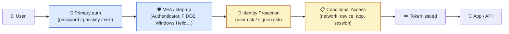
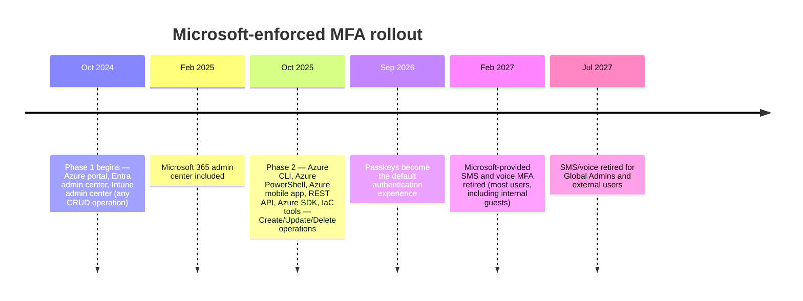
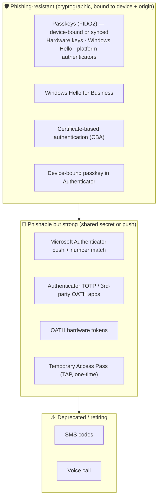
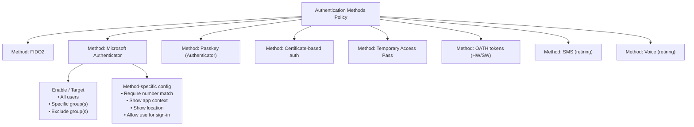
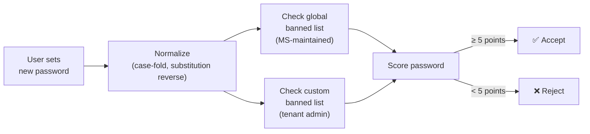
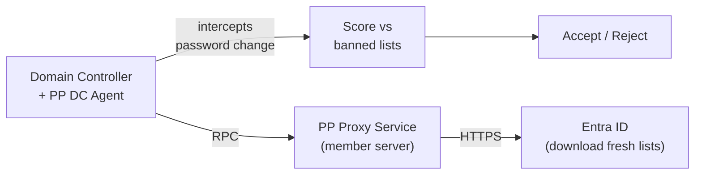
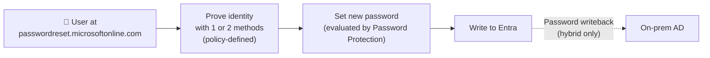
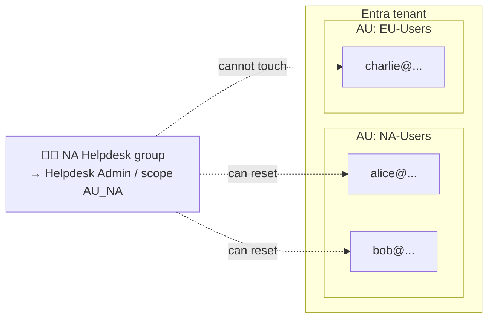

# Microsoft Entra ID — Security Foundations

> **TL;DR** — Microsoft Entra ID (formerly Azure AD) ships with a layered set of **identity security controls**: Security Defaults (the one-switch baseline), Microsoft-enforced mandatory MFA (Phase 1 all CRUD ops on admin portals; Phase 2 any Create/Update/Delete via CLI, PowerShell, SDK, IaC or REST — rolling out from 1 Oct 2025, postponement available to 1 Jul 2026), the converged **Authentication Methods Policy** (the single place to configure passwordless, MFA, and SSPR methods — legacy policies retired **30 Sep 2025**), **Entra Password Protection** (global + custom banned lists, extensible to on-prem AD), **Self-Service Password Reset**, named locations, and least-privilege admin roles. Passkeys are the **default** phishing-resistant method as of **1 Sep 2026**; Microsoft-provided SMS/voice retire **1 Feb 2027** (Global Admins + external users: 1 Jul 2027). This note covers the foundation — Conditional Access, Identity Protection, PIM/Governance, and advanced topics live in sibling files.

---

## Table of contents

1. [Where this fits in the stack](#1-where-this-fits-in-the-stack)
2. [The security control surfaces](#2-the-security-control-surfaces)
3. [Security Defaults](#3-security-defaults)
4. [Mandatory MFA — the 2024–2026 enforcement waves](#4-mandatory-mfa--the-20242026-enforcement-waves)
5. [Authentication methods: hierarchy and retirement timeline](#5-authentication-methods-hierarchy-and-retirement-timeline)
6. [Authentication Methods Policy (the converged policy)](#6-authentication-methods-policy-the-converged-policy)
7. [Password policies and Entra Password Protection](#7-password-policies-and-entra-password-protection)
8. [Self-Service Password Reset (SSPR)](#8-self-service-password-reset-sspr)
9. [Named locations and trusted IPs](#9-named-locations-and-trusted-ips)
10. [Authentication strengths (preview of CA concept)](#10-authentication-strengths-preview-of-ca-concept)
11. [Admin roles and administrative units](#11-admin-roles-and-administrative-units)
12. [Licensing cheat sheet](#12-licensing-cheat-sheet)
13. [Cheat sheet](#13-cheat-sheet)
14. [Further reading](#14-further-reading)

---

## 1. Where this fits in the stack

Entra ID is the **IdP** (see [SAML 2.0](saml.md) §2) for most Microsoft 365 / Azure tenants and tens of thousands of SaaS apps via SAML + OIDC. "Entra ID security" means the tenant-level controls that decide **who can sign in, how, from where, and with what evidence** — *before* an application sees a token.



| Layer | Covered in |
|---|---|
| Primary auth + MFA methods, SSPR, password protection, baseline tenant settings | **This file** |
| Conditional Access policies (signals, grants, session controls) | [`entra-id-conditional-access.md`](entra-id-conditional-access.md) |
| Risk-based protection (sign-in risk, user risk, CAE) | [`entra-id-identity-protection.md`](entra-id-identity-protection.md) |
| Just-in-time admin access, access reviews, entitlement management | [`entra-id-pim-governance.md`](entra-id-pim-governance.md) |
| Workload identities, cross-tenant, Zero Trust, monitoring | [`entra-id-advanced.md`](entra-id-advanced.md) |

---

## 2. The security control surfaces

A new Entra tenant exposes roughly six places where "security" is configured. Learn them by name — the Microsoft portal moves blades around constantly.

| Surface | Portal location | What it does |
|---|---|---|
| **Security Defaults** | Entra admin center → *Overview* → *Properties* → *Manage Security defaults* | One-switch baseline (MFA + block legacy auth). On by default for *new* tenants. |
| **Authentication Methods Policy** | *Entra* → *Protection* → *Authentication methods* → *Policies* | The **converged** policy for every method (passkey, Authenticator, FIDO2, TAP, SMS, voice, OATH HW/SW, cert). Replaced legacy MFA + SSPR method tabs on **30 Sep 2025**. |
| **Password Protection** | *Entra* → *Protection* → *Authentication methods* → *Password protection* | Global banned list (MS-maintained) + custom banned list; lockout thresholds; on-prem AD agent toggle. |
| **Self-Service Password Reset** | *Entra* → *Protection* → *Password reset* | Who can reset, which methods, writeback to AD. |
| **Conditional Access** | *Entra* → *Protection* → *Conditional Access* | The policy engine. See its own file. |
| **Roles & admins / Administrative units** | *Entra* → *Roles & admins* | Built-in RBAC + scoped containers. |

> 💡 All of these live under **Entra → Protection** in the admin center — bookmark `entra.microsoft.com` and head there first.

---

## 3. Security Defaults

The **cheapest, laziest, best-return control in Entra**. One switch, no license required, applies to the whole tenant.

### What it enforces

| Behavior | Detail |
|---|---|
| **MFA registration** | All users must register for MFA. (The old 14-day grace period was removed on 29 Jul 2024 — only the 24-hour new-tenant grace period at tenant creation remains.) |
| **MFA for admins, always** | Members of 16 highly privileged roles must MFA on every sign-in: Global Administrator, Application Administrator, Authentication Administrator, Billing Administrator, Cloud Application Administrator, Conditional Access Administrator, Exchange Administrator, Helpdesk Administrator, Password Administrator, Privileged Authentication Administrator, Privileged Role Administrator, Security Administrator, SharePoint Administrator, User Administrator, Authentication Policy Administrator, Identity Governance Administrator. |
| **MFA for users, when needed** | Microsoft's risk engine challenges when it looks risky (new device, odd location). |
| **Block legacy authentication** | IMAP, POP, SMTP AUTH, legacy EWS — anything using Basic Auth — is blocked. |
| **Protect privileged actions** | Any Azure portal / PowerShell / CLI sign-in requires MFA. |
| **Device code flow blocked by default** | For *new* tenants created on or after **1 Jul 2026**, device code flow is blocked. |

### Who should use it

- Small / mid-size tenants without Entra ID P1.
- Any tenant until a Conditional Access baseline is built.

### Who shouldn't

- Tenants with **Conditional Access** in production — the two are **mutually exclusive**. Enabling Security Defaults disables all CA policies and vice versa.
- Tenants needing granular exclusions (e.g., service accounts that can't do MFA yet) — use CA with a break-glass pattern instead.

> ⚠️ **New tenants have Security Defaults ON.** If you deploy CA, Microsoft will refuse to let you enable CA policies until you turn Security Defaults OFF. Plan that cutover — there's a moment where neither is enforcing.

---

## 4. Mandatory MFA — the 2024–2026 enforcement waves

Independent of Security Defaults and CA, Microsoft has been **gradually forcing MFA** on specific Microsoft-owned sign-in surfaces. These are **tenant-wide and cannot be disabled** — only postponed.



### What's in scope

| Phase | Covers | Enforcement |
|---|---|---|
| **Phase 1** (now complete) | Sign-in to Azure portal, `portal.azure.com`, `entra.microsoft.com`, `intune.microsoft.com`, `admin.microsoft.com` to perform any CRUD operation | MFA required on every sign-in. Session cookies honor the normal lifetime. |
| **Phase 2** (rolling out from 1 Oct 2025, postponement available to 1 Jul 2026) | Azure CLI, Azure PowerShell, Azure mobile app, ARM REST endpoints, Azure SDK, IaC tools (Terraform/Bicep/ARM templates) when they call ARM | MFA required for any **Create / Update / Delete**. Read operations exempt. |

### How it interacts with CA and break-glass

- CA policies still evaluate on top. If your CA says "require passkey", the Microsoft-enforced MFA is satisfied by the passkey — no double challenge.
- **Break-glass accounts are NOT exempt.** You must register an MFA method for them. Microsoft recommends passkey (FIDO2) or certificate-based authentication (CBA). Typical pattern: a hardware FIDO2 security key stored in a safe.
- Tenants that needed more time could **postpone Phase 1 to 30 Sep 2025** via `aka.ms/managemfaforazure` (that window is now closed). Phase 2 can still be postponed to **1 Jul 2026** via `aka.ms/postponePhase2MFA`.

> 💡 Microsoft sees mandatory MFA as **floor, not ceiling**. Build your Conditional Access baseline assuming every admin surface already requires MFA.

---

## 5. Authentication methods: hierarchy and retirement timeline

**Not all MFA is equal.** Microsoft now ranks authentication methods by **phishing resistance** — the ability of the method to survive a user being tricked by a real-time proxy (AiTM) phishing kit.

### The hierarchy



| Method | Phishing-resistant? | Notes |
|---|---|---|
| **Passkeys (FIDO2)** — hardware key or synced | ✅ | Bound to origin via WebAuthn. The new default experience since **1 Sep 2026**. |
| **Windows Hello for Business** | ✅ | Certificate or key-trust, device-bound. |
| **Certificate-based auth (CBA)** | ✅ | Smartcards / PIV / corporate PKI. |
| **Device-bound passkey in Authenticator** | ✅ | Attested to the phone's secure enclave. |
| **Authenticator push + number match** | ❌ (approximate) | Good UX, resistant to MFA fatigue since number-match became default in 2023. Still vulnerable to real-time AiTM. |
| **Authenticator TOTP / 3rd-party OATH apps** | ❌ | 6-digit code the user types — phishable. |
| **OATH hardware tokens (HOTP/TOTP)** | ❌ | Same shared-secret weakness, no origin binding. |
| **Temporary Access Pass (TAP)** | ❌ | Short-lived passcode for onboarding / re-provisioning. Admin-issued. Set it `one-time` by default. |
| **SMS** | ❌ | SIM-swap, SS7 interception, no origin binding. Retiring **1 Feb 2027**. |
| **Voice call** | ❌ | Same failure modes as SMS. Retiring **1 Feb 2027**. |

### SMS/voice retirement timeline (what's happening)

| Date | Change |
|---|---|
| **1 Sep 2026** (now past) | Passkeys become the **default** sign-in experience. Users previously enabled for SMS/voice are auto-enabled for passkeys and nudged to register via a Microsoft-managed registration campaign. |
| **1 Feb 2027** | Microsoft-provided SMS and voice MFA is **retired** for all users *except* Global Administrators and external users (internal guest users ARE in scope). After this date, users whose only MFA method is SMS/voice are forced to register a passkey to sign in — no opt-out. |
| **1 Jul 2027** | SMS/voice retired for Global Administrators and external users. (Internal guest users already retired on 1 Feb 2027.) |

Organizations that need to keep SMS/voice can bring their own telecom via Microsoft Security Store ("customer-configured telephony providers" — Soprano and Telesign are the initial private-preview providers; selection and configuration from the marketplace opens **30 Oct 2026**) — but the clear direction is **passkeys as default, hardware keys for admins, CBA for the highest trust**.

> ⚠️ **Audit before 1 Feb 2027.** Query sign-in logs for users whose last successful MFA was SMS or voice (`authenticationDetails/authenticationMethod eq 'Text message'` or `'Phone call'`). Nudge them to passkey registration before the date, or you'll have an on-call Monday morning.

---

## 6. Authentication Methods Policy (the converged policy)

Before the migration, three separate blades all claimed to control MFA:

- The **legacy MFA settings** at `account.activedirectory.windowsazure.com`.
- The **SSPR → Authentication methods** tab.
- The modern **Authentication methods policy**.

On **30 Sep 2025**, Microsoft retired the ability to *manage* methods in the first two. Settings remain visible read-only in some places, but the **Authentication Methods Policy is now the single source of truth** for who can use which method, for what purpose (sign-in / MFA / SSPR / passwordless).

### Model



Each method has:

| Setting | What it controls |
|---|---|
| **Enabled** | Whether the method exists at all for the tenant. |
| **Target** | Which users/groups can register and use it. `All users` or `Select users/groups`. |
| **Exclude** | Groups to exclude from the above. |
| **Method-specific config** | E.g., Authenticator can require **number match**, show **app context** and **location**; FIDO2 can restrict **Attestation GUIDs** (AAGUIDs) to approved hardware. |

### Checking migration status

```bash
# Microsoft Graph (PowerShell) — inspect converged policy
Connect-MgGraph -Scopes "Policy.Read.All"
Get-MgPolicyAuthenticationMethodPolicy | Format-List

# Each method lives under /policies/authenticationMethodsPolicy/authenticationMethodConfigurations
Get-MgPolicyAuthenticationMethodPolicyAuthenticationMethodConfiguration |
  Select-Object Id, State
```

> 💡 **Post-migration hygiene:** go through the (now-read-only) legacy MFA and SSPR blades and remove any method still listed there — otherwise audits will keep flagging it as a shadow setting.

### Authentication Methods Registration Campaign

A *nudge* mechanism inside the policy: when a user signs in with a weaker method (SMS/voice/Authenticator-OTP), prompt them to register a stronger one (push, passkey). Targeted by group, configurable snooze count. **Use it to accelerate passkey adoption.**

---

## 7. Password policies and Entra Password Protection

Cloud-only Entra ID enforces:

| Rule | Value |
|---|---|
| Length | 8–256 characters (≥ 8 required). |
| Character requirement | At least **three** of: uppercase, lowercase, number, symbol. |
| Expiry (cloud-only accounts) | Default **never** (changed from 90 days back in 2019 — rotation as a control is out of favor). |
| Lockout | Smart lockout: **10** failures by default → **60-second** lockout; exponential backoff for repeat offenders. Attempts from recognized devices tracked separately from unknown devices. |

### Entra Password Protection

The feature that enforces **banned password lists** on every password change / reset.



| List | Source | Enforced? |
|---|---|---|
| **Global banned list** | MS telemetry: common weak passwords + passwords seen in real attacks. Not published (adversaries would optimize against it). | Always on for all cloud sign-ins. |
| **Custom banned list** | Admin-defined. Up to **1000** terms. Normalization (case + leetspeak reversal) is applied, so adding `contoso` also blocks `C0nt0s0!`. | On when configured. |

**Scoring**: each banned-token match costs points; a password with "too many" weak features (close to a banned word, too many substitutions) is rejected. It's a **scoring algorithm, not a strict regex match** — which is why some near-matches slip through.

### Hybrid: Entra Password Protection on on-prem AD

The same banned-password enforcement can be pushed into **on-premises AD DS**, so password changes in `Ctrl+Alt+Del` or `net user` go through the same filter.



Two agents:

| Agent | Where it runs | Role |
|---|---|---|
| **Password Protection DC Agent** | **Every** writable DC | Hooks into the password-change pipeline; evaluates against downloaded list. |
| **Password Protection Proxy** | One or more member servers | Pulls the latest banned-list bundle from Entra over HTTPS and serves it to DCs. |

Agents can run in **Audit mode** (log rejections but accept passwords — good for pilots) before switching to **Enforce**.

### Licensing

| Scenario | License |
|---|---|
| Global banned list, cloud-only users | **Free** (Entra ID Free). |
| Global banned list, synced users | **P1** required (yes, even the global list — synced users count as hybrid). |
| Custom banned list (cloud or hybrid) | **P1**. |
| On-prem AD agent enforcement | **P1**. |

---

## 8. Self-Service Password Reset (SSPR)

Lets users reset their own forgotten/expired passwords and unlock accounts, without a helpdesk ticket.



### Policy knobs

| Setting | Default | Notes |
|---|---|---|
| **Enabled for** | Selected group / all users / none | Pilot with a group first. |
| **Methods required to reset** | 1 or 2 | Admins **must use 2** by hard-coded policy. |
| **Available methods** | SMS, voice call, Email OTP, Authenticator push/OTP, software OATH, hardware OATH (preview), security questions (legacy SSPR policy only) | Choose from what's enabled in the Authentication Methods Policy. Passkey/FIDO2 and Windows Hello are NOT SSPR methods. |
| **Registration** | Require users to register on next sign-in; re-register every *N* days | Combined security info registration (SSPR + MFA at once) is the default. |
| **Notifications** | Notify the user on reset; notify admins on admin reset | Turn both on. |

> ⚠️ **Security questions are the weakest method** — stock questions are easily OSINT'd from LinkedIn/Facebook. Disable them for anyone with a role assignment.

### Password writeback (hybrid)

Cloud resets propagate to on-prem AD via **Entra Connect** (or **Cloud Sync**). Required if:

- Any users are synced from AD.
- You want SSPR to work for people on domain-joined machines.
- You want cloud-driven password changes (e.g., Identity Protection confirmed-compromised) to force the on-prem password too.

Enable it in Entra Connect: **Optional Features → Password Writeback**. Needs `Reset Password` and `Change Password` ACEs on the AD user objects for the Entra Connect service account.

### SSPR vs password **change**

| | SSPR (forgot) | Password **change** (I know the current one) |
|---|---|---|
| Portal | `passwordreset.microsoftonline.com` | `mysignins.microsoft.com/security-info` → Password |
| Requires methods registered | Yes | No — just the current password |
| Requires licensed user | Yes (P1 for self-service reset) | No |
| Writeback needed for hybrid | Yes | Native with Entra Connect |

---

## 9. Named locations and trusted IPs

A **Named Location** is a labelled IP range or country set, reusable in Conditional Access policies and Identity Protection signals.

| Type | What goes in | Typical use |
|---|---|---|
| **IP ranges** | IPv4/IPv6 CIDR blocks | Corporate NAT egress, VPN exits, offices. |
| **Countries / regions** | ISO 3166-1 codes, optionally derived from GPS | Geo-block / geo-allow policies. |

### "Mark as trusted location"

A checkbox on an IP-range named location. Treating a location as trusted tells **Identity Protection** to **suppress sign-in risk** from those IPs. Historically also used by MFA to skip the challenge — but with modern CA, use a **CA policy targeting All locations → Exclude trusted** instead, so the control is explicit.

> ⚠️ **"Trusted" doesn't mean "no MFA".** It means the risk engine trusts the IP. If your CA policy requires MFA for *everyone, everywhere*, trusted-location users still MFA. Decide what you want and codify it in CA — don't rely on the implicit skip.

### MFA trusted IPs (deprecated path)

The old **"MFA trusted IPs"** blade let you add IP ranges that bypassed MFA. It's part of the retired legacy MFA settings. The modern replacement:

1. Create a **Named Location** for the IP range.
2. In a CA policy, **exclude** that location (or include it, depending on direction).

### GPS-based country location

A preview-turned-GA feature: the country is derived from Authenticator's GPS reading instead of IP geolocation. More accurate for VPN/CDN-obscured IPs. **Only Authenticator can provide this signal** — other methods fall back to IP.

---

## 10. Authentication strengths (preview of CA concept)

**Authentication strength** is a *set of methods* an admin considers acceptable for a given operation. You define a strength once, then reference it in Conditional Access policies ("require authentication strength: *Phishing-resistant MFA*").

### Built-in strengths

| Strength | Methods allowed |
|---|---|
| **MFA** | Any valid combination (password + any 2FA, or any single passwordless method). |
| **Passwordless MFA** | Authenticator passwordless, passkey, Windows Hello, CBA, FIDO2 security key — anything that's single-factor-but-strong. |
| **Phishing-resistant MFA** | FIDO2 (passkey), Windows Hello for Business, Certificate-based authentication only. |

### Custom strengths

Mix and match methods by name and even restrict FIDO2 to specific **AAGUIDs** (hardware-key models you've issued). Example: a strength called `"CA-GA-HWkey"` that only accepts a **YubiKey 5 (AAGUID 2fc0579f-8113-47ea-b116-bb5a8db9202a)** + certificate, nothing else.

> 💡 This is where you encode **"Global Admins may only sign in with a hardware security key we issued."** Use it in a CA policy scoped to the GA role.

Deep dive on how CA uses strengths lives in [`entra-id-conditional-access.md`](entra-id-conditional-access.md).

---

## 11. Admin roles and administrative units

### The principle

Entra ships with ~100 built-in roles. **Default** should be: assign the narrowest role you can, scope it to the smallest set of objects possible, and make it **eligible** (requires activation) via PIM.

> This file covers the **permanent assignment / built-in roles basics**. PIM, access reviews, and governance are in [`entra-id-pim-governance.md`](entra-id-pim-governance.md).

### Roles you must know

| Role | What it can do | Rule of thumb |
|---|---|---|
| **Global Administrator** | Everything. Includes reading all mailboxes, resetting any password, modifying Conditional Access. | Target: **≤ 5** permanent, all with hardware keys, all registered for break-glass. |
| **Privileged Role Administrator** | Can assign roles (including GA). | Only as eligible, PIM-activated, with approval. |
| **Security Administrator** | Read/write all security-related config (CA, Identity Protection, Defender). Cannot grant roles. | Preferred over GA for SOC/SecOps engineers. |
| **Security Reader** | Read-only across security surfaces. | Default for analysts who only investigate. |
| **Conditional Access Administrator** | CRUD on CA policies only. | Rare — usually bundled into Security Admin. |
| **Authentication Administrator** | Reset passwords and MFA methods for **non-admin** users. | Front-line helpdesk. |
| **Privileged Authentication Administrator** | Same but for any user, including admins. | Highly privileged — PIM-only. |
| **User Administrator** | User CRUD + group management. | Can be powerful (resets passwords) — scope carefully. |
| **Helpdesk Administrator** | Reset passwords for non-admins and some other front-line tasks. | Alternative to Authentication Admin. |
| **Global Reader** | Read-only everything. | Auditors, change managers. |

### Administrative Units (AUs)

An **AU** is a container that scopes roles to a subset of users/groups/devices. Example: give the "North America Helpdesk" team the *Helpdesk Administrator* role, but **only over users in the `NA-Users` AU** — they can't touch EMEA.



AU specifics:

- Supported role list is published — not every role can be scoped (GA cannot).
- Dynamic membership via a rule (`user.country -eq "US"`) is supported with **P1** (each AU member also needs P1 for dynamic membership).
- **AUs cannot be nested.** A separate feature — **restricted management AUs** — protects objects inside them *from* tenant-level admins, useful for VIP accounts.

> 💡 **Restricted Management AUs** are the cleanest way to protect executive accounts from a compromised helpdesk admin. Put the exec users in a restricted-management AU; only members of the AU's role assignments (plus Privileged Authentication Admin / Privileged Role Admin / Global Admin) can modify them — no tenant-wide Password Admin or Helpdesk Admin can reset their passwords.

### Service accounts

Prefer **workload identities** (service principals / managed identities) to interactive service accounts. Where you absolutely need a user account:

- Give it a long, random passkey or certificate — **never** a shared password in a wiki.
- Exclude it from MFA-required CA policies **only** on a trusted IP/location and only for the apps it needs.
- Review quarterly via Access Reviews.

Deep dive in [`entra-id-advanced.md`](entra-id-advanced.md).

---

## 12. Licensing cheat sheet

| Feature | Entra ID Free | Microsoft 365 Apps | Entra ID P1 | Entra ID P2 |
|---|---|---|---|---|
| Security Defaults | ✅ | ✅ | ✅ | ✅ |
| Mandatory MFA (Microsoft-enforced) | ✅ | ✅ | ✅ | ✅ |
| Authentication Methods Policy | ✅ | ✅ | ✅ | ✅ |
| Password Protection — global list (cloud) | ✅ | ✅ | ✅ | ✅ |
| Password Protection — custom list / hybrid AD | ❌ | ❌ | ✅ | ✅ |
| Self-Service Password Reset — cloud users | ❌ (Change only) | ✅ | ✅ | ✅ |
| SSPR — hybrid / password writeback | ❌ | ❌ | ✅ | ✅ |
| Conditional Access | ❌ | ❌ | ✅ | ✅ |
| Named locations | ❌ | ❌ | ✅ | ✅ |
| Authentication Strengths | ❌ | ❌ | ✅ | ✅ |
| Administrative Units | ❌ | ❌ | ✅ | ✅ |
| Dynamic group / AU membership | ❌ | ❌ | ✅ | ✅ |
| Identity Protection | ❌ | ❌ | ❌ | ✅ |
| PIM | ❌ | ❌ | ❌ | ✅ |
| Access Reviews | ❌ | ❌ | ❌ | ✅ |
| Entitlement Management | ❌ | ❌ | ❌ | ✅ |

> ⚠️ "Microsoft 365 E3" bundles P1; "Microsoft 365 E5" and "EMS E5" bundle P2. Check what your users actually have — it's rarely uniform.

---

## 13. Cheat sheet

```text
Security Defaults          one-switch MFA + legacy-auth block; mutually exclusive with CA
Mandatory MFA              forced on Azure portal / CLI / API — cannot be disabled
Authentication Methods     the ONE policy for passkey, Authenticator, FIDO2, CBA, OATH, SMS, voice
                           Legacy MFA + SSPR method tabs RETIRED 30 Sep 2025
Passkey                    default sign-in experience since 1 Sep 2026
SMS / Voice                retiring 1 Feb 2027 (Global Admins + external: 1 Jul 2027)
Password Protection        global (MS) + custom banned lists; hybrid via DC Agent + Proxy
SSPR                       mysignins.microsoft.com; admins must use 2 methods; writeback for hybrid
Named Locations            IP ranges / countries; "Trusted" suppresses IP risk
Authentication Strength    named sets of methods; used in CA policies (see CA file)
Admin Units                scope roles to subsets of users/groups; Restricted AUs protect VIPs

Rule of thumb for a tenant handover:
  1. Turn on Security Defaults (if no CA yet).
  2. Confirm Phase 1 + Phase 2 MFA are passing — review the "MFA enforcement" sign-in report.
  3. Audit who is Global Admin — target ≤ 5 permanent.
  4. Enable Password Protection custom list with your domain + product names.
  5. Turn on SSPR with combined registration, 2 methods, no security questions.
  6. Deploy Entra ID P1/P2 → Build CA baseline → disable Security Defaults → cut over.
```

---

## 14. Further reading

### Microsoft Learn (primary refs)

- Security Defaults — <https://learn.microsoft.com/entra/fundamentals/security-defaults>
- Plan for mandatory Entra MFA — <https://learn.microsoft.com/entra/identity/authentication/concept-mandatory-multifactor-authentication>
- Authentication Methods Policy — <https://learn.microsoft.com/entra/identity/authentication/concept-authentication-methods-manage>
- How to migrate to the Authentication Methods Policy — <https://learn.microsoft.com/entra/identity/authentication/how-to-authentication-methods-manage>
- Protecting authentication methods in Entra ID (defaults) — <https://learn.microsoft.com/entra/identity/authentication/concept-authentication-default-enablement>
- Passkeys by default + SMS/voice retirement — <https://learn.microsoft.com/entra/identity/authentication/concept-sms-voice-retirement>
- Password protection — <https://learn.microsoft.com/entra/identity/authentication/concept-password-ban-bad>
- On-prem password protection — <https://learn.microsoft.com/entra/identity/authentication/concept-password-ban-bad-on-premises>
- Custom banned password lists — <https://learn.microsoft.com/entra/identity/authentication/tutorial-configure-custom-password-protection>
- SSPR overview — <https://learn.microsoft.com/entra/identity/authentication/concept-sspr-howitworks>
- SSPR writeback — <https://learn.microsoft.com/entra/identity/authentication/concept-sspr-writeback>
- Named locations — <https://learn.microsoft.com/entra/identity/conditional-access/concept-assignment-network>
- Authentication strengths — <https://learn.microsoft.com/entra/identity/authentication/concept-authentication-strengths>
- Built-in roles reference — <https://learn.microsoft.com/entra/identity/role-based-access-control/permissions-reference>
- Administrative units — <https://learn.microsoft.com/entra/identity/role-based-access-control/administrative-units>

### Related learning bits in this repo

- [SAML 2.0](saml.md) — the federation protocol Entra speaks to most SaaS apps.
- [Conditional Access](entra-id-conditional-access.md) — the policy engine on top of these primitives.
- [Identity Protection](entra-id-identity-protection.md) — risk-based signals and automated response.
- [PIM & Governance](entra-id-pim-governance.md) — just-in-time admin access and lifecycle.
- [Advanced Entra security](entra-id-advanced.md) — workload identities, cross-tenant, Zero Trust, logging.
