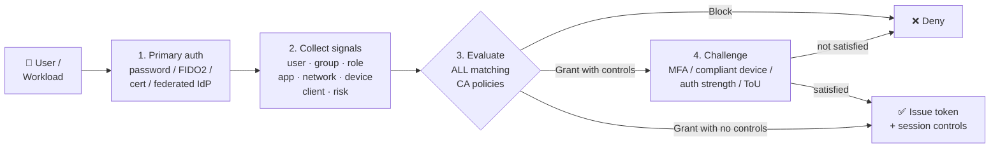
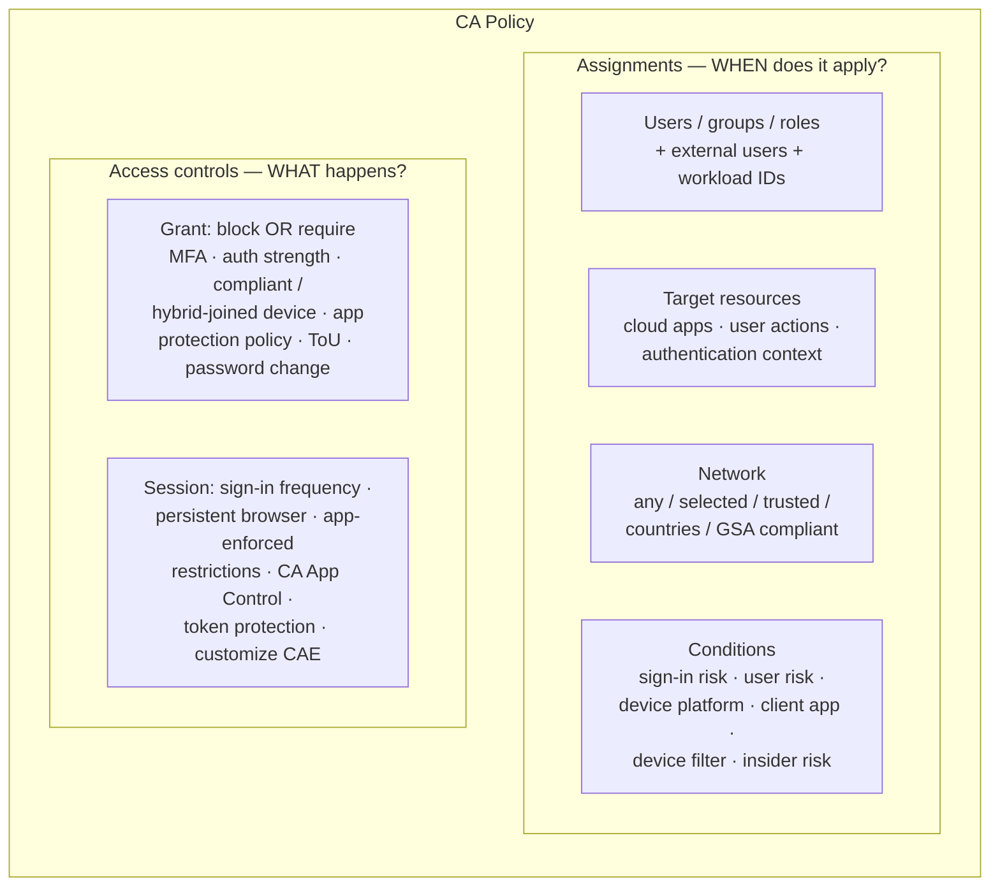
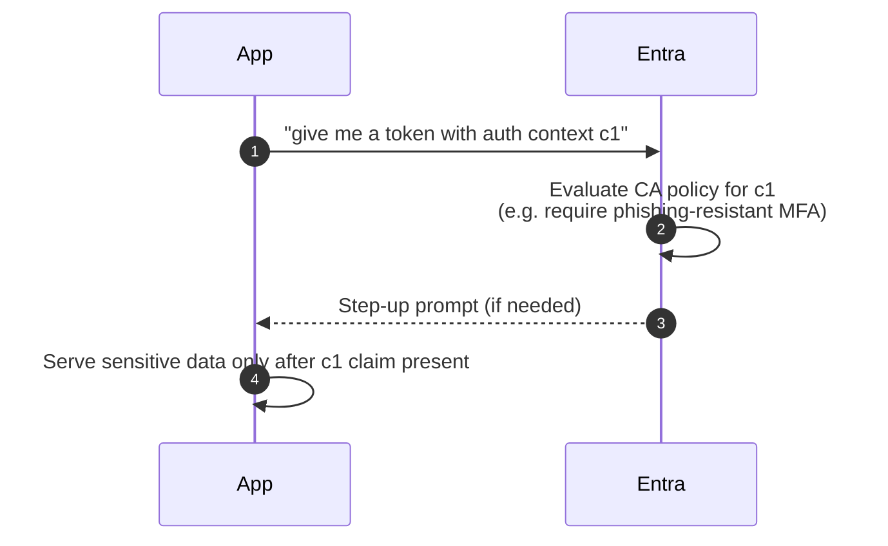
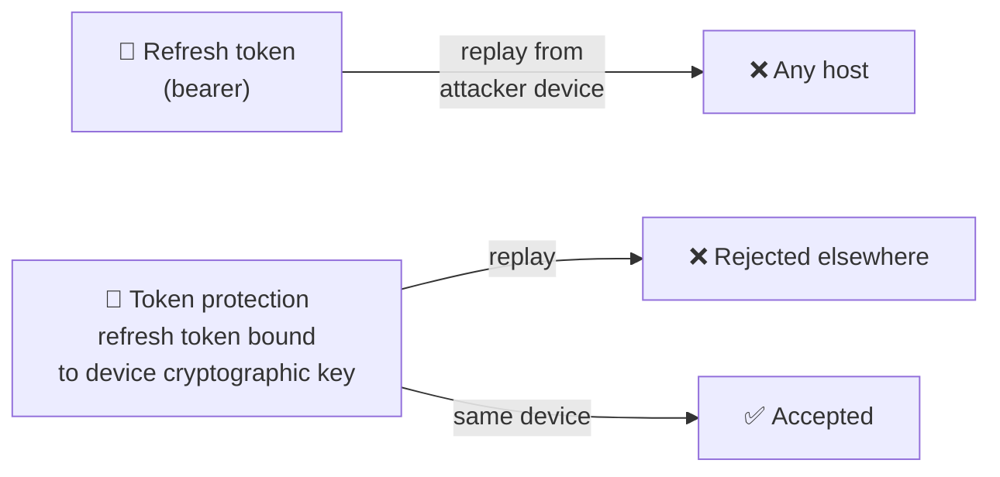
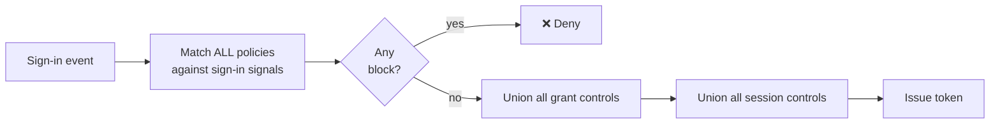

# Entra ID — Conditional Access (CA)

> **TL;DR** — Conditional Access is Entra's **policy engine**: for every token issuance, it takes a bundle of signals (user, app, network, device, risk) and decides *allow*, *allow with controls* (MFA, compliant device, auth strength…), or *block*. It runs **after** primary authentication succeeds and **before** the token is issued, which is why a correct password is never enough — CA is where Zero Trust is actually enforced in Entra.

---

## Table of contents

1. [Where CA sits in the sign-in pipeline](#1-where-ca-sits-in-the-sign-in-pipeline)
2. [Policy anatomy: assignments + access controls](#2-policy-anatomy-assignments--access-controls)
3. [Assignments — users, roles, workload identities](#3-assignments--users-roles-workload-identities)
4. [Assignments — target resources & authentication context](#4-assignments--target-resources--authentication-context)
5. [Assignments — network & conditions](#5-assignments--network--conditions)
6. [Grant controls](#6-grant-controls)
7. [Authentication strengths](#7-authentication-strengths)
8. [Session controls](#8-session-controls)
9. [Token protection](#9-token-protection)
10. [How multiple policies combine](#10-how-multiple-policies-combine)
11. [Report-only mode and the What-If tool](#11-report-only-mode-and-the-what-if-tool)
12. [Policy templates (Secure Foundation / Zero Trust)](#12-policy-templates-secure-foundation--zero-trust)
13. [Common policy recipes](#13-common-policy-recipes)
14. [Gotchas & operational hygiene](#14-gotchas--operational-hygiene)
15. [Cheat sheet](#15-cheat-sheet)
16. [Further reading](#16-further-reading)

---

## 1. Where CA sits in the sign-in pipeline

CA is **not** authentication — it's the *authorization gate* that runs between "we verified the user's credentials" and "we hand out a token".



Key implications:

- **Primary auth alone is never enough** — even a correct password hits the CA gate.
- **Legacy auth protocols** (POP, IMAP, SMTP AUTH, older EAS) can't satisfy MFA/device controls, so a "require MFA" or "require compliant device" policy **implicitly blocks legacy auth**. Microsoft retired basic auth for Exchange Online in 2022–2023, but SMTP AUTH and third-party apps still show up — block them explicitly.
- CA runs **per token request**, including silent token refreshes. Combined with **Continuous Access Evaluation (CAE)**, revocation can propagate within minutes rather than at the next hour's token refresh (see `entra-id-identity-protection.md`).

---

## 2. Policy anatomy: assignments + access controls

Every CA policy is a boolean function: *IF (all assignments match) THEN (apply access controls)*.



| Section | Logic | Notes |
|---|---|---|
| **Users** | include **OR** exclude | Exclude always wins. **Always exclude break-glass accounts** here. |
| **Target resources** | include / exclude cloud apps, or user actions, or auth context — **pick one kind per policy** | You can't mix "cloud app = Exchange" with "user action = register security info" in the same policy. |
| **Network** | include / exclude | Default is "any network" — leave it unless you really want location scoping. |
| **Conditions** | all configured conditions **AND**-ed | A condition set to "any" acts as "don't care". |
| **Grant** | pick controls, then choose **Require all** (default, AND) OR **Require one** (OR) | Blocks are their own grant setting and override everything else. |
| **Session** | multiple controls can be enabled together | Session controls only kick in when the policy *grants* access. |

---

## 3. Assignments — users, roles, workload identities

| Target | How to use |
|---|---|
| **All users** | The right choice for tenant-wide baselines (MFA for everyone, block legacy auth). Must be paired with a disciplined **exclusion** list. |
| **Specific users/groups** | Phase-in during rollout, or scope to an app's user base. Prefer dynamic groups when possible. |
| **Directory roles** | Scope to admins — e.g. Global Administrator, Privileged Role Administrator, Security Administrator. Pairs well with phishing-resistant MFA. |
| **Guest / external users** | Granular — "B2B collaboration guest", "B2B collaboration member", "B2B direct connect", "Service provider users", "Other external users". |
| **Workload identities** | Service principals owned by the tenant (apps, scripts). **Requires Workload Identities Premium licence**. Policies apply to **client-credentials** flows — federated workload identities (OIDC from GitHub/AKS etc.) still evaluate CA. |
| **Agent identities** (newer) | First-party and third-party AI/agent identities can be targeted separately — treat them like workload identities but note they're a distinct object class. |

### Break-glass accounts (emergency access)

Every tenant needs **two cloud-only accounts** that are *excluded from every CA policy* so that a mis-configured policy, an auth strength typo, or an Entra outage of a specific authentication method can't lock you out.

- Store credentials offline (safe), long random password, FIDO2 security key as the only MFA method.
- **Monitor sign-ins** on these accounts — any login should trigger a SIEM alert.
- Audit the exclusion list monthly: *the only exclusions should be break-glass* (plus any sync service account you deliberately exempt).

---

## 4. Assignments — target resources & authentication context

A policy targets **one of three** kinds of resources — not a mix.

### a) Cloud apps

Include/exclude Entra-registered applications. Special aggregate targets:

| Pseudo-app | Covers |
|---|---|
| **All cloud apps** | Everything registered + all Microsoft first-party apps. Required for the "MFA for all users" baseline. |
| **Office 365** | Exchange Online, SharePoint, Teams, OneDrive, Graph (implicit) — a single tile. |
| **Microsoft Admin Portals** | Entra admin center, Microsoft 365 admin center, Defender, Intune, etc. Target this to force phishing-resistant MFA for admin UX. |
| **Microsoft Azure Management** | ARM, Azure portal, CLI, PowerShell — target to protect subscription-level actions. |

> ⚠️ **Avoid "All cloud apps" with a block** unless you really mean it (including break-glass). Use specific apps or pair with narrow conditions.

### b) User actions

| User action | Why target it |
|---|---|
| **Register security information** | Require MFA (or trusted location) to add/change MFA methods — prevents attacker-added phones. From **July 2026**, this also covers Windows Hello for Business and macOS Platform SSO credential registration. |
| **Register or join devices** | Require MFA to join a device to Entra ID. |

### c) Authentication context

An **authentication context** is a label (e.g. `c1`, "High-risk file access") that an *application* can request mid-session. The CA policy attached to that label is then evaluated **step-up** — without changing the app's own sign-in policy.



Use cases: SharePoint-sensitive sites, Defender for Cloud Apps session controls, **PIM role activation** ("activating Global Admin requires compliant device + phishing-resistant MFA"), **protected actions** (e.g. "delete CA policy" requires step-up).

---

## 5. Assignments — network & conditions

### Network (Locations)

| Location kind | How defined | Typical use |
|---|---|---|
| **IPv4 / IPv6 ranges** | CIDR blocks you enter; optionally mark **Trusted** | Corporate egress IPs, VPN, data-centre allowlists |
| **Countries / regions by IP** | ISO country codes, resolved via Entra's IP-to-geo map (not authoritative — see gotchas) | Geo-block, travel scenarios |
| **Countries / regions by GPS** | Resolved via the Microsoft Authenticator app contacting the device every hour | Stricter travel enforcement — needs Authenticator installed |
| **Compliant network** | Managed by **Global Secure Access** (Entra Private/Internet Access) | Replaces old "trusted IP" concept with an identity-bound network signal |

**Trusted locations** are an attribute on IP-based named locations. Being inside a trusted location *doesn't automatically skip MFA* — it just becomes a signal you can reference (include/exclude) or that other features (Identity Protection risk evaluation) consult.

### Conditions

| Condition | Values | Notes |
|---|---|---|
| **Sign-in risk** | None / Low / Medium / High (plus "no risk score calculated") | Fed by Identity Protection. Details in `entra-id-identity-protection.md`. |
| **User risk** | Low / Medium / High | Cumulative on the user, not the session. |
| **Device platforms** | Android, iOS, Windows, macOS, Linux | Match is best-effort (based on user-agent / client); **do not** rely on this for strong device binding — use compliant/hybrid-joined. |
| **Client apps** | Browser, Mobile apps & desktop clients, **Exchange ActiveSync**, **Other clients (legacy auth)** | The two legacy buckets are what you block to kill basic auth. |
| **Filter for devices** | Rule-based filter on device attributes (`device.trustType`, `device.isCompliant`, `device.extensionAttribute1-15`, `device.manufacturer`, `device.operatingSystem`, `device.displayName`) | Powerful for "privileged access workstations" patterns. Can `include` or `exclude`. |
| **Filter for applications** | Rule-based filter on app attributes (custom security attributes) | Dynamic app grouping, e.g. all apps tagged `Sensitivity:High`. |
| **Insider risk** | Elevated | Signal from **Microsoft Purview Adaptive Protection**. Enables "if Purview thinks this user is risky, block or require step-up". |
| **Authentication flows** (newer) | Device code flow, Authentication transfer | Block the specific flows that attackers love (device code phishing) without blocking everything else. |

---

## 6. Grant controls

Pick **Block** OR **Grant with controls**. When multiple grant controls are selected, Entra defaults to **Require all the selected controls** (AND); flip to **Require one of the selected controls** (OR) when any of them should satisfy the policy.

| Control | What it checks | Typical use |
|---|---|---|
| **Require multifactor authentication** | Any MFA method the user has registered satisfies it | Legacy switch — prefer **authentication strength**. |
| **Require authentication strength** | A specific allow-list of methods (see §7) | The modern replacement for "require MFA" — lets you enforce phishing-resistant for admins. |
| **Require device to be marked as compliant** | Intune (or partner MDM) compliance state on the device object | The strongest "managed endpoint" signal. |
| **Require Microsoft Entra hybrid joined device** | Device is AD-joined **and** registered to Entra | For hybrid estates that haven't moved to Entra-joined. |
| **Require approved client app** | Only Microsoft-approved mobile apps (Outlook, Teams, etc.) — legacy, mostly superseded by app protection policy | Use for Exchange/SharePoint mobile only. |
| **Require app protection policy** | Intune App Protection Policy (MAM) is applied on the client | BYOD mobile: no MDM, but data stays inside protected apps. |
| **Require password change** | Forces a password reset at the next sign-in — used almost exclusively by the **User-risk** policy | Combine with "Require MFA" so the reset itself is MFA-protected. |
| **Terms of use** | User must accept a tenant-published PDF | Required for compliance regimes; good for guest access acknowledgement. |
| **Custom controls** (deprecated) | External MFA provider via redirect | Being retired — migrate to **external authentication methods** (EAM). |

> ⚠️ **"Require one" vs "Require all"**: Policies like *"compliant device OR MFA"* are a Zero-Trust classic — managed devices glide through, unmanaged devices MFA — and need the radio button flipped to **Require one of the selected controls**. *"Compliant device AND phishing-resistant MFA"* is the default stack and what you want on Global Admin.

---

## 7. Authentication strengths

Authentication strengths are **method-allowlist policies** referenced from a CA grant control. They replace the old "require MFA" flag with something precise enough to say "no SMS".

### Built-in strengths

| Strength | Methods accepted | Who uses it |
|---|---|---|
| **Multifactor authentication** | Any combination that satisfies classic MFA: FIDO2 security key, WHfB (or platform credential), CBA (multifactor), Authenticator phone sign-in, Temporary Access Pass, password + (SMS / voice / push / OATH), federated single-factor + something you have, or federated multifactor | Baseline MFA policies |
| **Passwordless MFA** | FIDO2 security key (incl. passkey), WHfB (or platform credential), CBA (multifactor), Microsoft Authenticator (phone sign-in) | Phase out passwords for a user population |
| **Phishing-resistant MFA** | **WHfB** (or **platform credential** on macOS), **FIDO2 security key** (passkeys included), **certificate-based authentication (multifactor)** — public-key bound to origin, no shared secret to phish | Admin roles, sensitive apps |

### Custom strengths

You can build your own allow-list: pick the exact combinations (e.g. "passkey in Authenticator **only**", or "FIDO2 with a specific AAGUID"). Useful when you've standardised on a specific key vendor or need to enforce FIDO2 L2 attestation.

### Interaction with the authentication methods policy

- A strength just says "these methods satisfy me".
- The **Authentication methods policy** (tenant-wide, `Entra admin center → Authentication methods`) says "these methods are *enabled* for which users".
- If a user has no enabled method that satisfies the required strength → they're **blocked at MFA** (expected; they need to register a stronger method).

---

## 8. Session controls

Session controls modify the *token/session* that gets issued when a policy grants access.

| Control | What it does | Typical use |
|---|---|---|
| **Sign-in frequency** | Forces re-auth after N hours/days, **or on every sign-in** (step-up for sensitive apps) | Tighten session lifetime on admin portals; "every time" for break-glass-like scenarios. |
| **Persistent browser session** | Controls the "Stay signed in?" prompt (always / never / configurable) | Kiosk / shared workstations → never persistent. |
| **Customize continuous access evaluation** | Disable (not recommended) or re-enable CAE for the targeted sign-ins | Troubleshooting only. |
| **Disable resilience defaults** | When Entra can't evaluate a policy (back-end outage), should the old cached token be honored? | Leave resilience ON for most policies; turn OFF only on the highest-sensitivity policy if you'd rather fail closed. |
| **Require token protection for sign-in sessions** | Binds refresh token to device TPM/secure enclave — see §9 | Windows (GA), web apps & Apple (Preview as of 2026). |
| **Use Conditional Access App Control** | Routes the session through **Microsoft Defender for Cloud Apps** reverse-proxy → can block downloads, mask fields, require step-up per action | Compliance (DLP on unmanaged devices), BYOD. |
| **Use app-enforced restrictions** | Tells Exchange/SharePoint: "this session is unmanaged — go into web-only read-only mode" | Office 365 on BYOD. Must be paired with the corresponding Exchange/SharePoint tenant setting. |
| **Use Global Secure Access security profile** | Attaches an **Entra Internet Access** security profile (web category filtering, TLS inspection, etc.) to sessions that match the policy | Bring identity-aware network security to specific user/app/location scopes without a separate network policy. |

### Sign-in frequency — adaptive vs fixed

Adaptive session lifetime is **the default** (rolling token refresh, reduced prompts on known devices + low risk). Set a **fixed** frequency only when you have a concrete reason (compliance, admin portal). Setting "Every time" effectively disables SSO for that scope — use sparingly.

---

## 9. Token protection

Refresh tokens are the crown jewels of a session; stealing one from a browser profile gives an attacker long-lived access from *anywhere*. Token protection makes refresh tokens **device-bound** via a key in the TPM / Secure Enclave.



- **How you turn it on:** CA session control → *Require token protection for sign-in sessions*.
- **Platform maturity (as of 2026):** native apps are **GA on Windows, iOS/iPadOS and macOS**; **browser-based (web app) support is in Preview** on Windows and macOS and currently only protects **Azure Resource Manager** (Azure portal and a short allow-list of ARM admin UIs). Scope the policy to the supported app + platform + resource combinations to avoid locking out users on unsupported combos.
- **Supported resources (native):** Exchange Online, SharePoint Online, Teams (plus Azure Virtual Desktop and Windows 365 on Windows). Apple's native Mail and Calendar don't support token protection and will be blocked once the policy is enforced.
- **How to monitor:** sign-in logs include `tokenProtectionStatusDetails` with a `signInSessionStatus` of *bound* or *unbound* (plus a numeric status code — 1002/1003/1004 are the common ones during onboarding). Roll out in **Report-only** first and track adoption before flipping to **On**.

---

## 10. How multiple policies combine

**There is no policy order in CA.** Every policy whose assignments match the sign-in is evaluated, and the result is a **merge**:

- Any matching policy that **blocks** → sign-in is blocked (block beats grant).
- Otherwise, the **union** of all required grant controls must be satisfied (MFA from policy A + compliant device from policy B → the user must do both).
- The **union** of session controls is applied.



Practical consequences:

- You don't "move policy X above policy Y" — just scope them precisely.
- Unexpected MFA prompts? Check *all* matched policies in the sign-in log's **Conditional Access** tab — a "Report-only" policy also shows up there.
- A single Require-All grant inside one policy differs from two separate Require-One policies — the first is a strict AND within one rule, the second still ANDs across policies (because both match).

---

## 11. Report-only mode and the What-If tool

### Report-only

Every new policy goes to Report-only first. Entra evaluates it against live sign-ins and records *what would have happened* in the sign-in log (**Report-only tab**) without enforcing. Minimum bake time: **1–2 weeks** covering a payday / month-end / holiday, so corner-case accounts fire.

### What-If tool

In the CA blade, **Policies → What If** lets you simulate: *"User = Alice, cloud app = Azure Portal, from country = Spain, device platform = Windows, client = browser, sign-in risk = Medium"* → it lists which policies apply and the aggregated grant/session controls. Use it when onboarding an exception or diagnosing a complaint.

### Sign-in log — CA diagnostics

In a sign-in log entry, the **Conditional Access** tab shows every policy evaluated with its result:

| Result | Meaning |
|---|---|
| **Success** | Policy matched and the user satisfied the controls. |
| **Failure** | Policy matched but a control failed → sign-in blocked or user prompted. |
| **Not applied** | Assignments didn't match. |
| **Report-only: Success / Failure / Not applied** | Same, but non-enforcing. |

---

## 12. Policy templates (Secure Foundation / Zero Trust)

Entra ships Microsoft-authored templates you can deploy in one click. They are Report-only by default — review assignments (especially exclusions for break-glass) before turning on.

**Secure Foundation** — the baseline Microsoft recommends for every tenant:

1. Require MFA for admins
2. Securing security info registration
3. Block legacy authentication
4. Require MFA for admins accessing Microsoft admin portals
5. Require MFA for all users
6. Require MFA for Azure management
7. Require compliant or Entra hybrid-joined device OR MFA for all users
8. Require compliant device

**Zero Trust** — adds guest, risk, device-platform and session scope on top: *Require MFA for guest access*, *Require MFA for risky sign-ins* and *Require password change for high-risk users* (both P2), *Block access for unknown or unsupported device platform*, *No persistent browser session*, *Require approved client apps or app protection policies*, and *Block access for users with insider risk* (needs Microsoft Purview Adaptive Protection).

**Remote work / Protect administrator / Emerging threats / AI Agents** — smaller bundles for specific scenarios (phishing-resistant MFA for admins lives in *Protect administrator* and *Emerging threats*; the newer *AI Agents* category covers block-high-risk-agent-identities and autonomous / on-behalf-of agent access).

> 💡 **Never deploy a template straight to On.** Always: deploy as Report-only → review a week of sign-in logs → fix exclusions → enable for a pilot group → enable for all.

---

## 13. Common policy recipes

### 13.1 Block legacy authentication (must-have)

- **Users:** All, exclude break-glass + any sanctioned SMTP AUTH service principal.
- **Cloud apps:** All.
- **Conditions → Client apps:** Exchange ActiveSync + Other clients.
- **Grant:** Block.

### 13.2 Require MFA for all users

- **Users:** All, exclude break-glass.
- **Cloud apps:** All.
- **Grant:** Require authentication strength → *Multifactor authentication*.

### 13.3 Phishing-resistant MFA for admins

- **Users:** Directory roles → Microsoft's recommended 14-role list: **Global Administrator, Application Administrator, Authentication Administrator, Billing Administrator, Cloud Application Administrator, Conditional Access Administrator, Exchange Administrator, Helpdesk Administrator, Password Administrator, Privileged Authentication Administrator, Privileged Role Administrator, Security Administrator, SharePoint Administrator, User Administrator**. (Only built-in roles are evaluated — admin-unit-scoped and custom roles are not.)
- **Cloud apps:** All.
- **Grant:** Require authentication strength → *Phishing-resistant MFA*.

### 13.4 Protect security-info registration

- **Users:** All, exclude break-glass.
- **Target resources → User actions:** Register security information.
- **Conditions → Locations:** Exclude Trusted locations (optional — allow registration from HQ with just password + MFA; block elsewhere).
- **Grant:** Require MFA.

### 13.5 Require compliant device for Azure management

- **Users:** All, exclude break-glass.
- **Cloud apps:** Microsoft Azure Management + Microsoft Admin Portals.
- **Grant:** Require device to be marked as compliant.
- **Session:** Sign-in frequency = 4 hours.

### 13.6 Geo-block high-risk countries

- **Users:** All, exclude break-glass + traveling-executives group.
- **Cloud apps:** All.
- **Conditions → Locations:** Include named location "Blocked countries".
- **Grant:** Block.
- Pair with an alert: any sign-in that would have been blocked goes to your SIEM.

### 13.7 Workload identity — service principal from known IPs only

- **Workload identities:** Select the SPNs you want protected.
- **Cloud apps:** All (or specific).
- **Conditions → Locations:** Exclude trusted SP egress ranges.
- **Grant:** Block.
- Licence: **Workload Identities Premium** required. Covers client-credentials flows.

### 13.8 Step-up for PIM activation

- Define authentication context `c1` = "Admin role activation".
- Create a CA policy targeting auth context `c1` → require phishing-resistant MFA + compliant device.
- In PIM role settings → "On activation, require Conditional Access authentication context" → pick `c1`.

---

## 14. Gotchas & operational hygiene

| Pitfall | What happens | How to avoid |
|---|---|---|
| **Locking yourself out** | Deploy an "All users / All apps / Require compliant device" policy, your Mac isn't managed → everyone including you is out. | Deploy Report-only, review, pilot, enable; **always** have break-glass excluded and tested. |
| **Over-broad exclusions** | A "VIP Exceptions" group grows to 400 users | Periodic access review on the exclusion group. |
| **Guest confusion** | A "require compliant device" policy applies to B2B guests, whose devices you don't manage | Use the fine-grained guest/external user buckets; create a separate guest policy with *MFA* instead of *compliant*. |
| **Service accounts** | A legacy SA using password auth gets blocked | Migrate SA → **managed identity** or service principal with certificate; put it on a workload-identity CA policy, not a user policy. |
| **"Block legacy auth" also blocks SMTP AUTH relay** | Scanners, scripts fail | Either migrate to OAuth (modern auth) or allow a specific SP with a workload-identity exemption. |
| **Country-by-IP is only approximate** | VPN users geo-shift; mobile carriers resolve to arbitrary countries | Use GPS-based countries (Authenticator) for strict enforcement, or combine with Identity Protection risk signals. |
| **Mixed signals — "Require one" vs "Require all"** | You think it requires MFA **and** compliant device; it actually requires either | Always double-check the radio button at the bottom of the Grant blade. |
| **Nested policies still AND** | Policy A requires MFA, Policy B requires compliant device → user must satisfy both | That's *usually* what you want; if not, tighten assignments so only one matches. |
| **Token protection on unsupported platform** | Everyone on Linux/old client → blocked | Scope by device platform + client app; verify in sign-in logs first. |
| **No alerting on break-glass logins** | Attacker uses your emergency account unnoticed | Diagnostic settings → Sign-in logs → Log Analytics / Sentinel → alert on the two break-glass UPNs. |

### Change management

- Policy changes are a shared tenant risk. Use **backup/export** (Microsoft Graph API `/identity/conditionalAccess/policies`) to GitOps your CA state.
- Use **named locations with descriptive names** (`HQ-London-Public-Egress`, not `IPs1`).
- The **Audit log** records every CA policy change — pipe it to Sentinel alongside sign-in logs.

---

## 15. Cheat sheet

```text
Policy = Assignments (WHEN) + Access Controls (WHAT)

Assignments
  Users/Groups/Roles  → include + exclude  (always exclude break-glass!)
  Target resources    → ONE of: cloud apps | user actions | auth context
  Network             → any / selected / trusted / countries (IP or GPS) / GSA compliant
  Conditions          → sign-in risk · user risk · device platform · client app ·
                        device filter · app filter · insider risk · auth flow

Access controls
  Grant               → Block, or Require (one | all) of:
                        MFA · auth strength · compliant device · hybrid-joined ·
                        approved client app · app protection policy · password change · ToU
  Session             → sign-in freq · persistent browser · token protection ·
                        app-enforced restrictions · CA App Control · CAE · resilience

Evaluation
  All matching policies evaluated (no order)
  Block beats everything
  Grants and sessions UNION across matches
  Report-only logs without enforcing

Must-have baseline
  1. Block legacy auth
  2. MFA for all users
  3. Phishing-resistant MFA for admin roles
  4. Protect security-info registration
  5. 2 break-glass accounts, excluded + monitored

Auth strengths
  MFA · Passwordless MFA · Phishing-resistant MFA (WHfB, FIDO2, passkey, CBA)

Diagnostics
  Sign-in log → Conditional Access tab (per-policy result)
  What-If tool → simulate before deploying
  Report-only → observe before enforcing
```

---

## 16. Further reading

- Overview: Conditional Access — Zero Trust policy engine — <https://learn.microsoft.com/en-us/entra/identity/conditional-access/overview>
- Build Conditional Access policies — <https://learn.microsoft.com/en-us/entra/identity/conditional-access/concept-conditional-access-policies>
- Plan your Conditional Access deployment — <https://learn.microsoft.com/en-us/entra/identity/conditional-access/plan-conditional-access>
- Policy templates (Secure Foundation / Zero Trust) — <https://learn.microsoft.com/en-us/entra/identity/conditional-access/concept-conditional-access-policy-common>
- Authentication strengths overview — <https://learn.microsoft.com/en-us/entra/identity/authentication/concept-authentication-strengths>
- How authentication strengths work — <https://learn.microsoft.com/en-us/entra/identity/authentication/concept-authentication-strength-how-it-works>
- Session controls — <https://learn.microsoft.com/en-us/entra/identity/conditional-access/concept-conditional-access-session>
- Adaptive session lifetime — <https://learn.microsoft.com/en-us/entra/identity/conditional-access/concept-session-lifetime>
- Token protection overview — <https://learn.microsoft.com/en-us/entra/identity/conditional-access/concept-token-protection>
- Token protection deployment — Windows — <https://learn.microsoft.com/en-us/entra/identity/conditional-access/deployment-guide-token-protection-windows>
- Token protection deployment — Apple (iOS / iPadOS / macOS) — <https://learn.microsoft.com/en-us/entra/identity/conditional-access/deployment-guide-token-protection-apple>
- Token protection deployment — Web apps (Preview, ARM) — <https://learn.microsoft.com/en-us/entra/identity/conditional-access/deployment-guide-token-protection-web-apps>
- Network conditions (locations, GSA) — <https://learn.microsoft.com/en-us/entra/identity/conditional-access/concept-assignment-network>
- Filter for devices — <https://learn.microsoft.com/en-us/entra/identity/conditional-access/concept-condition-filters-for-devices>
- Filter for applications — <https://learn.microsoft.com/en-us/entra/identity/conditional-access/concept-filter-for-applications>
- Workload identities in CA — <https://learn.microsoft.com/en-us/entra/identity/conditional-access/workload-identity>
- Insider-risk–based block — <https://learn.microsoft.com/en-us/entra/identity/conditional-access/policy-risk-based-insider-block>
- Protected actions — <https://learn.microsoft.com/en-us/entra/identity/role-based-access-control/protected-actions-overview>
- Common policy: block legacy authentication — <https://learn.microsoft.com/en-us/entra/identity/conditional-access/policy-block-legacy-authentication>
- Common policy: block access by example (all apps except Office 365 from untrusted networks) — <https://learn.microsoft.com/en-us/entra/identity/conditional-access/policy-block-example>
- Authentication flows (device code flow, authentication transfer) — <https://learn.microsoft.com/en-us/entra/identity/conditional-access/concept-authentication-flows>
- Common policy: phishing-resistant MFA for admins — <https://learn.microsoft.com/en-us/entra/identity/conditional-access/policy-admin-phish-resistant-mfa>
- Common policy: security-info registration — <https://learn.microsoft.com/en-us/entra/identity/conditional-access/policy-all-users-security-info-registration>
- Zero Trust identity & device access policies — <https://learn.microsoft.com/en-us/security/zero-trust/zero-trust-identity-device-access-policies-common>

**Related learning bits:** [SAML 2.0](saml.md) · *Entra ID basics (Security Defaults, MFA, SSPR)* · *Entra ID Identity Protection (risk policies, CAE)* · *Entra ID PIM & Governance* · *Entra ID advanced (workload IDs, cross-tenant, Zero Trust architecture)*
