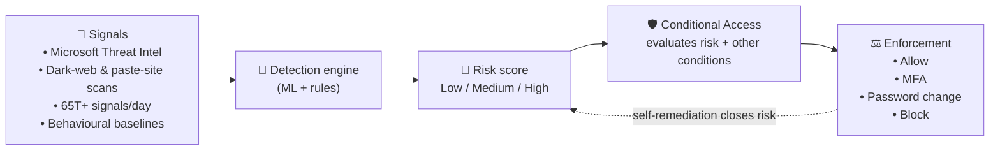
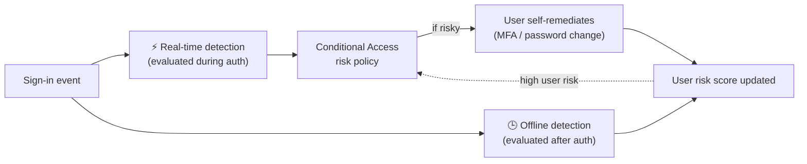
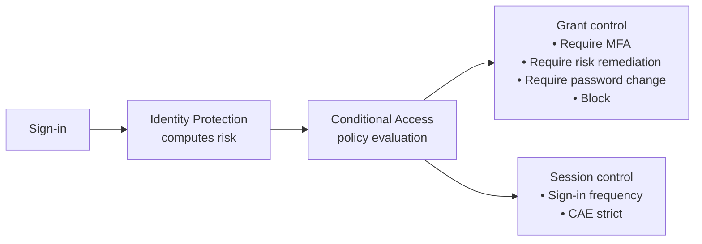
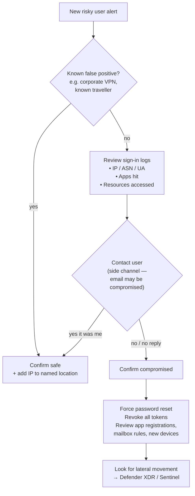
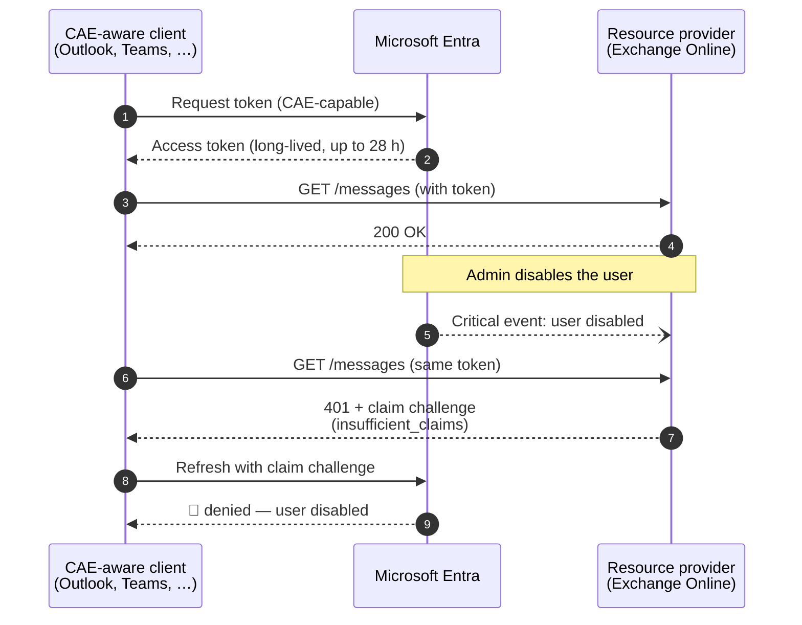

# Microsoft Entra ID Protection

> **TL;DR** — **Identity Protection** is Entra's **risk engine**. It consumes signals from Microsoft's security graph (trillions/day) and ML-scores every user and every sign-in on a scale of **Low / Medium / High** across ~20 detection types (leaked creds, atypical travel, anomalous token, password spray, …). You then **act on those risk scores through Conditional Access** — require MFA, force a secure password change, or block — and **Continuous Access Evaluation (CAE)** can revoke live tokens in near-real time when things change (user disabled, password reset, IP moved out of named location, high user risk raised).

---

## Table of contents

1. [Why Identity Protection exists](#1-why-identity-protection-exists)
2. [Key vocabulary](#2-key-vocabulary)
3. [License tiers — what you actually get](#3-license-tiers--what-you-actually-get)
4. [Risk levels and the real-time vs offline split](#4-risk-levels-and-the-real-time-vs-offline-split)
5. [Sign-in risk detections](#5-sign-in-risk-detections)
6. [User risk detections](#6-user-risk-detections)
7. [Workload identity risk detections](#7-workload-identity-risk-detections)
8. [Risk-based policies (now via Conditional Access)](#8-risk-based-policies-now-via-conditional-access)
9. [The three reports: investigation workflow](#9-the-three-reports-investigation-workflow)
10. [Risk feedback — teaching the model](#10-risk-feedback--teaching-the-model)
11. [Continuous Access Evaluation (CAE)](#11-continuous-access-evaluation-cae)
12. [Token theft and token protection](#12-token-theft-and-token-protection)
13. [Agents and Defender XDR integration](#13-agents-and-defender-xdr-integration)
14. [Cheat sheet](#14-cheat-sheet)
15. [Further reading](#15-further-reading)

---

## 1. Why Identity Protection exists

Conditional Access alone answers *"who / what / where / how"* at the moment of sign-in. It can't answer *"does this sign-in look like the real user?"* — because that requires looking at **billions of other sign-ins** and **threat intel feeds** the tenant doesn't see.

Identity Protection sits **between the authentication event and Conditional Access**:



**Key insight:** Identity Protection *scores*; Conditional Access *acts*. Historically Identity Protection had its own enforcement policies — those are being retired (see §8).

---

## 2. Key vocabulary

| Term | Meaning |
|---|---|
| **Risk detection** | A single suspicious event, e.g. "sign-in from anonymous IP". Each has a `riskEventType`. |
| **Sign-in risk** | Probability that *this particular sign-in* isn't the owner. Lives on the sign-in. |
| **User risk** | Probability that *this user account* is compromised. Aggregates all current signals about the user. |
| **Risk level** | `low` / `medium` / `high` — Microsoft's confidence (ML-derived). |
| **Risk state** | `none` / `atRisk` / `confirmedCompromised` / `remediated` / `dismissed` / `confirmedSafe`. |
| **Real-time detection** | Fires during the sign-in → can be enforced inline (5–10 min to surface in UI). |
| **Offline detection** | Fires after sign-in → up to **48h** to surface. Can still raise user risk. |
| **Self-remediation** | User closes their own risk by completing MFA or a **secure password change**. |
| **Risk feedback** | Admin marks a user/sign-in **Confirm compromised** or **Confirm safe** — this trains the model. |
| **CAE** | *Continuous Access Evaluation* — the token issuer and resource provider keep talking, so critical events revoke access near-real-time. |
| **Claim challenge** | HTTP 401 with a `WWW-Authenticate: Bearer` header telling a CAE-aware client *"this token's no good, go get a new one."* |
| **Workload identity** | Non-human principal (service principal / app registration). Can't do MFA, often has long-lived secrets. |

---

## 3. License tiers — what you actually get

| Capability | Free / M365 Apps | **Entra ID P1** | **Entra ID P2** | **Workload ID Premium** |
|---|---|---|---|---|
| View risky users list | Count only | Yes (details limited) | Yes (full detail) | – |
| View risky sign-ins | – | Count only | Yes (full detail) | – |
| Full list of risk detections (per event) | – | – | **Yes** | – |
| Risk-based Conditional Access (user risk / sign-in risk conditions) | – | – | **Yes** | – |
| MFA registration policy | – | Yes | Yes | – |
| Workload identity risk detection details | – | detections visible, no details | detections visible, no details | **Yes** |
| Risk-based CA for workload identities | – | – | – | **Yes** |
| Export to Log Analytics / SIEM via diagnostic settings | – | Yes | Yes | Yes |

> 💡 **Rule of thumb:** P2 = "Identity Protection, fully usable". P1 only gives you a glimpse that risk exists.

---

## 4. Risk levels and the real-time vs offline split

### Risk levels

| Level | Confidence | Notes |
|---|---|---|
| **High** | Microsoft is highly confident the account is compromised. Threat intel or confirmed signals (e.g. leaked credential match, verified threat actor IP) land here. | Persist until remediated or dismissed. |
| **Medium** | Moderate-severity anomalies; less certainty. | Persist until remediated or dismissed. |
| **Low** | Anomalies present but weak signal. | **Automatically age out after ~6 months** to keep reports clean. |

A single detection type can fire at different levels — e.g. *Unfamiliar sign-in properties* fires Low/Medium/High depending on how far from baseline. *Leaked credentials* and *Verified threat actor IP* are **always High**.

### Real-time vs offline



- **Real-time:** 5–10 min to appear in the reports; *can be enforced inline* (CA can block or step-up during the sign-in).
- **Offline:** up to **48 h**; can only be enforced *on the next sign-in* (but may raise user risk high enough to force a password change).

---

## 5. Sign-in risk detections

A sign-in is risky when *this specific authentication* looks wrong. Non-exhaustive — Microsoft adds new detections regularly; the canonical list is the [`concept-identity-protection-risks`](https://learn.microsoft.com/entra/id-protection/concept-identity-protection-risks) article.

| Detection | RT / Offline | What it means |
|---|---|---|
| **Anonymous IP address** | RT | Sign-in from Tor / anonymizing VPN. |
| **Atypical travel** | RT | Two sign-ins from locations that are physically impossible given the time gap (Microsoft Entra ML-based detection). |
| **Unfamiliar sign-in properties** | RT | Combo of IP/ASN, user-agent, country, device, etc. differs from the learned baseline. Learning-mode period is dynamic — **minimum 5 days** of history. |
| **Malicious IP address** | Offline | IP has an established bad reputation (brute force, password spray, etc.). |
| **Suspicious browser** | Offline | Browser/UA pattern deviates from the user's norm. |
| **Password spray** | RT / Offline | Microsoft observed a spray attack across tenants that successfully matched a password in yours. |
| **Impossible travel** | Offline | MDCA-sourced detection: activities from geographically distant locations within an impossible time window. Separate from (not a legacy name of) Atypical travel. |
| **New country** | Offline | First-ever sign-in from a country for this user (MDCA signal). |
| **Activity from anonymous IP (MDCA)** | Offline | Signal shared from Microsoft Defender for Cloud Apps. |
| **Microsoft Entra threat intelligence (sign-in)** | RT / Offline | IP/account tied to an active named campaign (e.g. nation-state) or a real-time rule. |
| **Verified threat actor IP** | RT | IP positively attributed to a tracked threat actor — **always High**. |
| **Anomalous token (sign-in)** | RT / Offline | Token exhibits characteristics inconsistent with legitimate issuance (e.g. unexpected lifetime, replay, mismatched client). Core signal for **token theft**. |
| **Token issuer anomaly** | Offline | SAML token issuer claims are unusual or match known attacker patterns. |
| **Suspicious inbox manipulation rules** | Offline | Signal from MDCA — attacker set up auto-forward/delete rules. |
| **Suspicious inbox forwarding** | Offline | Forward-to-external rule created (MDCA). |
| **Mass access to sensitive files** | Offline | Spike in SharePoint/OneDrive access post-sign-in (MDCA). |
| **Suspicious MFA authentication approval** | RT | Sign-in uses Password + Authenticator push, but unfamiliar ASN/browser/device/GPS and location-proximity analysis flag probable social-engineering / MFA-fatigue approval — **always High**. |
| **Additional risk detected (sign-in)** | RT / Offline | A premium detection fired on a tenant without P2 — details redacted. |
| **Admin confirmed user compromised** | Offline | Admin clicked *Confirm user compromised*. Flows to the sign-in. |

### What the UI shows for a risky sign-in

| Column | Why it matters |
|---|---|
| **Risk state / Risk level** | Current score at both sign-in and user level. |
| **Risk detail** | *User passed MFA, AI confirmed sign-in safe, Admin dismissed*… |
| **Detections linked to this sign-in** | Which rules fired — often multiple per sign-in. |
| **Token issuer type / Conditional Access** | Was CA applied? Which policies matched? |

---

## 6. User risk detections

A user is risky when *the account itself* looks compromised, independent of any one sign-in.

| Detection | Trigger | Risk level |
|---|---|---|
| **Leaked credentials** | Microsoft matched a credential from the dark web / paste sites / public GitHub / breach dumps / law-enforcement seizures against your tenant's current valid password. | **Always High** |
| **Microsoft Entra threat intelligence (user)** | Account activity matches a known campaign / IOC. | varies |
| **Possible attempt to access PRT** | Defender for Endpoint saw a PRT-access attempt on the device. | **High** |
| **Anomalous user activity** | Baseline-deviation across the user's directory operations. | varies |
| **Attacker in the Middle (AitM)** | MDCA detects an authentication session linked to a malicious reverse proxy (EvilProxy-style). | **High** |
| **Anomalous token (user)** | Token lifetime / replay / unfamiliar location — rolled up to the user. | varies |
| **Suspicious API traffic** | Abnormal Graph API or directory enumeration from the user — recon / exfil signal. | varies |
| **Suspicious credential addition** | New auth method registered under suspicious circumstances (potential attacker persistence). | RT, varies |
| **Suspicious sending patterns** | MDO signal — user sending suspicious email; at risk of being / is restricted from sending. | **Medium** |
| **User reported suspicious activity** | User denied an MFA prompt via *Report suspicious activity* (replaces the older "MFA fatigue / denied" categorisation). | varies |
| **Attacker-added device** | During *Require risk remediation*: threat intel flags a device joined under the user's identity as attacker-controlled. The Entra device object is disabled. | **High** |
| **Admin confirmed user compromised** | You clicked *Confirm compromised*. | **Always High** |
| **Additional risk detected (user)** | A premium detection fired on a tenant without P2 — details redacted. | varies |

> ⚠️ **Leaked credentials requires Password Hash Sync (PHS) for on-premises passwords.** If you're federated to on-prem AD without PHS, this detection is blind. Enable **Password Hash Sync** (even if you authenticate via AD FS) specifically to receive leaked-credential alerts — this is a well-known Microsoft recommendation. A cloud password reset remediates the risk for both cloud and on-prem credentials when PHS is enabled.

---

## 7. Workload identity risk detections

Service principals can't do MFA and often have credentials sitting in config files or Key Vault. Identity Protection extends risk scoring to them.

| Detection (workload) | Description |
|---|---|
| **Microsoft Entra threat intelligence** | SP activity matches known attack patterns. |
| **Suspicious sign-ins** | Learned baseline (2–60 days) across IP/ASN, target resource, user-agent, hosting/non-hosting IP, country, credential type. |
| **Leaked credentials** | Secret/key found in public GitHub, paste sites, or breach dumps — matched to a live credential in your tenant. |
| **Malicious application** | Microsoft already disabled the app (`DisabledDueToViolationOfServicesAgreement`). |
| **Suspicious application** | App looks like it might violate terms but hasn't been disabled yet. |
| **Anomalous service principal activity** | Admin-type SP suddenly makes unusual directory changes. |
| **Suspicious API traffic** | Abnormal MS Graph calls / directory enumeration (recon / exfil signal). |
| **Admin confirmed SP compromised** | Admin feedback. |

**Out of scope:** Managed Identities, multi-tenant apps you don't own.

**Remediation playbook for a compromised SP:**
1. Inventory every credential (secret, cert, federated credential) on the SP *and* the application object.
2. Add a **new** credential — prefer x.509 certs or federated credentials over client secrets.
3. Remove the old/compromised credentials.
4. Rotate any Key Vault secrets the SP could read.
5. Review app roles and consented delegated/application permissions.

---

## 8. Risk-based policies (now via Conditional Access)

### The deprecation you must know about

> ⚠️ **The legacy "User risk policy" and "Sign-in risk policy" blades inside Identity Protection are retiring on October 1, 2026.** There is **no automatic migration** — if you don't recreate them in Conditional Access, they'll simply stop working.

### The modern path — risk conditions in CA

Conditional Access has two user-specific conditions fed by Identity Protection:

- **Sign-in risk** (per-sign-in signal, real-time)
- **User risk** (per-user aggregate, mostly offline)



### Recommended baseline policies

| Policy | Condition | Control | Effect |
|---|---|---|---|
| **A. Block high user risk** | User risk = **High** | Block | Stops confirmed-compromise accounts cold until an admin acts. |
| **B. Remediate medium+ user risk** | User risk ≥ **Medium** | **Require risk remediation** (recommended — adaptive) *or* Require secure password change | User self-serves back to safe. Adaptive remediation handles passwordless too. |
| **C. MFA on medium+ sign-in risk** | Sign-in risk ≥ **Medium** | Require MFA + **Sign-in frequency: every time** | Steps up the suspicious sign-in; low-risk sign-ins stay frictionless. |
| **D. Block anonymous IP on high sign-in risk** | Sign-in risk = High | Block | Tight policy for sensitive apps. |
| **E. MFA registration** | New user | Require registration | Forces MFA enrolment on day one so policies A/B/C have something to prompt with. |

> ⚠️ Microsoft explicitly says **don't combine `signInRiskLevels` and `userRiskLevels` conditions in the same CA policy** — split them into separate policies. Precedence: **Require risk remediation** > **Require password change**; **Block** overrides everything.

### Adaptive "Require risk remediation"

This grant control is smarter than the old "password change" control:

- **Password user, risky:** forces secure password change.
- **Passwordless user (passkey / WHfB), risky:** revokes sessions and re-prompts.
- **Attacker-added device detected:** disables the Entra device object and re-prompts.

It also automatically pins **Authentication strength = MFA** and **Sign-in frequency = Every time**, so you don't have to configure those by hand.

> ⚠️ **Guest users** aren't supported by *Require risk remediation* — Entra can't revoke a guest's session. Use *Block* or a step-up MFA policy instead.

---

## 9. The three reports: investigation workflow

Identity Protection has **three** blades under *Protection → Identity Protection*:

| Report | Granularity | Primary use |
|---|---|---|
| **Risky users** | one row per user | Triage who is at risk *right now*. Confirm compromised / confirm safe. Reset password / revoke sessions. |
| **Risky sign-ins** | one row per sign-in | Dig into a specific session. See which detections fired on it. Confirm compromised / confirm safe. |
| **Risk detections** | one row per detection | Hunt by detection type (e.g. "show me all password-spray hits this month"). |

### Triage flow



### Required roles (least-privilege)

| Task | Role |
|---|---|
| View risk reports | Global Reader |
| View sign-in / audit logs | Reports Reader |
| Confirm compromised / safe, dismiss risk | Security Operator / Security Administrator |
| Create risk-based CA policies | Conditional Access Administrator |
| Workload identity risk reports | Security Reader (view) / Security Admin (act) |

---

## 10. Risk feedback — teaching the model

Risk feedback does two things: **closes the risk** (so the user isn't held in policy limbo) and **trains the model** (reduces false positives for everyone).

| Action | When to use | Effect |
|---|---|---|
| **Confirm compromised** | You verified this was an attacker. | Risk level → High; feeds into user risk aggregation; signal returned to Microsoft's ML. |
| **Confirm safe** | You verified it was the user. | Risk state → *confirmedSafe*; **do not use** just to clear noise — use *Dismiss* instead. |
| **Dismiss user risk** | Risk no longer relevant but you aren't certain it was safe. | Risk state cleared; doesn't train the model. |
| **(Auto) AI confirmed sign-in safe** | ID Protection decided after the fact it was a false positive, or the user remediated. | Reported in the UI; user-risk score adjusted automatically. |

> 💡 **Confirm safe is a strong statement** — it tells Microsoft "ignore this pattern for this user *and* use it as a training example". Use it for sanctioned VPN IPs, corporate pentests, legitimate overseas travel, etc.

---

## 11. Continuous Access Evaluation (CAE)

### The problem CAE solves

OAuth access tokens are valid for a fixed lifetime (default 1 h). If you disable a user at 14:03, their Outlook keeps working until the token expires. Shortening token lifetimes hurts UX and reliability without really fixing the problem.

**CAE** flips the model: the token issuer (Entra) and the resource provider (Exchange, SharePoint, Teams, MS Graph, Azure DevOps…) maintain a conversation, and either side can cause an **immediate re-evaluation**.

### Critical events (always on, every tenant)

These cause **near-real-time** access revocation (propagation ≤ 15 min, usually seconds):

| Critical event |
|---|
| User account deleted or disabled |
| Password changed or reset |
| MFA enabled for the user |
| Admin explicitly revokes refresh tokens (`Revoke-MgUserSignInSession`) |
| **High user risk** detected by Identity Protection |

### Conditional Access policy evaluation (resource-side)

Supported resource providers pull a subset of CA policies and enforce them in-line. Today:

- **Named-location (IP-based) policies** — if the user moves to a non-trusted IP, token is rejected instantly.
- (Other conditions still only evaluated at token acquisition.)

### How clients participate

A CAE-aware client receives a **claim challenge** (HTTP 401 with `www-authenticate: Bearer error="insufficient_claims"`) and knows to bypass its cache and go back to Entra for a fresh token. Non-CAE clients just keep using the token until it expires.



### Token lifetime trade-off

With CAE enabled and a CAE-capable client, tokens become **long-lived (up to 28 h)** instead of 1 h — stability goes up, and revocation goes *faster*, not slower, because it's event-driven.

### Strict location enforcement (Public Preview)

Default CAE accepts a grace window where the IP seen by Entra might differ from the IP seen by the resource (NAT, SNAT, split-tunnel VPN, SD-WAN). **Strictly enforce location policies** (Public Preview) removes that exception:

- Token is rejected immediately on *any* IP mismatch outside named locations.
- Opt-in via a CA session control.
- Only safe when egress IPs are **dedicated and enumerable** — in shared/dynamic egress networks it will cause blocks.

### Supported scope

- **Initial / fully-supported scope:** Exchange Online, SharePoint Online, Teams. MS Graph and Azure DevOps (GA August 2025) also support CAE.
- **Partial / platform-dependent:** OneDrive (varies by client), Office desktop clients (Current / Monthly Enterprise channels), Teams services (calls/chat don't honour IP-based CA).
- **Not supported:** guest users (Entra can't revoke a guest session).
- **CAE for workload identities:** separate feature; **Microsoft Graph only**, single-tenant service principals, up to 24-hour LLTs. Managed identities and third-party SaaS are out of scope.

### Gotchas

| Gotcha | What happens |
|---|---|
| CAE only honours **IPv4/IPv6 named locations**, not country/region or legacy MFA Trusted IPs. | If you use country conditions, CAE falls back to a 1-h token. |
| Sum of all IP ranges > **5 000** | CAE can't enforce location change in real time — falls back to 1-h token. Other events still work. |
| Push notifications | A push preview can appear before CAE re-evaluates. Tapping it triggers the check. |
| Guest accounts | Revocation and IP policies **not** enforced instantly. |
| Co-authoring in Office | Open documents may keep working until close; use SharePoint network location policy to shrink the window. |

---

## 12. Token theft and token protection

Token theft (session cookie exfil via AiTM phishing kits, infostealer malware) is the current dominant attack on identities with MFA. Identity Protection contributes through:

- **Anomalous token** / **Token issuer anomaly** detections — ML-based, offline.
- **AiTM** detection — observes characteristic proxy-phish patterns.
- **Possible attempt to access PRT** — from Defender for Endpoint on the device.

Pair these detections with **Token Protection** in Conditional Access (a session control that binds the access token to a specific device using a device-bound cryptographic key). Even if the cookie is stolen, the attacker's machine can't replay it. See the CA notes in `entra-id-conditional-access.md`.

**Investigation reference:** Microsoft's [token theft playbook](https://learn.microsoft.com/security/operations/token-theft-playbook).

---

## 13. Agents and Defender XDR integration

### Agent detections (newer)

With **Microsoft Entra Agent ID**, autonomous AI agents get their own identities and their own tab in *Risk detections → Agent detections*. In on-behalf-of flows (agent acting with a user's delegated permissions), risky activity is still attributed to the **user**, to avoid breaking the agent for everyone else.

### Defender XDR

Identity Protection risk detections surface in the **Microsoft Defender portal** as alerts under product **"AAD Identity Protection"**. This matters because:

- You can correlate an identity risk event with endpoint, email, and cloud-app alerts into a single **incident**.
- The MITRE ATT&CK chain view stitches the full attack path.
- UEBA (from Defender for Identity + Sentinel) adds on-prem AD signals that the pure cloud-only Identity Protection can't see (e.g. Kerberoasting, DCSync).

### Exporting risk data

Diagnostic settings on the tenant can stream to:

- **Log Analytics** (Sentinel / KQL hunting)
- **Event Hub** (any SIEM)
- **Storage Account** (archive / compliance)

Graph API collections (`riskyUsers`, `riskDetections`, `riskyServicePrincipals`, `servicePrincipalRiskDetections`) let you build custom automation and confirm-compromised programmatically.

---

## 14. Cheat sheet

```text
Risk engine        = Identity Protection       (needs P2 for full use)
Signal types       = Sign-in risk  (per session, mostly real-time)
                     User risk     (per account, mostly offline)
Risk levels        = Low  → ages out at 6 months
                     Med  → persists until remediated/dismissed
                     High → persists; "leaked creds" & "verified TA IP" are always High
Enforcement        = Conditional Access  (legacy IdP policies retire 2026-10-01)
Must-have policies = 1) Block High user risk
                     2) Require risk remediation on Med+ user risk
                     3) Require MFA on Med+ sign-in risk
                     4) MFA registration policy
Feedback           = Confirm compromised  (trains model, marks high risk)
                     Confirm safe         (trains model, adds to baseline)
                     Dismiss              (closes risk, does NOT train)
CAE critical events= User disabled / password change / MFA enabled
                     Admin token revoke / High user risk
CAE prop time      = ≤ 15 min; IP location = instant
CAE token lifetime = up to 28 h with CAE-capable client (not a weakness — event-driven revoke)
Named locations    = Must be IP-based for CAE location enforcement
                     Keep total IPs < 5 000, include IPv4 + IPv6
Workload identities= Separate licence (Workload ID Premium) for risk-based CA on SPs
Reports            = Risky users / Risky sign-ins / Risk detections
Export             = Diagnostic settings → Log Analytics / Event Hub / Storage
                     Graph: riskyUsers, riskDetections, riskyServicePrincipals
Related CA controls= Token protection, Authentication strength, Sign-in frequency = every time
```

---

## 15. Further reading

- Identity Protection overview — <https://learn.microsoft.com/entra/id-protection/overview-identity-protection>
- Risk detection types and levels — <https://learn.microsoft.com/entra/id-protection/concept-risk-detection-types>
- Risk detection and event types (full list) — <https://learn.microsoft.com/entra/id-protection/concept-identity-protection-risks>
- Risk-based access policies — <https://learn.microsoft.com/entra/id-protection/concept-identity-protection-policies>
- Configure risk policies (incl. migration from legacy) — <https://learn.microsoft.com/entra/id-protection/howto-identity-protection-configure-risk-policies>
- Investigate risk — <https://learn.microsoft.com/entra/id-protection/howto-identity-protection-investigate-risk>
- Remediate risks and unblock users — <https://learn.microsoft.com/entra/id-protection/howto-identity-protection-remediate-unblock>
- Workload identity risk — <https://learn.microsoft.com/entra/id-protection/concept-workload-identity-risk>
- Continuous Access Evaluation — <https://learn.microsoft.com/entra/identity/conditional-access/concept-continuous-access-evaluation>
- CAE strict location enforcement — <https://learn.microsoft.com/entra/identity/conditional-access/concept-continuous-access-evaluation-strict-enforcement>
- Token theft playbook — <https://learn.microsoft.com/security/operations/token-theft-playbook>
- Microsoft Security blog — Token tactics: prevent, detect, respond — <https://www.microsoft.com/security/blog/2022/11/16/token-tactics-how-to-prevent-detect-and-respond-to-cloud-token-theft>

**Related learning bits in this repo:** `entra-id-conditional-access.md` (CA policy mechanics, grant/session controls, Token Protection) · `entra-id-pim-governance.md` (PIM, access reviews) · `entra-id-advanced.md` (workload identities beyond risk, cross-tenant, Zero Trust)
