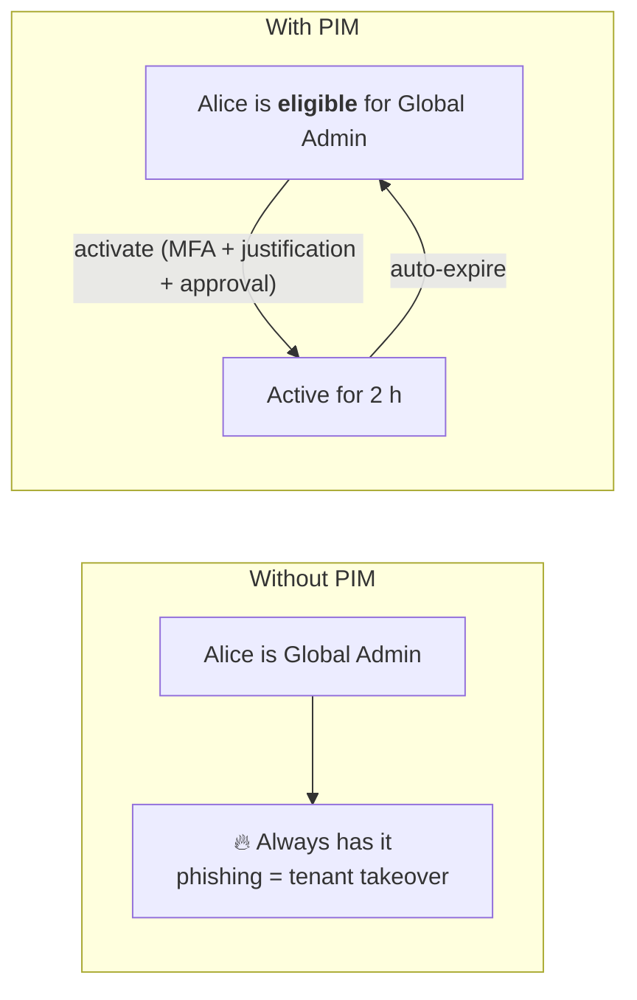
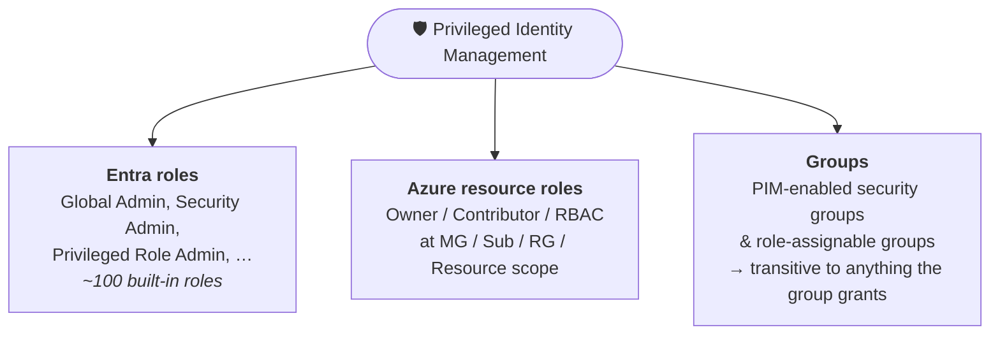
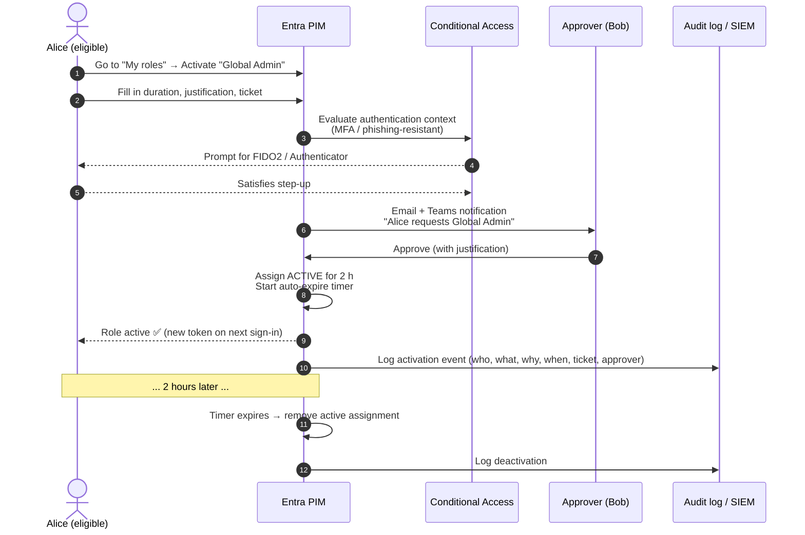
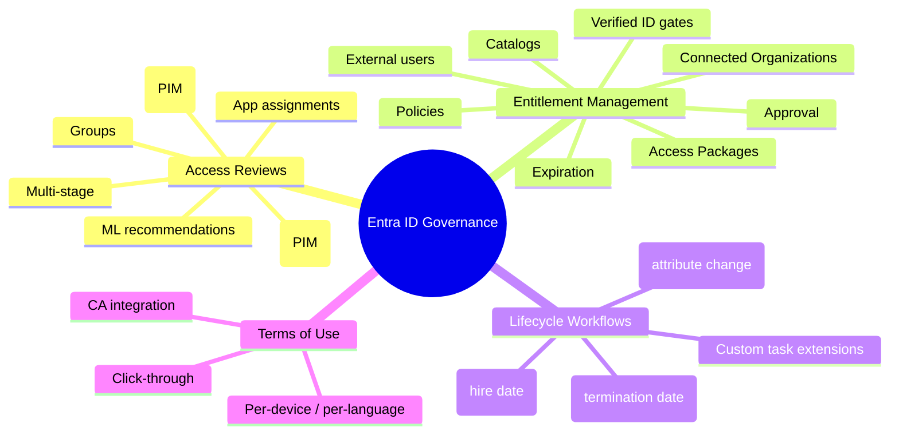
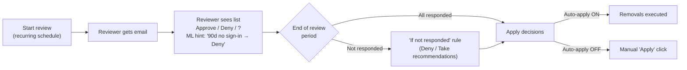
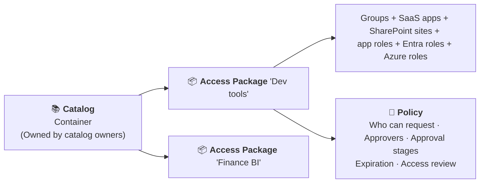
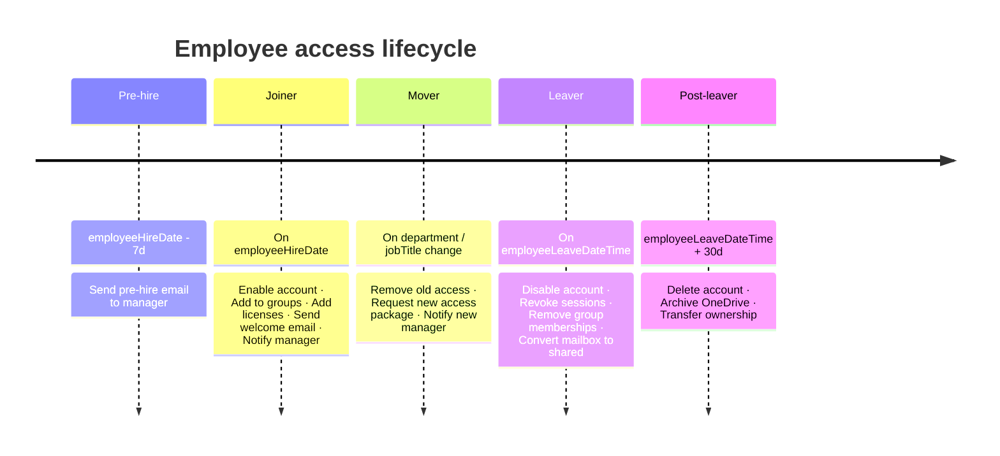
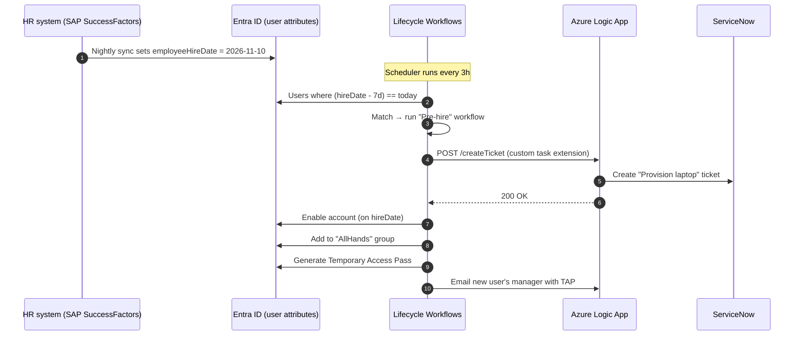
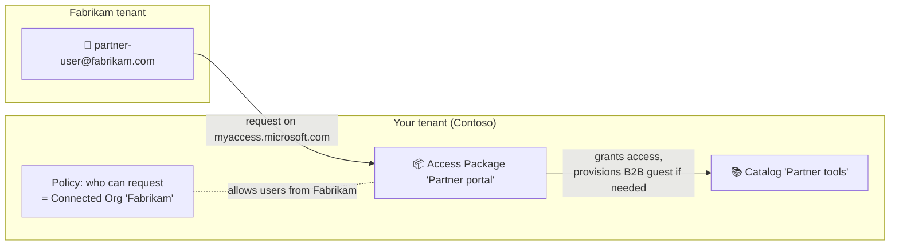

# Entra ID — Privileged Identity Management & ID Governance

> **TL;DR** — By default, Entra admin roles and resource access are **permanent**: once granted, a user *always* has them, whether they need them right now or not. **Privileged Identity Management (PIM)** flips this to **just-in-time**: you become *eligible* for a role, and you must **activate** it (with MFA, justification, often approval) for a short, time-boxed window. **Entra ID Governance** expands this idea to the full access lifecycle: **Access Reviews** (does this person still need it?), **Entitlement Management** (self-service access packages with approval and expiry), **Lifecycle Workflows** (joiner/mover/leaver automation), and **Terms of Use** (click-through legal gates). Together they turn "standing access" into "requested, reviewed, and revoked access".

---

## Table of contents

1. [Why PIM and Governance exist](#1-why-pim-and-governance-exist)
2. [Key vocabulary](#2-key-vocabulary)
3. [The PIM mental model](#3-the-pim-mental-model)
4. [Three scopes of PIM](#4-three-scopes-of-pim)
5. [Role / policy settings](#5-role--policy-settings)
6. [The activation flow](#6-the-activation-flow)
7. [Approval workflows](#7-approval-workflows)
8. [PIM alerts and audit](#8-pim-alerts-and-audit)
9. [Break-glass accounts](#9-break-glass-accounts)
10. [Entra ID Governance — what's in the box](#10-entra-id-governance--whats-in-the-box)
11. [Access Reviews](#11-access-reviews)
12. [Entitlement Management](#12-entitlement-management)
13. [Lifecycle Workflows](#13-lifecycle-workflows)
14. [Terms of Use](#14-terms-of-use)
15. [Connected Organizations](#15-connected-organizations)
16. [Licensing cheat sheet](#16-licensing-cheat-sheet)
17. [Cheat sheet](#17-cheat-sheet)
18. [Further reading](#18-further-reading)

---

## 1. Why PIM and Governance exist

Classical identity has three problems once an org gets past ~50 people:

- **Standing admin rights.** If every engineer keeps Global Admin permanently, a single phished account owns the tenant.
- **Access that never expires.** Projects end, people change teams — but group memberships, app assignments and role assignments *persist*.
- **No audit of "do you still need this?"** Compliance frameworks (SOX, ISO 27001, SOC 2) explicitly require periodic recertification.

| Problem | PIM / Governance answer |
|---|---|
| Too many standing admins | **PIM**: make admin roles *eligible* — activate when needed, auto-expire |
| Nobody checks group / app assignments | **Access Reviews**: recurring reviewer sign-off with auto-removal |
| Access requests via email/ticket chaos | **Entitlement Management**: self-service access packages with policy |
| Joiners miss tools, leavers keep access | **Lifecycle Workflows**: attribute-driven automation at hire / termination date |
| "Did they accept the AUP?" | **Terms of Use** policies gated by CA |

> 💡 **The red thread:** *access should be granted by request, time-boxed, approved by the right person, reviewed on a schedule, and removed automatically when it isn't needed anymore.*

---

## 2. Key vocabulary

| Term | Meaning |
|---|---|
| **Eligible assignment** | You *can* use the role, but you must **activate** it first. No permissions until you do. |
| **Active assignment** | You *have* the role right now (classical, permanent-style grant). |
| **Just-in-Time (JIT)** | The pattern of elevating only for a short period when needed. |
| **Activation** | The process of turning an eligible assignment into an active one for a bounded time. |
| **PIM policy / role settings** | Per-role rules: max activation duration, MFA required, approval required, justification required, notification recipients. |
| **Approver** | A principal (user or group) who must approve activation before permissions apply. |
| **Access Package** | A bundle of groups + apps + SharePoint sites that can be requested as one unit. |
| **Catalog** | A container for access packages and their underlying resources, owned by catalog admins. |
| **Access Review** | A recurring "attestation" cycle where a reviewer decides approve / deny / don't-know for each assignment. |
| **Lifecycle Workflow** | A set of ordered tasks (e.g. enable account → add to group → send welcome email) triggered on joiner / mover / leaver events. |
| **Terms of Use (ToU)** | A click-through document (PDF) users must accept before being granted access, enforced via a Conditional Access grant control. |
| **Connected Organization** | An external tenant or domain registered in your directory so its users can request your access packages. |

---

## 3. The PIM mental model



Two assignment types, two assignment durations → four combinations:

| | **Permanent** | **Time-bound** |
|---|---|---|
| **Eligible** | You can always activate (needs MFA+approval each time) | You can activate until a specific end date, then nothing |
| **Active** | Classical standing admin — **avoid for privileged roles** | Standing admin that disappears on a date (project access, contractors) |

> 💡 **The goal state for privileged roles:** zero permanent-active, a handful of permanent-eligible (for the sysadmins), everyone else time-bound-eligible via group membership.

---

## 4. Three scopes of PIM

PIM manages three different kinds of privileged access, each with its own blade and its own policy:



| Scope | What you elevate into | Needed for |
|---|---|---|
| **Entra roles** | Directory roles (Global Admin, User Admin, …) | Managing the tenant itself |
| **Azure resource roles** | Azure RBAC at Management Group / Subscription / Resource Group / Resource scope | Deploying infrastructure, reading resources, cost reader, etc. |
| **PIM for Groups** | Membership *or* ownership of a group | Scaling: use a group assigned to many things (SAML apps, SharePoint, M365 groups) — JIT applies to **everything** that group grants |

### Why PIM for Groups is a force multiplier

Instead of putting every admin in Global Administrator eligible-directly, you create a `tier0-admins` **role-assignable security group**, assign *it* the role permanently, then make users **eligible members of the group** via PIM. One policy, many users, and you can reuse the same group for app-level access too.

---

## 5. Role / policy settings

Every PIM-managed role (Entra role, Azure role, or group) has an attached **policy** controlling:

### Activation tab

| Setting | What it controls | Typical secure value |
|---|---|---|
| **Activation maximum duration** | How long an activation lasts (slider: 1–24 hours) | 1–8 hours (shorter = better) |
| **Require MFA on activation** | Must satisfy a strong auth method *now* | On (prefer Authentication Strengths + phishing-resistant for tier 0) |
| **Require justification** | Free-text reason box | On |
| **Require ticket information** | Ticket system + ticket number fields | On for roles with change-management scope |
| **Require approval** | Approver(s) must click Approve | On for Global Admin, Privileged Role Admin, Security Admin |

> ⚠️ "Require MFA on activation" **does not** force the user to prove MFA a second time if their session already has it. For step-up, pair with a **Conditional Access authentication strength**. See `entra-id-conditional-access.md`.

### Assignment tab

| Setting | What it controls |
|---|---|
| **Allow permanent eligible assignment** | Can admins assign "eligible forever"? |
| **Expire eligible assignments after** | Hard ceiling when permanent is off (e.g. 1 year) |
| **Allow permanent active assignment** | Can admins assign "active forever"? **Turn OFF for Global Admin.** |
| **Expire active assignments after** | Ceiling when permanent-active is off |
| **Require MFA on active assignment** | MFA at assignment creation time |
| **Require justification on active assignment** | Free-text at assignment creation |

### Notifications tab

Granular control over who gets emailed for each of: assignment created, approval pending, activation occurred. Recipients can be *role-assignees themselves*, *admins*, and *approvers* — three independent columns, three event types.

> 💡 **Send activation notifications to a SecOps distribution list.** Treat admin activations like login-anomalies: review in the SIEM.

---

## 6. The activation flow

What happens when Alice needs Global Admin for 2 hours:



Key points:

- **Activation issues a new token.** Existing access tokens don't magically gain the role — the user usually needs to sign out/in or wait for token refresh (~1 hour). Continuous Access Evaluation can shorten this.
- **Deactivation does not immediately kill in-flight tokens** either, unless CAE is enabled on the resource. For sensitive roles, keep activation short so the blast radius of a stolen token is small.
- The whole flow is captured in the **Entra audit log** under category `PIM`, and signals also appear in `Microsoft.Graph` activity.

---

## 7. Approval workflows

| Element | Behavior |
|---|---|
| **Approvers** | A set of users or groups. **Pick ≥ 2**: one approver = single point of failure. |
| **Self-approval** | The requester **cannot** approve their own request. Service principals also can't approve. |
| **Timeout** | Delegated approvers have **24 hours** to decide; after that, the request expires and must be re-submitted. The 24-hour window **is not configurable**. |
| **Default approvers** | If no specific approvers are configured on a role, active **Privileged Role Administrators** and **Global Administrators** become the default approvers. |
| **Notifications** | Email + Microsoft 365 "Approvals" app + Teams actionable card. |

**Multi-stage approval**: PIM activation itself is single-stage. For true multi-stage approval (e.g. manager → security team), model the role as an **access package** in Entitlement Management that assigns the user to a **PIM-eligible group**, and configure the access-package policy with up to **three** approval stages.

---

## 8. PIM alerts and audit

### Built-in alerts (ID Governance → PIM → Microsoft Entra roles → Alerts)

Readable by: Global Admin, Privileged Role Admin, Global Reader, Security Admin, Security Reader.

| Alert | Severity | What it flags | Tunable |
|---|---|---|---|
| **There are too many Global Administrators** | Low | Count *and* % of total role assignments both exceed thresholds | Count 2–100 + 0–100 % |
| **Roles are being assigned outside of Privileged Identity Management** | High | Someone added an assignment directly via Microsoft Graph / portal bypassing PIM | — |
| **Roles don't require multifactor authentication for activation** | Low | A role policy allows activation without MFA | — |
| **Potential stale accounts in a privileged role** | Medium | Account in a privileged role hasn't signed in for *n* days (1–365) — often shared/service accounts | Days (1–365) |
| **Administrators aren't using their privileged roles** | Low | Eligible admin hasn't activated in N days | Days (0–100) |
| **Roles are being activated too frequently** | Low | Same user activates ≥ N times within a time window | Count 2–100 + time window |
| **The organization doesn't have Microsoft Entra ID P2 or Microsoft Entra ID Governance** | Low | PIM premium features unavailable | — |

> 💡 **"Activated too frequently" is a tell.** If an admin activates 5× per day, either the activation window is too short, or the role is wrong-sized — carve a narrower role, or a group with just what they need.

### Audit history

- **PIM → Resource audit** — chronological log of assignment/activation events for one scope.
- **PIM → My audit** — the user's own actions.
- **Microsoft Entra sign-in logs** — show *who activated what* under "Authentication Details".
- **Microsoft Entra audit logs** — category `PIM`, loggable to **Log Analytics / Sentinel** via diagnostic settings for long retention + hunting.

Hunt example (KQL in Log Analytics):

```kusto
AuditLogs
| where Category == "RoleManagement"
| where OperationName in ("Add member to role completed (PIM activation)", "Add eligible member to role in PIM completed")
| extend Role = tostring(TargetResources[0].displayName), Actor = tostring(InitiatedBy.user.userPrincipalName)
| summarize Activations=count() by Actor, Role, bin(TimeGenerated, 1d)
| order by Activations desc
```

---

## 9. Break-glass accounts

PIM can lock you out: if MFA, approvers, or the CA policy chain fail, nobody can activate. **Always keep two break-glass (emergency access) accounts** that bypass PIM entirely.

| Property | Break-glass account |
|---|---|
| Role | Global Administrator, **permanent active** (not PIM-managed) |
| Name | Non-obvious, e.g. `breakglass-01@<tenant>.onmicrosoft.com` |
| Password | Long, random, stored in a **sealed envelope in a physical safe** (and/or a separate PAM vault) |
| MFA | FIDO2 key stored in the safe. **Exclude** from any CA policy that could lock them out (requires-compliant-device, named-locations, etc.) |
| Monitoring | High-priority Sentinel alert on **any sign-in** by these accounts |
| Testing | Use them **once a quarter** and log the drill |

> ⚠️ Excluding break-glass from CA ≠ no security. The password + FIDO2 are in physical custody; any sign-in is immediately alerted.

---

## 10. Entra ID Governance — what's in the box

Governance is an *additional* SKU on top of Entra ID P2. It adds:



What's in **Entra ID P2** vs **Entra ID Governance** has shifted — see §16.

---

## 11. Access Reviews

An **access review** is a recurring question: *"should this person still have this access?"*

### What can be reviewed

| Target | Why review it |
|---|---|
| **Group** (security / M365) | Memberships drift; teams change |
| **Application assignments** | Users keep SaaS licenses after role changes |
| **Entra roles** (PIM eligible or active) | Attest privileged access for SOX / ISO |
| **Azure resource roles** (PIM) | Owner/Contributor drift on prod subscriptions |
| **Access package assignments** | Did the reason still hold after N months? |
| **Catalog access reviews** | One review covers *every* access package in a catalog |
| **Inactive users / stale guests** | Remove users who haven't signed in for N days |

### Who reviews

| Reviewer type | When to use |
|---|---|
| **Self-review** | Users attest they still need their own access (cheap, low-assurance) |
| **Manager** | Best for employees — leverages `manager` attribute |
| **Group owner** | For the group being reviewed |
| **Selected users or groups** | Named reviewers (e.g. app owner, compliance) |
| **Multi-stage** | Up to **three** sequential stages — later stages can override earlier ones (e.g. manager → resource owner → security) |

### Decisions and auto-apply

| Decision | Effect on auto-apply |
|---|---|
| **Approve** | User keeps access |
| **Deny** | User **removed** from the group / assignment / role |
| **Don't know** | Nothing (unless "if reviewers don't respond" is set to deny) |

Key settings:

- **Auto-apply results to resource** — on expiry, denials are enforced automatically. Off = you must click "Apply".
- **If reviewers don't respond** — No change / Approve / Deny / **Take recommendations**.
- **Recurrence** — one-time / weekly / monthly / quarterly / semi-annually / annually.
- **Justification required** — force reviewers to type a reason (useful audit evidence).

### Machine-learning recommendations

Access Reviews surface two kinds of recommendation to help reviewers decide:

- **Inactive user** — Deny suggested for users who haven't signed in to the tenant in the last 30 days (or, for application reviews, haven't accessed the app).
- **User-to-group affiliation** — an ML model scores each user by how close they sit to the rest of the group in the org reporting chart; outliers get a Deny suggestion. Requires Entra ID Governance; groups > 600 members not supported.

If "Take recommendations" is enabled, unreviewed users get the system's recommendation at review end — this is what makes 10 000-member group reviews tractable.



---

## 12. Entitlement Management

### The three nouns



| Noun | Purpose |
|---|---|
| **Catalog** | Groups related resources. Delegated owner model — HR owns HR catalog, eng owns dev catalog. |
| **Access Package** | A *bundle* of resources a user can request as one item. Includes **policies**. |
| **Policy** | Rules for one way of getting into the package: audience, approval, expiration, access reviews. One access package can have multiple policies (e.g. "internals auto-approve 30 days", "externals need manager + 7 days"). |

### What a resource can be

Inside a package you can attach:

- **Microsoft Entra groups** (security or M365) → cascades to anything the group grants (SAML apps, licenses, team membership)
- **Entra Enterprise applications** (with or without specific app roles)
- **SharePoint Online sites** (direct role assignment)
- **Microsoft Entra roles** (requires Governance SKU)
- **Azure RBAC at Management Group / Subscription / Resource Group** scopes — both **Eligible** (PIM-activated) and **Active** role types are supported ([docs](https://learn.microsoft.com/en-us/entra/id-governance/entitlement-management-azure-role-assignments))

### Policy anatomy

| Policy field | What it does |
|---|---|
| **Who can request** | Internal users / specific groups / users from connected organizations / all external users |
| **Approval required** | Yes/No, how many stages (up to 3) |
| **Stage approvers** | Manager / specific users / group / sponsor from connected org |
| **Alternate approvers** | Fallback after N days if stage approver is silent |
| **Justification** | Required / optional |
| **Questions** | Custom questions shown at request time (e.g. "cost center?") |
| **Expiration** | Number of days, specific date, or on-demand review |
| **Access reviews** | Attach a recurring review to this policy's assignments |
| **Verified ID gating** | Request a verifiable credential (e.g. employment proof) before approval — modern feature |

### External users

Access packages can *provision* a guest B2B account on request-approval if the requester isn't in the tenant yet. Combined with **Connected Organizations** (§15), partners can self-serve access without IT touching the tenant per-user.

### What the user sees

`myaccess.microsoft.com` — a self-service portal listing available packages, their current assignments and pending requests. No admin ticket needed.

---

## 13. Lifecycle Workflows

### The idea

Users have three major transitions. Each should fire a set of tasks automatically.



### Triggers

| Trigger kind | Driver |
|---|---|
| **Automatic / scheduled** | A user attribute (`employeeHireDate`, `employeeLeaveDateTime`) crosses a time offset, evaluated by the LCW scheduler (default every 3 hours). |
| **On-demand** | An admin kicks it off against a specific user set. Useful for testing and for ad-hoc "re-run leaver on this stale account". |

Scope is an **attribute-based rule** (e.g. `department eq 'Engineering'`). You can have many workflows — up to **100** per tenant.

### Built-in tasks (non-exhaustive)

- Enable / disable user account
- Add / remove from a group
- Add / remove from an Entra role
- Request / remove assignment to an access package
- Send welcome / offboarding / manager email
- Revoke all refresh tokens
- Generate temporary access pass
- Convert mailbox to shared
- Delete user

### Custom task extensions

When a built-in task isn't enough, a **custom task extension** calls an **Azure Logic App** via an authenticated webhook. The Logic App can:

- Call Graph for operations LCW doesn't ship (e.g. set extension attribute)
- Call ServiceNow / Jira / HR system APIs
- Post to Teams / Slack
- Create a ticket

Limit: **100 custom task extensions** per tenant.



---

## 14. Terms of Use

### What it is

A click-through PDF users must accept, enforced as a **grant control** in Conditional Access. On first encounter (and on new versions), the user sees a page: *"To continue, you must review and accept the following Terms of Use"*. Decline = no access.

### Features

| Feature | Notes |
|---|---|
| **PDF content** | Upload per language (locale auto-match) |
| **Require acceptance every N days** | Re-consent cadence |
| **Expire consents** | Yes/No + per-user override |
| **Per-device** | Ask once per device, not once per session |
| **Reporting** | Who accepted, when, from which IP; **export per-user acceptance history** |

### How it's enforced

1. Create ToU in **Identity Governance → Terms of use**.
2. Create / edit a **Conditional Access policy**, add **Grant → Require terms of use** as a control.
3. Target users, apps, conditions as normal.

> 💡 Classic use: an "all users must accept the AUP" CA policy that applies everywhere. For admins, add a *separate* ToU gated to admin portals — see Microsoft's prebuilt [admin-portal terms of use policy](https://learn.microsoft.com/en-us/entra/identity/conditional-access/policy-all-users-require-terms-of-use).

---

## 15. Connected Organizations

A **Connected Organization** registers an external tenant (another Entra tenant) or a domain (for Microsoft Account / SAML partners) so its users can request *your* access packages.



| Property | Detail |
|---|---|
| **Identity sources** | External Entra tenant, Microsoft Account, OIDC-federated IdP, or arbitrary email domain |
| **Sponsor** | A principal in your tenant who can approve requests from the connected org |
| **State** | Configured / Proposed / — proposed orgs are "known but unconfigured", can be promoted |
| **Scope in a policy** | A policy targets "specific connected organizations" vs "all" — pick list in the access-package policy |

If you can't model the external party as a Connected Org, fall back to **groups** (sync or manual) of those users and target the policy at the group.

---

## 16. Licensing cheat sheet

Rapidly evolving — check Microsoft's licensing guide, but as of late 2026:

| Feature | Entra ID P1 | Entra ID P2 | Entra ID Governance |
|---|---|---|---|
| **PIM for Entra roles** | — | ✅ | ✅ |
| **PIM for Azure resources** | — | ✅ | ✅ |
| **PIM for Groups** | — | ✅ | ✅ |
| **Access Reviews** (groups, apps) | — | ✅ | ✅ |
| **Access Reviews with ML recommendations** | — | ✅ | ✅ |
| **Entitlement Management** (groups / apps / SharePoint) | — | ✅ | ✅ |
| **Entitlement Management: Entra roles, Azure roles in packages** | — | — | ✅ |
| **Lifecycle Workflows** | — | — | ✅ |
| **Custom task extensions** | — | — | ✅ |
| **Automatic assignment policies (attribute-driven)** | — | — | ✅ |
| **Terms of Use** | ✅ | ✅ | ✅ |

> ⚠️ Microsoft shifts features between SKUs; **only users who** *consume* **the premium feature need the license**, not everyone in the tenant. Read `entra/fundamentals/whats-new` before a renewal.

---

## 17. Cheat sheet

```text
--- PIM mental model ---
Eligible assignment = you CAN use the role, must activate first
Active assignment   = you HAVE the role now
Just-in-Time        = eligible + short-lived activation

--- PIM scopes ---
1. Entra roles          (Global Admin, User Admin, …)
2. Azure resource roles (MG/Sub/RG/Resource RBAC)
3. Groups               (PIM-enabled security / role-assignable)

--- PIM policy knobs ---
Activation:  max duration · MFA · justification · ticket · approval
Assignment:  permanent? · expire-after · MFA on assign · justification on assign
Notification: role-assignee / admin / approver × assigned/approval/activation

--- PIM essentials ---
Approvers: pick ≥ 2 · 24h timeout · requester can't self-approve
Alerts: too-many-GAs, assignments-outside-PIM, no-MFA, idle-admins, too-frequent-activations
Audit:  Entra audit log (PIM) + sign-in log + stream to Sentinel

--- Break-glass ---
2 accounts · permanent Global Admin · physical vault · excluded from CA · alerted on sign-in · drilled quarterly

--- Governance verbs ---
Catalog                 — container
Access Package          — bundle of resources
Policy                  — who/how for one access path
Access Review           — recurring attestation
Lifecycle Workflow      — joiner/mover/leaver automation
Terms of Use            — click-through gated by CA
Connected Organization  — external tenant that can request your packages

--- Access review decisions ---
Approve · Deny · Don't know
Auto-apply ON         = removals happen on expiry
If not responded =    No change | Approve | Deny | Take recommendations

--- Lifecycle Workflow triggers ---
Automatic: hireDate / leaveDateTime offset (scheduler ~3h)
On-demand: ad-hoc run against a user set
Custom task extension → Azure Logic App → anything
```

---

## 18. Further reading

**PIM**

- Microsoft: What is Privileged Identity Management — <https://learn.microsoft.com/en-us/entra/id-governance/privileged-identity-management/pim-configure>
- Microsoft: Configure Entra role settings in PIM — <https://learn.microsoft.com/en-us/entra/id-governance/privileged-identity-management/pim-how-to-change-default-settings>
- Microsoft: PIM for Groups (concept) — <https://learn.microsoft.com/en-us/entra/id-governance/privileged-identity-management/concept-pim-for-groups>
- Microsoft: Configure PIM for Groups settings — <https://learn.microsoft.com/en-us/entra/id-governance/privileged-identity-management/groups-role-settings>
- Microsoft: Assign Azure resource roles in PIM — <https://learn.microsoft.com/en-us/entra/id-governance/privileged-identity-management/pim-resource-roles-assign-roles>
- Microsoft: Approval workflow for PIM for Groups — <https://learn.microsoft.com/en-us/entra/id-governance/privileged-identity-management/groups-approval-workflow>
- Microsoft: PIM deployment plan — <https://learn.microsoft.com/en-us/entra/id-governance/privileged-identity-management/pim-deployment-plan>
- Microsoft: Security operations for PIM (alerts, hunting) — <https://learn.microsoft.com/en-us/entra/architecture/security-operations-privileged-identity-management>

**Governance**

- Microsoft: What is Entra ID Governance — <https://learn.microsoft.com/en-us/entra/id-governance/identity-governance-overview>
- Microsoft: What is Entitlement Management — <https://learn.microsoft.com/en-us/entra/id-governance/entitlement-management-overview>
- Microsoft: Plan Access Reviews deployment — <https://learn.microsoft.com/en-us/entra/id-governance/deploy-access-reviews>
- Microsoft: Access review recommendations — <https://learn.microsoft.com/en-us/entra/id-governance/review-recommendations-access-reviews>
- Microsoft: Multi-stage access reviews — <https://learn.microsoft.com/en-us/entra/id-governance/using-multi-stage-reviews>
- Microsoft: What are lifecycle workflows — <https://learn.microsoft.com/en-us/entra/id-governance/what-are-lifecycle-workflows>
- Microsoft: Lifecycle workflow templates — <https://learn.microsoft.com/en-us/entra/id-governance/lifecycle-workflow-templates>
- Microsoft: Plan a Lifecycle Workflow deployment — <https://learn.microsoft.com/en-us/entra/id-governance/lifecycle-workflows-deployment>
- Microsoft: Terms of Use overview — <https://learn.microsoft.com/en-us/entra/identity/conditional-access/terms-of-use>
- Microsoft: Require ToU for admin portals (template) — <https://learn.microsoft.com/en-us/entra/identity/conditional-access/policy-all-users-require-terms-of-use>
- Microsoft: What's new in Entra — <https://learn.microsoft.com/en-us/entra/fundamentals/whats-new>

**Related learning bits**

- `entra-id-basics.md` — MFA, authentication methods, Security Defaults
- `entra-id-conditional-access.md` — how ToU, MFA, and authentication strength are enforced
- `entra-id-identity-protection.md` — user/sign-in risk, CAE
- `entra-id-advanced.md` — workload identities, cross-tenant, Zero Trust
