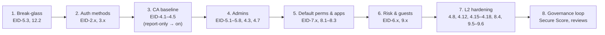

# Entra ID — Security Controls Baseline (CIS-style)

> **TL;DR** — A tenant hardening baseline for Microsoft Entra ID written as **auditable controls**. Each control has a **title**, a **description** (what it does and why it matters), the **UI location** where you set it in the Microsoft Entra admin center (`entra.microsoft.com`), the **value** to set, and a **pass/fail audit** check. Controls are grouped into 12 domains and tagged with a **level** (**L1** = do it everywhere, low friction; **L2** = high-security tenants, needs planning), the **license** they require, and the **[Microsoft cloud security benchmark (MCSB) v2](https://learn.microsoft.com/security/benchmark/azure/)** control they satisfy. The numeric thresholds come from Microsoft's published guidance: **fewer than 5 Global Administrators** (MCSB recommends 2–4) and **fewer than 10 privileged role assignments** ([Entra RBAC best practices](https://learn.microsoft.com/entra/identity/role-based-access-control/best-practices)). Also **2 cloud-only break-glass accounts** and **no standing admin access**. The theory behind each area lives in the sibling notes. This file is the checklist.

---

## Table of contents

1. [How to read this baseline](#1-how-to-read-this-baseline)
2. [Control summary](#2-control-summary)
3. [Domain 1 — Tenant properties & baseline](#3-domain-1--tenant-properties--baseline)
4. [Domain 2 — Authentication methods & MFA](#4-domain-2--authentication-methods--mfa)
5. [Domain 3 — Passwords & self-service password reset](#5-domain-3--passwords--self-service-password-reset)
6. [Domain 4 — Conditional Access](#6-domain-4--conditional-access)
7. [Domain 5 — Privileged access (roles, PIM, break-glass)](#7-domain-5--privileged-access-roles-pim-break-glass)
8. [Domain 6 — Identity Protection (risk)](#8-domain-6--identity-protection-risk)
9. [Domain 7 — Default user permissions](#9-domain-7--default-user-permissions)
10. [Domain 8 — Applications, consent & workload identities](#10-domain-8--applications-consent--workload-identities)
11. [Domain 9 — External identities & guests](#11-domain-9--external-identities--guests)
12. [Domain 10 — Devices](#12-domain-10--devices)
13. [Domain 11 — Hybrid identity](#13-domain-11--hybrid-identity)
14. [Domain 12 — Logging, monitoring & governance](#14-domain-12--logging-monitoring--governance)
15. [Rollout order](#15-rollout-order)
16. [Further reading](#16-further-reading)

---

## 1. How to read this baseline

Every control follows the same template:

| Field | Meaning |
|---|---|
| **ID / Title** | `EID-<domain>.<n>`, written as an *"Ensure …"* statement, like CIS |
| **Level** | **L1** = baseline for every tenant, little user impact · **L2** = defense in depth, needs a pilot or more licenses |
| **License** | **Free** · **P1** (Entra ID P1 / M365 E3 / Business Premium) · **P2** (Entra ID P2 / M365 E5) · **Gov** (Entra ID Governance) · **WID** (Workload ID Premium) |
| **MCSB** | Microsoft cloud security benchmark v2 control (IM = Identity Management, PA = Privileged Access, LT = Logging & Threat Detection). Shown in the [control summary](#2-control-summary) only |
| **Description** | What the control does and the attack it stops, in one or two sentences |
| **Enforce in UI** | Bold line = portal path (or CA policy name); `•` lines = setting → **value to set** |
| **Audit** | How to prove it passes |

> **Portal paths drift.** Microsoft renames blades often. The paths below match the current left nav (**Entra ID**, **ID Protection**, **ID Governance**). If a path has moved, search for the **setting name**. Setting names change far less often than menus.

> **Break-glass rule for every CA control in this file.** Every Conditional Access policy **excludes the emergency-access group** (EID-5.3), and nothing else is excluded without a documented exception.

---

## 2. Control summary

| ID | Control | Level | License | MCSB |
|---|---|---|---|---|
| **1 — Tenant properties & baseline** |||||
| EID-1.1 | Security Defaults on **or** a CA baseline in force (never neither) | L1 | Free/P1 | IM-6 |
| EID-1.2 | Technical & security contacts populated | L1 | Free | IR-2 |
| EID-1.3 | "Access management for Azure resources" is **No** | L1 | Free | PA-1 |
| EID-1.4 | Identity Secure Score reviewed monthly, target ≥ 80% | L1 | Free | IM-2 |
| **2 — Authentication methods & MFA** |||||
| EID-2.1 | Passkeys (FIDO2) enabled, with attestation for admins | L1 | Free | IM-6 |
| EID-2.2 | Microsoft Authenticator enabled (push + passkey) | L1 | Free | IM-6 |
| EID-2.3 | SMS / Voice call disabled (or scoped to an exception group) | L2 | Free | IM-6 |
| EID-2.4 | Email OTP disabled for members | L1 | Free | IM-6 |
| EID-2.5 | Temporary Access Pass enabled, one-time use | L1 | Free | IM-6 |
| EID-2.6 | System-preferred MFA enabled | L1 | Free | IM-6 |
| EID-2.7 | "Report suspicious activity" enabled | L1 | Free | IM-2 |
| EID-2.8 | Registration campaign nudges users to Authenticator/passkey | L1 | Free | IM-6 |
| EID-2.9 | Legacy per-user MFA disabled for all users | L1 | P1 | IM-6 |
| **3 — Passwords & SSPR** |||||
| EID-3.1 | Custom banned password list enforced | L1 | P1 | IM-6 |
| EID-3.2 | Smart lockout threshold ≤ 10 | L1 | Free | IM-6 |
| EID-3.3 | Password Protection for on-prem AD in **Enforced** mode | L1 | P1 | IM-6 |
| EID-3.4 | SSPR enabled for all users, 2 methods required | L1 | P1 | IM-6 |
| EID-3.5 | SSPR notifies users and all admins on reset | L1 | P1 | IM-2 |
| EID-3.6 | Security questions not an SSPR method | L1 | P1 | IM-6 |
| EID-3.7 | Cloud passwords set to never expire (with MFA in place) | L1 | Free | IM-6 |
| **4 — Conditional Access** |||||
| EID-4.1 | Block legacy authentication | L1 | P1 | IM-6, IM-7 |
| EID-4.2 | Require MFA for all users, all resources | L1 | P1 | IM-6 |
| EID-4.3 | Require phishing-resistant MFA for admin roles | L1 | P1 | IM-6, PA-1 |
| EID-4.4 | Require MFA for Azure management | L1 | P1 | IM-6 |
| EID-4.5 | Secure security-info registration | L1 | P1 | IM-6 |
| EID-4.6 | Block device code flow & authentication transfer | L1 | P1 | IM-7 |
| EID-4.7 | Admin sessions: sign-in frequency ≤ 4 h, no persistent browser | L1 | P1 | PA-6 |
| EID-4.8 | Require compliant / hybrid-joined device for admins | L2 | P1 + Intune | PA-6, IM-7 |
| EID-4.9 | Require MFA for guests / external users | L1 | P1 | IM-6 |
| EID-4.10 | Block access from unneeded countries | L2 | P1 | IM-7 |
| EID-4.11 | Require MFA to register or join devices | L1 | P1 | IM-6 |
| EID-4.12 | Token protection for admin sessions (Windows) | L2 | P1 | IM-7 |
| EID-4.13 | No policy left in report-only longer than 30 days; exclusions reviewed | L1 | P1 | IM-7 |
| EID-4.14 | Continuous access evaluation (CAE) left on; strict location enforcement where networks allow | L1 | P1 | IM-7 |
| EID-4.15 | Require **Passwordless MFA** strength for standard users (legacy-app exceptions fall back to MFA strength) | L2 | P1 | IM-6 |
| EID-4.16 | Require managed device or app protection policy for sensitive apps & mobile | L2 | P1 + Intune | IM-7 |
| EID-4.17 | Location controls for sensitive apps: MFA/block outside trusted IPs; anonymous IP blocked | L2 | P1/P2 | IM-7 |
| EID-4.18 | Session controls for sensitive apps & unmanaged devices (short SIF, MDCA download/copy block) | L2 | P1 + MDCA | IM-7 |
| **5 — Privileged access** |||||
| EID-5.1 | Fewer than 5 Global Administrators (target 2–4, incl. break-glass) | L1 | Free | PA-1 |
| EID-5.2 | Fewer than 10 privileged role assignments | L1 | Free | PA-1, PA-7 |
| EID-5.3 | Two cloud-only emergency-access accounts | L1 | Free | PA-5 |
| EID-5.4 | Admin accounts are cloud-only, dedicated, unlicensed for productivity | L1 | Free | PA-1 |
| EID-5.5 | No standing privileged assignments; PIM eligible only | L1 | P2 | PA-2 |
| EID-5.6 | PIM activation requires MFA/auth context, justification, ≤ 8 h | L1 | P2 | PA-2 |
| EID-5.7 | PIM approval required for Global Admin & Privileged Role Admin | L1 | P2 | PA-2 |
| EID-5.8 | PIM notifications on privileged role activation | L1 | P2 | PA-2, LT-2 |
| EID-5.9 | Quarterly access review of privileged roles | L1 | P2/Gov | PA-4 |
| EID-5.10 | Use least-privileged built-in roles or scoped (AU) roles, not GA | L1 | Free/P1 | PA-7 |
| EID-5.11 | Role-assignable groups for roles; PIM for Groups | L2 | P2 | PA-2 |
| EID-5.12 | Restricted management AUs protect sensitive accounts | L2 | P1 | PA-1 |
| **6 — Identity Protection** |||||
| EID-6.1 | CA: high user risk → secure password change / risk remediation | L1 | P2 | IM-7, LT-2 |
| EID-6.2 | CA: medium+ sign-in risk → MFA (high → block for admins) | L1 | P2 | IM-7, LT-2 |
| EID-6.3 | Legacy Identity Protection risk policies migrated to CA | L1 | P2 | IM-7 |
| EID-6.4 | Risk alert & weekly digest e-mails configured | L1 | P2 | LT-2 |
| EID-6.5 | Risky users / sign-ins triaged on an SLA | L1 | P2 | LT-2, IR-3 |
| **7 — Default user permissions** |||||
| EID-7.1 | Users can register applications: **No** | L1 | Free | IM-3 |
| EID-7.2 | Restrict non-admin users from creating tenants: **Yes** | L1 | Free | PA-1 |
| EID-7.3 | Users can create security groups: **No** | L1 | Free | PA-7 |
| EID-7.4 | Microsoft 365 group creation restricted to a group | L2 | P1 | PA-7 |
| EID-7.5 | Users can create agent blueprints: **No** | L1 | Free | IM-3 |
| EID-7.6 | LinkedIn account connections: **No** | L1 | Free | DP |
| EID-7.7 | Restrict access to admin portal: **Yes** (friction only; pair with CA) | L1 | Free | PA-7 |
| EID-7.8 | Restrict non-admins from recovering BitLocker keys: **Yes** | L1 | Free | DP |
| **8 — Applications & consent** |||||
| EID-8.1 | User consent: none, or verified publishers + low-impact only | L1 | Free | IM-3 |
| EID-8.2 | Admin consent workflow enabled with named reviewers | L1 | Free | IM-3 |
| EID-8.3 | Group owner consent disabled | L1 | Free | IM-3 |
| EID-8.4 | App management policy blocks client secrets / caps credential lifetime | L2 | WID* | IM-3, IM-8 |
| EID-8.5 | High-privilege app permissions reviewed quarterly | L1 | Free | IM-3, PA-4 |
| EID-8.6 | Apps holding Tier-0 permissions have no individual owners | L1 | Free | PA-1 |
| EID-8.7 | Managed identities / federated credentials instead of secrets | L1 | Free | IM-3 |
| EID-8.8 | "Assignment required" on sensitive enterprise apps | L1 | Free | IM-7 |
| EID-8.9 | CA for workload identities (location / risk) | L2 | WID | IM-7 |
| **9 — External identities & guests** |||||
| EID-9.1 | Guest access restricted to own directory objects | L1 | Free | PA-7 |
| EID-9.2 | Guest invites limited to admins & Guest Inviter role | L1 | Free | PA-3 |
| EID-9.3 | Collaboration restrictions: allowlist (or denylist) of domains | L2 | Free | PA-3 |
| EID-9.4 | Guest self-service sign-up via user flows: **No** | L1 | Free | PA-3 |
| EID-9.5 | Cross-tenant access: default inbound locked down, MFA trust per partner | L2 | Free/P1 | IM-1 |
| EID-9.6 | Tenant restrictions v2 configured | L2 | P1 | IM-1 |
| EID-9.7 | Guest access reviewed quarterly; inactive guests removed | L1 | P2/Gov | PA-4 |
| **10 — Devices** |||||
| EID-10.1 | Users may join devices: **Selected** (or None) | L1 | Free | ES |
| EID-10.2 | Max devices per user ≤ 20 | L1 | Free | ES |
| EID-10.3 | Additional local admins on joined devices: **None** | L1 | Free | PA-7 |
| EID-10.4 | Entra LAPS enabled | L1 | Free | PA-7 |
| **11 — Hybrid identity** |||||
| EID-11.1 | Password hash sync enabled (leaked-credential detection, DR) | L1 | Free | IM-1, IM-2 |
| EID-11.2 | Entra Connect / Cloud Sync servers treated as Tier 0 | L1 | Free | IM-2 |
| EID-11.3 | Hard-match & soft-match takeover blocked | L1 | Free | IM-2 |
| EID-11.4 | No synced accounts in privileged roles | L1 | Free | PA-1 |
| **12 — Logging, monitoring & governance** |||||
| EID-12.1 | All Entra log categories exported (≥ 1 year retention) | L1 | P1 | LT-3, LT-6 |
| EID-12.2 | Alert on any break-glass sign-in | L1 | P1 | PA-5, LT-2 |
| EID-12.3 | Alerts on high-risk changes (role add, CA change, new credential) | L1 | P1 | LT-2 |
| EID-12.4 | Inactive users (> 90 days) disabled | L1 | P1/Gov | PA-3 |
| EID-12.5 | Lifecycle workflows for joiner / mover / leaver | L2 | Gov | PA-3 |
| EID-12.6 | Defender for Identity deployed on DCs/AD FS/AD CS (hybrid) | L2 | MDI | LT-2 |

\* App management policies: basic tenant-wide restrictions need Workload ID Premium for full use. Check the current licensing note on the docs page.

---

## 3. Domain 1 — Tenant properties & baseline

| ID | Control | Level | License | Description | Enforce in UI | Audit |
|---|---|---|---|---|---|---|
| **EID-1.1** | Ensure Security Defaults is enabled **or** a Conditional Access baseline is enforced | L1 | Free (Security Defaults) / P1 (CA) | One MFA engine must be on: Security Defaults (no P1) or a CA baseline (P1). They can't run together, and with **neither** there's no MFA beyond Microsoft's mandatory admin-portal MFA. | **No P1:** Entra ID → Overview → Properties → **Manage security defaults** → **Enabled**<br>**P1+:** build EID-4.1–4.5 first, then Security Defaults → **Disabled** | Security Defaults = Enabled, **or** at least one *enabled* (not report-only) CA policy that requires MFA for *All users* and *All resources*. |
| **EID-1.2** | Ensure technical and security contacts are set | L1 | Free | Microsoft sends breach, compromised-tenant and retirement notices here. Use a monitored distribution list, not a person. | **Entra ID → Overview → Properties**<br>• Technical contact, Global privacy contact, Privacy statement URL → shared mailbox<br>**M365 admin center → Settings → Org settings → Organization profile**<br>• Security contacts | All fields are populated with a DL that has an owner. |
| **EID-1.3** | Ensure "Access management for Azure resources" is set to No | L1 | Free | Lets a Global Admin **elevate** to User Access Administrator over every Azure subscription (root scope `/`). Turn on only as a time-boxed break-glass step, then off again; every use is logged. | **Entra ID → Overview → Properties**<br>• Access management for Azure resources: **No** (per user, check every GA) | No assignments exist at scope `/` for User Access Administrator (`az role assignment list --scope / --role "User Access Administrator"`). |
| **EID-1.4** | Ensure Identity Secure Score is reviewed monthly | L1 | Free | Identity Secure Score is the measurable posture metric, and many controls here map to its recommendations. Review monthly; remediate each item or record why the risk is accepted. | **Entra ID → Overview → Recommendations / Identity Secure Score**<br>**Defender portal → Exposure management → Secure score** (filter *Identity*) | Score ≥ 80% and a dated review record. No recommendation sits in *To address* for more than 90 days without an owner. |

---

## 4. Domain 2 — Authentication methods & MFA

All in **Entra ID → Authentication methods → Policies** unless noted. The legacy MFA and SSPR method policies retired **30 Sep 2025**, so this converged policy is the only place to configure methods. See [`entra-id-basics.md`](entra-id-basics.md) §5–6.

| ID | Control | Level | License | Description | Enforce in UI | Audit |
|---|---|---|---|---|---|---|
| **EID-2.1** | Ensure Passkeys (FIDO2) are enabled, with attestation enforced for admins | L1 | Free | Passkeys are phishing-resistant: they're bound to the origin, so AiTM proxies can't relay them. They're the target method for admins (EID-4.3). Attestation allows only genuine authenticators; admins use device-bound passkeys. | **Passkey (FIDO2)** → Enable **On**, Target **All users**<br>• Allow self-service setup: **Yes**<br>• Enforce attestation: **Yes** (at least for admins)<br>• Optional: key restrictions (AAGUID allowlist) for admin keys | Policy enabled. **Authentication methods → User registration details** shows 100% of privileged users with a passkey registered. |
| **EID-2.2** | Ensure Microsoft Authenticator is enabled | L1 | Free | The default MFA method for most users. Keep the app name and location visible in prompts so users can spot MFA-fatigue attacks. | **Microsoft Authenticator** → Enable **On**, Target **All users**, Mode **Any**<br>• Show application name / geographic location: **Microsoft managed** or **Enabled** | Enabled for All users; feature settings are not *Disabled*. |
| **EID-2.3** | Ensure SMS and Voice call are disabled (or limited to an exception group) | L2 | Free | SMS and voice can be SIM-swapped, intercepted and relayed by phishing proxies. Microsoft-provided SMS/voice retires **1 Feb 2027** (GAs and external users: **1 Jul 2027**). Any remaining users go in an owned, reviewed exception group. | **SMS** → **Off** (or Target `grp-mfa-sms-exception`)<br>**Voice call** → **Off** | Both off, or scoped to one exception group with an access review. |
| **EID-2.4** | Ensure Email OTP is not available to member users | L1 | Free | Email OTP is meant for B2B guests. As a recovery method for **members** it's weak: whoever owns the mailbox owns the account. | **Email OTP**<br>• Allow external users to use email OTP: **Yes**<br>• Don't target member users | Email OTP not targeted at All users or member groups. |
| **EID-2.5** | Ensure Temporary Access Pass is enabled and one-time use | L1 | Free | TAP is the safe way to onboard users to passkeys and recover lost methods, replacing help-desk temporary passwords. One-time use and a short lifetime limit a leaked TAP. | **Temporary Access Pass** → **On**<br>• One-time: **Yes**<br>• Lifetime: min 1 h, default 1 h, max **≤ 8 h** | Enabled; one-time = Yes; max lifetime ≤ 8 h. |
| **EID-2.6** | Ensure system-preferred MFA is enabled | L1 | Free | Prompts for the **strongest** registered method instead of the user's chosen default, so users can't pick SMS when they have a passkey. | **Authentication methods → Settings → System-preferred MFA**<br>• State: **Enabled** (or Microsoft managed), Include **All users** | State = Enabled / Microsoft managed; no exclusions. |
| **EID-2.7** | Ensure "Report suspicious activity" is enabled | L1 | Free | Users can report an MFA prompt they didn't start. The report sets user risk to **high** (feeds EID-6.1). It's the main defense against MFA-fatigue attacks. | **Authentication methods → Settings → Report suspicious activity**<br>• **Enabled**, Target **All users** | Enabled. |
| **EID-2.8** | Ensure the registration campaign nudges users to strong methods | L1 | Free | Prompts users still on SMS/voice to register Authenticator at sign-in, moving them off the methods disabled in EID-2.3. | **Authentication methods → Registration campaign**<br>• State: **Enabled**<br>• Days allowed to snooze: **≤ 3**<br>• Limited number of snoozes: **Enabled** | Enabled; **User registration details** shows "MFA capable" trending toward 100%. |
| **EID-2.9** | Ensure legacy per-user MFA is disabled | L1 | P1 | Legacy per-user MFA ignores CA conditions and causes double prompts. Once EID-4.2 is live, disable it so CA is the only MFA engine. | **Entra ID → Users → All users → Per-user MFA**<br>• Select users → **Disable MFA** | No user shows *Enabled* or *Enforced* (Graph: `GET /users/{id}/authentication/requirements` → `perUserMfaState = disabled`). |

---

## 5. Domain 3 — Passwords & self-service password reset

| ID | Control | Level | License | Description | Enforce in UI | Audit |
|---|---|---|---|---|---|---|
| **EID-3.1** | Ensure a custom banned password list is enforced | L1 | P1 | Adds org-specific terms (company, brand, product and office names) to Microsoft's global banned list. Attackers put these in password-spray wordlists. | **Authentication methods → Password protection**<br>• Enforce custom list: **Yes**<br>• Add **≥ 20** org-specific terms | Enforce custom list = Yes; list not empty. |
| **EID-3.2** | Ensure smart lockout threshold is 10 or fewer | L1 | Free | Limits online guessing while sparing real users from familiar locations. With on-prem AD, set the Entra threshold **lower** than AD's so cloud sprays don't lock AD accounts. | **Password protection**<br>• Lockout threshold: **10**<br>• Lockout duration: **≥ 60 s** | Threshold ≤ 10, duration ≥ 60. |
| **EID-3.3** | Ensure Password Protection for Windows Server AD is enabled in Enforced mode | L1 | P1 | Applies the banned lists to on-prem password changes through the DC agent; synced accounts are otherwise unprotected. Run Audit mode for a few weeks, then Enforced. | **Password protection**<br>• Enable on Windows Server AD: **Yes**<br>• Mode: **Enforced**<br>• Needs DC Agent + Proxy on-prem | Mode = Enforced; `Get-AzureADPasswordProtectionDCAgent` lists every DC with a recent heartbeat. |
| **EID-3.4** | Ensure SSPR is enabled for all users with 2 methods required | L1 | P1 | Takes resets away from the help desk, a social-engineering target. Requiring **2 methods** means one stolen factor can't reset a password. | **Password reset → Properties**<br>• SSPR enabled: **All**<br>**Password reset → Authentication methods**<br>• Methods required to reset: **2** | Enabled = All (or Selected covering all users); methods = 2. |
| **EID-3.5** | Ensure users and admins are notified on password reset | L1 | P1 | Users can report a reset they didn't make, and all admins see when an admin's password is reset. | **Password reset → Notifications**<br>• Notify users on password resets: **Yes**<br>• Notify all admins when other admins reset: **Yes** | Both Yes. |
| **EID-3.6** | Ensure security questions are not an SSPR method | L1 | P1 | Answers can be guessed or found through OSINT. Use Authenticator, passkeys or TAP instead. | **Authentication methods → Policies**<br>• Security questions: **not enabled**<br>Legacy view: **Password reset → Authentication methods** → unchecked | Not enabled. |
| **EID-3.7** | Ensure cloud-only passwords are set to never expire | L1 | Free | Forced rotation pushes users to predictable passwords (NIST SP 800-63B). Force a change only on evidence of compromise (EID-6.1). **Prerequisite:** MFA (EID-4.2) and the banned list (EID-3.1). | **M365 admin center → Settings → Org settings → Security & privacy → Password expiration policy**<br>• Set passwords to never expire: **checked** | Domain `passwordValidityPeriodInDays` = 2147483647. |

---

## 6. Domain 4 — Conditional Access

All in **Entra ID → Conditional Access → Policies → New policy**. Every policy **excludes the break-glass group** (EID-5.3). Roll out in **Report-only** first and check results with **What If** and **Insights and reporting**. Recipes and theory are in [`entra-id-conditional-access.md`](entra-id-conditional-access.md).

Naming convention used below: `CA<nnn>-<Persona>-<Apps>-<Control>`.

| ID | Control | Level | License | Description | Enforce in UI | Audit |
|---|---|---|---|---|---|---|
| **EID-4.1** | Ensure legacy authentication is blocked | L1 | P1 | Legacy protocols (POP, IMAP, SMTP AUTH, EAS basic) **can't do MFA** and carry most password spray. Any exception goes in an owned, ticketed group with a **sunset of 6 months or less**. | `CA001-All-AllApps-BlockLegacyAuth`<br>• Users: **All users**<br>• Resources: **All resources**<br>• Client apps: *Exchange ActiveSync* + *Other clients*<br>• Grant: **Block** | Policy On. Sign-in logs filtered *Client app = Other clients / EAS* show only failures (`53003`) or members of the dated exception group. |
| **EID-4.2** | Ensure MFA is required for all users on all resources | L1 | P1 | The baseline MFA control. Target **All resources** so new apps are covered, and use the MFA *authentication strength* rather than the checkbox so it can be tightened later. | `CA002-All-AllApps-RequireMFA`<br>• Users: **All users**<br>• Resources: **All resources**<br>• Grant: **Auth strength: Multifactor authentication** | Policy On, no exclusions other than break-glass. Sign-in log *Authentication requirement = Multifactor* for all interactive user sign-ins. |
| **EID-4.3** | Ensure phishing-resistant MFA is required for administrative roles | L1 | P1 | Push and OTP MFA can be phished by AiTM proxies, and admins have the biggest blast radius. The policy hits **active** role holders, so with PIM it applies after activation. Optional: a custom strength (FIDO2, WHfB, Platform SSO, CBA) to leave out synced passkeys. | `CA003-Admins-AllApps-PhishResistantMFA`<br>• Users: **directory roles** — GA, Privileged Role, Privileged Auth, Security, CA, Exchange, SharePoint, User, Authentication, Application, Cloud App, Helpdesk, Billing, Intune, Hybrid Identity Admin<br>• Resources: **All resources**<br>• Grant: **Auth strength: Phishing-resistant MFA** | Policy On. Role list matches Microsoft's template *Require phishing-resistant MFA for administrators*. Admins all have a passkey (EID-2.1). |
| **EID-4.4** | Ensure MFA is required for Azure management | L1 | P1 | Covers the Azure portal, CLI, PowerShell and IaC deployments for **every** user, because RBAC Owners often hold no Entra role. Mandatory MFA covers writes only; CA also covers reads. *L2:* also require a managed device. | `CA004-All-AzureMgmt-RequireMFA`<br>• Users: **All users**<br>• Resources: **Windows Azure Service Management API**<br>• Grant: **Require MFA**<br>*L2:* `CA004b` same scope → Grant **Compliant** *or* **Hybrid joined** device | Policy On (plus CA004b where adopted). |
| **EID-4.5** | Ensure security-info registration is protected | L1 | P1 | Stops an attacker with only a password from registering **their own** MFA method. New hires use a TAP (EID-2.5), which satisfies MFA. | `CA005-All-RegisterSecInfo-RequireMFA`<br>• Users: **All users** (excl. guests if needed)<br>• User action: **Register security information**<br>• Grant: **Require MFA** | Policy On. |
| **EID-4.6** | Ensure device code flow and authentication transfer are blocked | L1 | P1 | Device code phishing tricks users into handing over tokens via `microsoft.com/devicelogin`. Few orgs need it, and authentication transfer carries a similar risk. | `CA006-All-AllApps-BlockDeviceCode`<br>• Users: **All users** (excl. `grp-ca-devicecode-allowed`)<br>• Resources: **All resources**<br>• Authentication flows: *Device code* + *Authentication transfer*<br>• Grant: **Block** | Policy On. Sign-in logs `AuthenticationProtocol == "deviceCode"` show only failures or allowed exceptions. |
| **EID-4.7** | Ensure admin sessions have sign-in frequency ≤ 4 h and no persistent browser | L1 | P1 | Short admin sessions shrink the window to replay a stolen cookie. No persistent browser means no long-lived admin cookie left on disk. | `CA007-Admins-AllApps-SessionControls`<br>• Users: roles from EID-4.3<br>• Resources: **All resources**<br>• Sign-in frequency: **4 h** (*Every time* for top tier)<br>• Persistent browser: **Never persistent** | Policy On; frequency ≤ 4 h. |
| **EID-4.8** | Ensure admins sign in from compliant or hybrid-joined devices | L2 | P1 + Intune | Privileged access workstation principle: phishing-resistant credentials can still be stolen from an infected, unmanaged device. Requiring a managed device stops stolen admin tokens being used from an attacker's machine. | `CA008-Admins-AllApps-RequireCompliantDevice`<br>• Users: admin roles<br>• Resources: **All resources**<br>• Grant: **Compliant** *or* **Hybrid joined** device<br>• Optional: device filter `extensionAttribute1 -eq "PAW"` | Policy On; admin sign-ins show *Compliant = Yes*. |
| **EID-4.9** | Ensure MFA is required for guests and external users | L1 | P1 | Guests authenticate at their home tenant. Unless you trust their MFA claim (EID-9.5), require MFA in **your** tenant, as a strength so it can be raised later. | `CA009-Guests-AllApps-RequireMFA`<br>• Users: **Guest or external users** (all types)<br>• Resources: **All resources**<br>• Grant: **Auth strength: Multifactor authentication** | Policy On. Note that CAE (EID-4.14) doesn't apply to guest accounts, so a shorter sign-in frequency for guests on sensitive apps (EID-4.18) matters more. |
| **EID-4.10** | Ensure sign-ins from countries with no business presence are blocked | L2 | P1 | Cuts spray noise and opportunistic attacks. VPNs and residential proxies get around it, so it's noise reduction, not a primary control. | **Named locations → + Countries location** (allowed countries, unknown = No)<br>`CA010-All-AllApps-BlockCountries`<br>• Users: **All users**, Resources: **All resources**<br>• Locations: include *Any*, exclude *Allowed countries*<br>• Grant: **Block** | Policy On; travel exception process documented. |
| **EID-4.11** | Ensure MFA is required to register or join devices | L1 | P1 | With only a password, an attacker can register a device, get a Primary Refresh Token and persist. Enforce MFA through the CA user action, not the legacy device-settings toggle. | `CA011-All-RegisterDevice-RequireMFA`<br>• Users: **All users**<br>• User action: **Register or join devices**<br>• Grant: **Require MFA**<br>Then **Devices → Device settings** → *Require MFA to register or join*: **No** | CA policy On; device-settings toggle = No. |
| **EID-4.12** | Ensure token protection is required for admin sessions | L2 | P1 | Binds session tokens to the device, so a stolen PRT or refresh token can't be replayed elsewhere. Support is limited (Windows; Exchange, SharePoint, Teams), so pilot with admins on PAWs. See [`entra-id-advanced.md`](entra-id-advanced.md) §10. | `CA012-Admins-O365-TokenProtection`<br>• Users: admin group<br>• Resources: supported apps<br>• Platform: **Windows**<br>• Session: **Require token protection**<br>• Report-only → **On** | Policy On for the pilot scope; no unbound-token sign-ins in the sign-in log for the scope. |
| **EID-4.13** | Ensure CA hygiene: no stale report-only policies and reviewed exclusions | L1 | P1 | Stale report-only policies and growing exclusion groups are the commonest CA gaps. Every exclusion except break-glass needs an owner and an access review. | **Conditional Access → Policies** → review *State*<br>**ID Governance → Access reviews** → exclusion groups, quarterly<br>**Conditional Access → Insights and reporting** (needs Log Analytics)<br>• Weekly in rollout, then monthly: impact, auth-strength failures, unmatched sign-ins | No policy in *Report-only* > 30 days without a change ticket; each exclusion group has an access review; a dated record of the latest Insights review. |
| **EID-4.14** | Ensure continuous access evaluation (CAE) is not disabled | L1 | P1 (critical events work in every tenant) | Exchange, SharePoint, Teams and Graph revoke sessions within ~15 min of a critical event (user disabled, password reset, tokens revoked, high user risk) and enforce IP location policies instantly, instead of waiting for token expiry. Doesn't cover guests or Office web apps. | • On by default: no CA policy sets *Customize CAE* = **Disable** without a reason; migrate any old **Security → CAE** setting<br>• Use **IP-range** named locations with every IPv4 + IPv6 egress (not countries; ≤ 5,000 ranges)<br>• *L2:* Session → **Strictly enforce location policies** (preview)<br>• Runbooks: **Users → Revoke sessions** right after disabling an account | No enabled policy disables CAE without an exception record. Sign-in logs show *Continuous access evaluation = Yes* for Exchange/SharePoint/Teams sessions. Leaver runbook includes session revocation. |
| **EID-4.15** | Ensure standard users must use a passwordless MFA strength | L2 | P1 | MFA strength still accepts password + push/OTP, which AiTM phishing can relay. Make passwordless (WHfB, passkeys, phone sign-in, CBA) the default for standard users; apps that can't support it stay on EID-4.2 with a migration plan. | Prereq: > 95% passwordless registration (EID-2.5, 2.8)<br>`CA015-Users-AllApps-PasswordlessMFA`<br>• Users: **All users**, excl. admins, guests, `grp-ca-passwordless-exception`<br>• Resources: **All resources**, excl. named legacy apps<br>• Grant: **Auth strength: Passwordless MFA**<br>• Report-only → **On** | Policy On. Exception user group and excluded-app list both have owners and migration dates. Sign-in logs show *Authentication strength = Passwordless MFA* for in-scope sign-ins. Every excluded app is still covered by EID-4.2 (MFA strength). |
| **EID-4.16** | Ensure sensitive apps and mobile access require a managed device or app protection | L2 | P1 + Intune | MFA proves the user, not the device. Sensitive apps need a compliant or hybrid-joined desktop, and mobile access needs an Intune app protection policy. Extends EID-4.8 beyond admins. | `CA016` desktop<br>• Resources: sensitive apps (SharePoint, LOB)<br>• Platforms: **Windows, macOS**<br>• Grant: **Compliant** *or* **Hybrid joined**<br>`CA016b` mobile<br>• Resources: **All resources**; Platforms: **iOS, Android**<br>• Grant: **Require app protection policy** (not *approved client app*, read-only since 30 Jun 2026)<br>Optional: SharePoint **app enforced restrictions** for unmanaged browsers; block unknown platforms | Policies On. Sign-ins to the sensitive apps show *Compliant = Yes* or *Hybrid joined*. No enabled policy uses *Require approved client app* on its own. |
| **EID-4.17** | Ensure location controls protect sensitive apps and anonymizing networks are blocked | L2 | P1 (locations) / P2 (risk) | Require stronger proof, or block, when sensitive apps are reached from outside corporate networks, and block **Tor and anonymous proxies**. CA has no Tor location type, so use sign-in risk (anonymous IP) and MDCA IP tags. | **Named locations → + IP ranges** → corporate egress (IPv4 + IPv6), **Mark as trusted**<br>`CA017` sensitive apps, any location excl. trusted<br>• Grant: **Phishing-resistant / Passwordless** strength + SIF **1 h** (or **Block**)<br>`CA017b` high sign-in risk → **Block** (or rely on EID-6.2)<br>MDCA access policy: IP tag *Anonymous proxy / Tor* → **Block** | Trusted named location exists and is current (reviewed when egress IPs change). Policies On. Sign-ins with *riskEventTypes* `anonymizedIPAddress` against sensitive apps show failures. |
| **EID-4.18** | Ensure session controls limit sensitive apps and unmanaged-device sessions | L2 | P1 (+ Defender for Cloud Apps for session policies) | Long sessions on high-value apps or unmanaged PCs extend a stolen cookie's life and let data leave via download, copy or print. Use short reauthentication and MDCA session control. | `CA018` finance apps<br>• Sign-in frequency: **30 min**; browser **Never persistent**<br>`CA018b` regulated-data apps on unmanaged devices (device filter)<br>• Session: **Conditional Access App Control** → MDCA policy blocks download, copy/paste, print<br>Optional: SIF **8 h** for unmanaged devices only | Policies On. MDCA session policy is active and shows *Block* activity. Sign-in logs for the finance apps show reauthentication within 30 min. |

---

## 7. Domain 5 — Privileged access (roles, PIM, break-glass)

Microsoft's [Entra RBAC best practices](https://learn.microsoft.com/entra/identity/role-based-access-control/best-practices) plus MCSB **PA-1 → PA-7**. Theory is in [`entra-id-pim-governance.md`](entra-id-pim-governance.md).

| ID | Control | Level | License | Description | Enforce in UI | Audit |
|---|---|---|---|---|---|---|
| **EID-5.1** | Ensure fewer than 5 users hold the Global Administrator role | L1 | Free | GA has near-total control and can elevate into every Azure subscription (EID-1.3). Keep **2–4** GAs, **including** the two break-glass accounts; everyone else gets a least-privileged role. | **Roles & admins → Global Administrator → Assignments**<br>• Check *Eligible* and *Active* tabs<br>• Remove extras; assign narrower roles | Count of (eligible + active) GA assignments, including members of role-assignable groups, is **≥ 2 and < 5**. No GA alert card on **Entra ID → Overview**. |
| **EID-5.2** | Ensure fewer than 10 privileged role assignments exist | L1 | Free | Roles marked **PRIVILEGED** can reset credentials, change authentication or grant permissions, so each is an escalation path. Keep fewer than 10 such assignments tenant-wide. | **Roles & admins → All roles** → filter **Privileged = Yes**<br>• Review assignments per role<br>• Move to AU-scoped or narrower roles | Total privileged assignments < 10, and no warning banner on Roles & admins. |
| **EID-5.3** | Ensure two cloud-only emergency-access (break-glass) accounts exist | L1 | Free | Prevents lockout during an MFA, IdP or CA failure. Two cloud-only `*.onmicrosoft.com` accounts with permanent GA, not tied to a person, with **different** phishing-resistant credentials, excluded from all CA, kept under dual control, tested quarterly and alerted on (EID-12.2). | **Users → New user** `bg-01@<tenant>.onmicrosoft.com`<br>**Roles & admins → Global Administrator → Add assignments**<br>• Type: **Active, Permanent**<br>• Register passkeys<br>• Add to `grp-breakglass`; exclude it in every CA policy | Two accounts with `onPremisesSyncEnabled = null`, permanent GA, phishing-resistant method registered, a last-tested date ≤ 90 days ago, and an active alert rule. |
| **EID-5.4** | Ensure admin accounts are dedicated, cloud-only, and have no productivity licenses | L1 | Free | Admin roles must not sit on accounts used for mail and browsing, where phishing lands. Use cloud-only `adm-` accounts with no mailbox or Teams license; a synced admin falls with on-prem AD. | **Users → New user** (cloud-only)<br>• No license<br>• Assign roles only to `adm-` accounts | No role holder (except service roles like Directory Synchronization Accounts) has `onPremisesSyncEnabled = true` or an Exchange/Teams service plan. |
| **EID-5.5** | Ensure no standing access to privileged roles (PIM eligible only) | L1 | P2 | Admins are **eligible** and activate just in time, so a stolen admin credential gives nothing until an MFA-gated, logged activation. Only break-glass stays permanently active. | **PIM → Microsoft Entra roles → Assignments**<br>• Convert active assignments to **Eligible**<br>• Eligibility expires in **≤ 12 months** | **Active** assignments to privileged roles = break-glass + documented service exceptions only. Check **PIM → Alerts → "Roles are being assigned outside of PIM"** and **"Potential stale accounts in a privileged role"**. |
| **EID-5.6** | Ensure PIM activation requires strong MFA, justification, and a maximum duration | L1 | P2 | Activation is when trust is granted. Require phishing-resistant MFA via authentication context, a justification, a ticket for top roles, and a time limit. | **PIM → Microsoft Entra roles → Settings → (role) → Edit → Activation**<br>• Max duration: **≤ 8 h** (≤ 4 h GA/PRA)<br>• Require: **CA authentication context** (`c1` → phishing-resistant)<br>• Justification: **Yes**<br>• Ticket: **Yes** (GA/PRA) | For every privileged role: MFA or auth context required, justification required, max duration ≤ 8 h. |
| **EID-5.7** | Ensure approval is required to activate Global Admin and Privileged Role Admin | L1 | P2 | Two-person control on the two roles that can grant every other role. At least two approvers who aren't the requesters. | **PIM → Settings → GA / PRA → Edit → Activation**<br>• Require approval: **Yes**<br>• Approvers: **≥ 2** | Approval = Yes with ≥ 2 approvers for both roles. |
| **EID-5.8** | Ensure notifications fire on privileged role assignment and activation | L1 | P2 | Alerts security when a highly privileged role is assigned or activated, so an attacker's elevation gets seen. | **PIM → Settings → (role) → Edit → Notification**<br>• Eligible assignment, active assignment and activation alerts → add `secops@…` | Security DL is listed on all three notification rows for GA, PRA and Privileged Auth Admin at minimum. |
| **EID-5.9** | Ensure privileged role assignments are reviewed quarterly | L1 | P2/Gov | People keep roles after changing jobs. Quarterly reviews with auto-apply remove access when reviewers don't respond. | **PIM → Microsoft Entra roles → Access reviews → New**<br>• Scope: privileged roles<br>• Frequency: **Quarterly**<br>• Auto apply: **Yes**; no response → **Remove access** | An active recurring review exists; last instance completed ≤ 100 days ago. |
| **EID-5.10** | Ensure least-privileged roles are used instead of Global Administrator | L1 | Free/P1 | Most GA requests fit a narrower role (User, Groups, Helpdesk, Application, Exchange Admin, Global Reader). Use Administrative Units to scope roles, and custom roles (P1) for gaps. | **Roles & admins → All roles** (see *Least privileged role by task*)<br>**Roles & admins → Admin units → (AU) → Roles and administrators** for scoped roles | No GA is held for a task that a lower role in the [delegate-by-task](https://learn.microsoft.com/entra/identity/role-based-access-control/delegate-by-task) list covers. |
| **EID-5.11** | Ensure roles are assigned through role-assignable groups managed by PIM for Groups | L2 | P2 | Only Privileged Role Admins can change a role-assignable group's members, and PIM for Groups activates a bundle of Entra and Azure roles at once. | **Groups → New group** → *Entra roles can be assigned*: **Yes**<br>• Assign roles to the group<br>**PIM → Groups → Discover groups → Manage** → members **Eligible** | Role-assignable groups have no **Active** permanent members except break-glass. |
| **EID-5.12** | Ensure sensitive accounts are in restricted management administrative units | L2 | P1 | Tenant-wide User and Helpdesk Admins could reset passwords for executives, break-glass or service accounts. A restricted management AU lets only AU-scoped admins change its members. | **Roles & admins → Admin units → Add**<br>• Restricted management: **Yes**<br>• Add VIP / break-glass users<br>• Assign an AU-scoped admin | Break-glass and C-level accounts are in a restricted management AU. |

---

## 8. Domain 6 — Identity Protection (risk)

Theory is in [`entra-id-identity-protection.md`](entra-id-identity-protection.md).

| ID | Control | Level | License | Description | Enforce in UI | Audit |
|---|---|---|---|---|---|---|
| **EID-6.1** | Ensure high user risk requires secure password change or risk remediation | L1 | P2 | User risk means the **account** is likely compromised (leaked credentials, a reported MFA prompt). Force a secure password change or risk remediation, which also covers passwordless users. Users must be MFA-registered first or they're locked out. | `CA020-All-AllApps-UserRiskHigh`<br>• Users: **All users**; Resources: **All resources**<br>• User risk: **High**<br>• Grant: **Require risk remediation** (or password change + MFA)<br>• Sign-in frequency: **Every time** | Policy On; **ID Protection → Risky users** shows no high-risk user remaining *At risk* for more than 7 days. |
| **EID-6.2** | Ensure risky sign-ins require MFA | L1 | P2 | Sign-in risk means **this sign-in** looks anomalous (impossible travel, anonymous IP, token anomaly). Require MFA at medium and high, and block high for admins. Password change can't be combined with sign-in risk; that's EID-6.1. | `CA021-All-AllApps-SigninRiskMedHigh`<br>• Users: **All users**; Resources: **All resources**<br>• Sign-in risk: **High, Medium**<br>• Grant: **Auth strength: MFA**<br>• Sign-in frequency: **Every time** | Policy On. |
| **EID-6.3** | Ensure the legacy Identity Protection risk policies are migrated to Conditional Access | L1 | P2 | The old ID Protection risk policies are being retired. CA risk policies support exclusions, auth strengths and report-only. | **ID Protection → Dashboard → User risk / Sign-in risk policy**<br>• Policy enforcement: **Off** (after EID-6.1 and 6.2 are On) | Legacy policies Off; CA risk policies On. |
| **EID-6.4** | Ensure risk alert e-mails and the weekly digest are configured | L1 | P2 | Sends risky-user alerts to the SOC, not only to Global Admins. | **ID Protection → Settings → Users at risk detected alerts**<br>• Recipients `secops@…`; level **≥ Medium**<br>**Weekly digest** → same recipients | SOC DL configured on both. |
| **EID-6.5** | Ensure risky users and sign-ins are triaged within an SLA | L1 | P2 | Automation misses users who can't self-remediate, and workload identities. Give risk reports an owner and an SLA (e.g. high: 24 h); confirming or dismissing risk trains the model. | **ID Protection → Risky users / Risky sign-ins / Risky workload identities / Risk detections**<br>• *Confirm compromised* or *Dismiss* | Median time in *At risk* (high) ≤ SLA. Or ingest into Sentinel or Defender XDR incidents. |

---

## 9. Domain 7 — Default user permissions

Mostly in **Entra ID → Users → User settings**. The defaults are permissive and give every member user rights an attacker can use after compromising a single account.

| ID | Control | Level | License | Description | Enforce in UI | Audit |
|---|---|---|---|---|---|---|
| **EID-7.1** | Ensure "Users can register applications" is No | L1 | Free | By default any user can create app registrations and add secrets: an OAuth backdoor that survives password resets. Grant **Application Developer** to people who need it. | **Users → User settings**<br>• Users can register applications: **No** | `authorizationPolicy.defaultUserRolePermissions.allowedToCreateApps = false`. |
| **EID-7.2** | Ensure "Restrict non-admin users from creating tenants" is Yes | L1 | Free | A tenant's creator becomes its GA, and the new tenant has **none** of your controls, which opens a path to move data out. Use the **Tenant Creator** role. | **User settings**<br>• Restrict non-admin users from creating tenants: **Yes** | `allowedToCreateTenants = false`. |
| **EID-7.3** | Ensure "Users can create security groups" is No | L1 | Free | Stops group sprawl, and look-alike groups that could later be used in access policies. | **User settings**<br>• Users can create security groups: **No**<br>**Groups → General**<br>• Restrict access to groups features in My Groups: **Yes** | `allowedToCreateSecurityGroups = false`. |
| **EID-7.4** | Ensure Microsoft 365 group creation is limited to an approved group | L2 | P1 | Each M365 group also creates a Team, SharePoint site and mailbox. Limit creation to an owned group, or allow it with naming and expiration policies. | **Groups → General**<br>• Users can create M365 groups: **No**<br>• `Group.Unified` setting: `EnableGroupCreation = false`, `GroupCreationAllowedGroupId`<br>**Groups → Expiration** (e.g. 365 days) and **Naming policy** | Directory setting present; expiration policy configured. |
| **EID-7.5** | Ensure "Users can create agent blueprints" is No | L1 | Free | By default any user can create agent identity blueprints. Restrict this to the **Agent ID Developer** role, as EID-7.1 does for app registrations. | **Users → User settings**<br>• Users can create agent blueprints: **No** | Setting = No. |
| **EID-7.6** | Ensure LinkedIn account connections are disabled | L1 | Free | Stops org-chart and profile data flowing to LinkedIn, where it helps attacker reconnaissance. | **User settings**<br>• Allow LinkedIn account connections: **No** | Setting = No. |
| **EID-7.7** | Ensure "Restrict access to Microsoft Entra admin center" is Yes, backed by CA | L1 | Free | Hides the portal from non-admins but is **not a security control**: Graph, PowerShell and deep links still work. Pair it with EID-4.4, and optionally a CA block on Azure Service Management for non-admins. | **User settings**<br>• Restrict access to Microsoft Entra admin center: **Yes** | Setting = Yes. |
| **EID-7.8** | Ensure non-admin users can't recover BitLocker keys for their own devices | L1 | Free | A compromised user could read their device's BitLocker recovery key from My Account. Route key recovery through the help desk. | **Devices → Device settings**<br>• Restrict users from recovering BitLocker keys: **Yes** | Setting = Yes. |

---

## 10. Domain 8 — Applications, consent & workload identities

Theory is in [`entra-id-advanced.md`](entra-id-advanced.md) §3–6.

| ID | Control | Level | License | Description | Enforce in UI | Audit |
|---|---|---|---|---|---|---|
| **EID-8.1** | Ensure user consent is disabled or limited to verified publishers and low-impact permissions | L1 | Free | **Consent phishing** gets users to grant a malicious app access to mail and files. MFA doesn't stop it and a password reset doesn't undo it. Turn user consent off, or allow only verified publishers with low-impact permissions. | **Enterprise apps → Consent and permissions → User consent settings**<br>• **Do not allow**, or **Verified publishers, selected permissions**<br>**Permission classifications** → low impact only (`User.Read`, `openid`, `profile`, `email`, `offline_access`) | `permissionGrantPoliciesAssigned` contains no `microsoft-user-default-legacy`. |
| **EID-8.2** | Ensure the admin consent workflow is enabled | L1 | Free | With user consent restricted, users need a supported way to request apps or they'll find workarounds. Requests go to named reviewers. | **Consent and permissions → Admin consent settings**<br>• Users can request admin consent: **Yes**<br>• Reviewers: Cloud App Admin group (**≥ 2**)<br>• Expiration **30 days**; notifications **Yes** | Enabled with ≥ 2 reviewers. |
| **EID-8.3** | Ensure group owner consent is disabled | L1 | Free | Stops group owners giving apps access to a Team's or group's data outside the admin workflow. | **Consent and permissions → User consent settings**<br>• Group owner consent: **Do not allow**<br>• Teams RSC: Teams admin center | Setting = Do not allow. |
| **EID-8.4** | Ensure an app management policy blocks client secrets and caps credential lifetime | L2 | Workload ID Premium (check current licensing) | Client secrets are the credential most often leaked from repos and pipelines. Tenant policies can block new secrets and cap certificate lifetime, pushing teams to certificates and federated credentials. | **Enterprise apps → Application policies**<br>• Block password addition: **On**<br>• Max password lifetime (exceptions): **≤ 180 days**<br>• Max certificate lifetime: **≤ 365 days** | Policies On; no app has a secret with `endDateTime` more than 180 days out. |
| **EID-8.5** | Ensure apps with high-privilege permissions are reviewed quarterly | L1 | Free | Permissions such as `RoleManagement.ReadWrite.Directory`, `Application.ReadWrite.All`, `Mail.ReadWrite` or `Sites.FullControl.All` equal Tier 0 or tenant-wide data access. Each needs an owner, a justification and a quarterly re-review. | **Enterprise apps → (app) → Permissions** → review / revoke<br>**Overview → Recommendations** (unused apps and credentials)<br>**Usage & insights → Application activity** | An inventory of apps with high-impact permissions has a dated review. No unused app (> 90 days without sign-in) holds them. |
| **EID-8.6** | Ensure apps with Tier-0 permissions have no individual owners | L1 | Free | An app's owner can add credentials and sign in **as the app**, so owning an app with `RoleManagement.ReadWrite.Directory` is effectively GA. Manage these apps through Cloud App Admins under PIM. | **App registrations → (app) → Owners**<br>**Enterprise apps → (app) → Owners**<br>• Remove user owners | Apps with Tier-0 permissions have zero user owners. |
| **EID-8.7** | Ensure workloads use managed identities or federated credentials instead of secrets | L1 | Free | Use **managed identities** inside Azure and **workload identity federation** (OIDC) elsewhere (GitHub Actions, Terraform Cloud, Kubernetes), so there's no stored secret. Example: `~/code/entra-sso-manager/scripts/bootstrap-github-oidc.sh`. | **App registrations → (app) → Certificates & secrets → Federated credentials → Add**<br>• e.g. *GitHub Actions*, entity *Environment*<br>• Delete the client secret | The count of apps with active password credentials goes down every quarter. CI/CD service principals have federated credentials only. |
| **EID-8.8** | Ensure "Assignment required" is set on sensitive enterprise apps | L1 | Free | Without it, **every user**, guests included, can get a token for the app. It also forces admin consent for the app. | **Enterprise apps → (app) → Properties**<br>• Assignment required: **Yes**<br>**Users and groups** → assign groups | All SSO apps (SAML and OIDC) holding sensitive data have `appRoleAssignmentRequired = true`. |
| **EID-8.9** | Ensure Conditional Access protects workload identities | L2 | Workload ID Premium | Limits service principals to known egress IPs and blocks them when flagged risky, so a leaked credential can't be used from an attacker's network. | `CA030-WorkloadIDs-AllApps-BlockUntrustedLocation`<br>• Workload identities: selected service principals<br>• Locations: any, excl. CI egress IPs → **Block**<br>Second policy: service principal risk **High** → **Block** | Policies On for every CI/CD and automation service principal. |

---

## 11. Domain 9 — External identities & guests

Mostly in **Entra ID → External Identities → External collaboration settings**.

| ID | Control | Level | License | Description | Enforce in UI | Audit |
|---|---|---|---|---|---|---|
| **EID-9.1** | Ensure guest user access is restricted to their own directory objects | L1 | Free | By default guests can enumerate users, groups and memberships. Restricting them to their **own** profile removes that reconnaissance map. | **External collaboration settings → Guest user access**<br>• **Restricted to own directory objects (most restrictive)** | `guestUserRoleId = 2af84b1e-32c8-42b7-82bc-daa82404023b` (Restricted Guest User). |
| **EID-9.2** | Ensure guest invitations are limited to admins and the Guest Inviter role | L1 | Free | By default any member, **and any guest**, can invite more guests. Restrict invites to keep external access governed; use access packages for self-service. | **External collaboration settings → Guest invite settings**<br>• **Only users assigned to specific admin roles**<br>• Assign **Guest Inviter** to approved people | `allowInvitesFrom = adminsAndGuestInviters` (or `none`). |
| **EID-9.3** | Ensure collaboration restrictions use a domain allowlist | L2 | Free | Allow invitations only to approved partner domains. If that's impractical, at least deny free-mail and known-bad domains. | **External collaboration settings → Collaboration restrictions**<br>• **Allow invitations only to the specified domains**<br>• List partner domains | Allowlist (or a denylist covering consumer domains) configured. |
| **EID-9.4** | Ensure guest self-service sign-up via user flows is disabled | L1 | Free | Self-service sign-up creates guests without an invitation and **bypasses** the domain allow/deny lists. Enable it only for a specific app that needs it. | **External collaboration settings**<br>• Enable guest self-service sign up via user flows: **No** | Setting = No. |
| **EID-9.5** | Ensure cross-tenant access defaults are locked down | L2 | Free/P1 | Block default inbound B2B direct connect and leave default trust off. Allow collaboration per partner, and trust MFA / compliant-device claims only from partners you trust. Limit outbound where needed. | **Cross-tenant access settings → Default settings → Inbound**<br>• B2B direct connect: **Blocked**<br>• Trust settings: all **unchecked**<br>**Organizational settings → Add organization** (per partner)<br>• Trust MFA from Entra tenants: ✔ | Default inbound trust off; partner list documented. |
| **EID-9.6** | Ensure tenant restrictions v2 is configured | L2 | P1 | Stops users and corporate devices signing in to **other** tenants (an attacker's or a personal one) to move data out. Enforced on managed devices or through Global Secure Access. | **Cross-tenant access settings → Default settings → Tenant restrictions → Edit**<br>• External users and groups: **Block**<br>• External applications: **Block**<br>• Allow partners under **Organizational settings**<br>• Deploy via Intune, GPO or Global Secure Access | TRv2 policy exists and is deployed; sign-in logs show cross-tenant blocks. |
| **EID-9.7** | Ensure guest access is reviewed quarterly and inactive guests are removed | L1 | P2/Gov | Guests rarely leave on their own. Review guest access quarterly and remove guests with no sign-in for 90+ days automatically. | **ID Governance → Access reviews → New**<br>• Teams + Groups with guests; guest users only<br>• **Quarterly**; inactive **90 days**<br>• Auto apply **Yes**; no response → **Remove access**<br>• Denied guests: block 30 days, then remove | Recurring review active; no guest without a sign-in for more than 120 days. |

---

## 12. Domain 10 — Devices

All in **Entra ID → Devices → Device settings** unless noted.

| ID | Control | Level | License | Description | Enforce in UI | Audit |
|---|---|---|---|---|---|---|
| **EID-10.1** | Ensure only selected users can join devices to Entra ID | L1 | Free | If anyone can join devices, an attacker can join their own VM to get a PRT and an internal-looking device identity. Limit joining to the provisioning group. | • Users may join devices: **Selected** → `grp-device-joiners`<br>• Or **None** for Autopilot self-deploying only | Setting ≠ All. |
| **EID-10.2** | Ensure the maximum number of devices per user is 20 or fewer | L1 | Free | Limits how many devices one compromised account can register. Defense in depth with EID-4.11. | • Maximum number of devices per user: **≤ 20** | ≤ 20. |
| **EID-10.3** | Ensure no additional local administrators are added to joined devices | L1 | Free | By default GAs and the registering user become local admins on every joined device. Remove both and use LAPS or Intune for elevation. | • GA added as local admin on join: **No**<br>• Registering user added as local admin: **None**<br>• *Entra Joined Device Local Administrator* role: via PIM | Both settings restricted; Device Local Admin role has no standing members. |
| **EID-10.4** | Ensure Microsoft Entra LAPS is enabled | L1 | Free | A unique, rotating local admin password per Windows device, stored in Entra, blocks lateral movement with a shared password (pass-the-hash). | • Enable Microsoft Entra LAPS: **Yes**<br>**Intune → Endpoint security → Account protection → LAPS**<br>• Backup to Entra; rotate **≤ 30 days** | Setting = Yes; devices show a LAPS password in **Devices → Local administrator password recovery**. |

---

## 13. Domain 11 — Hybrid identity

Applies only if the tenant syncs from on-prem AD.

| ID | Control | Level | License | Description | Enforce in UI | Audit |
|---|---|---|---|---|---|---|
| **EID-11.1** | Ensure password hash sync is enabled | L1 | Free | Even with federation or PTA, PHS enables **leaked-credential detection** and gives a **failover** if AD FS or the PTA agents go down. | **Entra ID → Entra Connect → Connect Sync**<br>• Password Hash Sync: **Enabled** (Connect wizard → *Optional features*) | **Entra Connect** blade shows PHS Enabled with a recent heartbeat. |
| **EID-11.2** | Ensure Entra Connect / Cloud Sync servers are treated as Tier 0 | L1 | Free | Whoever controls the sync server can change synced identities and steal the sync account's credentials. Harden it like a domain controller. | On-prem: no browsing, few admins, MFA, Defender<br>In Entra, check:<br>• **Entra Connect → Connect Sync** health<br>• **Directory Synchronization Accounts** role: sync accounts only | The sync server is in the Tier-0 OU with a restricted admin group. Only the expected sync accounts hold the sync roles. |
| **EID-11.3** | Ensure cloud object takeover through soft/hard match is blocked | L1 | Free | An on-prem attacker could create an AD user matching a **cloud-only admin's** UPN or ImmutableId and sync over it. Block soft match and hard-match takeover. | No portal toggle. Graph / PowerShell `onPremisesDirectorySynchronization`:<br>• `BlockSoftMatch = true`<br>• `BlockCloudObjectTakeoverThroughHardMatch = true` | `Get-MgDirectoryOnPremiseSynchronization` → both features `true`. |
| **EID-11.4** | Ensure no synced accounts hold privileged Entra roles | L1 | Free | If AD is compromised, a synced admin account hands the attacker the cloud too. | **Roles & admins → (privileged role) → Assignments**<br>• *Directory synced* = **No** for every member | Zero privileged role members with `onPremisesSyncEnabled = true` (see EID-5.4). |

---

## 14. Domain 12 — Logging, monitoring & governance

| ID | Control | Level | License | Description | Enforce in UI | Audit |
|---|---|---|---|---|---|---|
| **EID-12.1** | Ensure all Entra log categories are exported with at least 1 year of retention | L1 | P1 (sign-in logs export) | Entra keeps logs only **30 days** (7 on Free). Export every category, especially non-interactive, service principal and managed identity sign-ins, where token replay and app abuse show up. | **Monitoring & health → Diagnostic settings → Add**<br>• All categories: Audit, SignIn, NonInteractive, ServicePrincipal, ManagedIdentity, Provisioning, ADFS, risk logs, MicrosoftGraphActivity, NetworkAccessTraffic<br>• Send to Log Analytics (Sentinel) and/or storage<br>• Retention **≥ 365 days** | The diagnostic setting includes every category above, and `SigninLogs \| where TimeGenerated < ago(300d)` returns rows. |
| **EID-12.2** | Ensure an alert fires on any break-glass account sign-in | L1 | P1 | Break-glass accounts bypass CA and hold permanent GA, so any use must page the SOC immediately. | **Log Analytics workspace → Alerts → Create alert rule** (or Sentinel rule)<br>• Query: see below the table<br>• Every **5 min**, threshold **> 0**, severity **0** | Rule enabled; the last quarterly test (EID-5.3) raised an alert. |
| **EID-12.3** | Ensure alerts exist for high-risk directory changes | L1 | P1 | Catches the persistence and privilege-escalation steps attackers take right after initial access. | Sentinel / Log Analytics rules on `AuditLogs`<br>• Activities: see the table below | Rules enabled and routed to the incident queue. |
| **EID-12.4** | Ensure inactive user accounts are disabled after 90 days | L1 | P1/Gov | Stale accounts are easy spray targets and no one notices misuse. Disable after 90 days without sign-in, delete 30–90 days later, with documented exceptions. | **ID Governance → Access reviews → New**<br>• Inactive users **90 days** → auto **Disable**<br>Or **Lifecycle workflows**<br>Check: **Users → All users** → filter *Last sign-in* | No enabled member account with `signInActivity.lastSuccessfulSignInDateTime` older than 90 days that isn't on the exception list. |
| **EID-12.5** | Ensure lifecycle workflows cover joiner, mover, and leaver | L2 | Gov | Automate access on the HR timeline. Leaver: disable, revoke sessions and remove access on the **termination date**. Mover: re-review access. Joiner: TAP before day 1. | **ID Governance → Lifecycle workflows → Create workflow**<br>• Templates: pre-hire onboarding, offboard, real-time termination<br>• Trigger: `employeeLeaveDateTime` | Leaver workflow enabled; run history shows completed runs. |
| **EID-12.6** | Ensure Microsoft Defender for Identity covers on-prem identity infrastructure | L2 | MDI (E5 Security) | Detects on-prem AD attacks (Kerberoasting, DCSync, Golden Ticket, pass-the-hash, AD CS abuse) **before** they reach the cloud. | **Defender portal → Settings → Identities → Sensors**<br>• Deploy on every DC, AD FS, AD CS and Entra Connect server | All Tier-0 servers show a *Running* sensor with no health issues. |

**EID-12.2 — detail**

```kusto
SigninLogs
| where UserId in ("<bg-01-objectId>", "<bg-02-objectId>")
```
→ frequency **5 min**, threshold **> 0**, severity **0**, action group: SOC e-mail + SMS + ticket.

**EID-12.3 — detail**

| Activity (`OperationName`) | Why |
|---|---|
| `Add member to role` / `Add eligible member to role` (privileged roles) | Privilege escalation |
| `Add/Update/Delete conditional access policy` | Defense evasion |
| `Add service principal credentials` / `Update application – Certificates and secrets management` | OAuth backdoor |
| `Consent to application` (with application permissions) | Consent phishing |
| `Set domain authentication` / `Set federation settings on domain` | Golden SAML / federation backdoor |
| `Update authorization policy` / `Update cross-tenant access settings` | Weakening tenant settings |
| `Disable Strong Authentication` / `User registered security info` (admins) | MFA tampering |

---

## 15. Rollout order

The controls depend on each other. Rolling out in the wrong order locks people out, for example user-risk policies before users have MFA, or CA before break-glass exists.



| Phase | Week | Controls | Exit criteria |
|---|---|---|---|
| 0. Safety net | 0 | EID-5.3, EID-12.1, EID-12.2 | Break-glass tested, logs flowing, alert fires |
| 1. Methods | 1–2 | EID-2.1–2.8, EID-3.1–3.6 | > 95% users MFA-capable |
| 2. CA baseline | 2–4 | EID-4.1, 4.2, 4.4, 4.5, 4.6, 4.11 (report-only → On), 4.14, EID-1.1, 2.9 | Report-only shows no unexpected blocks for 7 days |
| 3. Privileged | 3–6 | EID-5.1, 5.2, 5.4–5.10, 4.3, 4.7, 1.3 | GA < 5, zero standing admins, admins on passkeys |
| 4. Tenant hygiene | 4–6 | EID-7.x, 8.1–8.3, 8.5–8.8, 9.1, 9.2, 9.4, 10.x | Default permissions locked |
| 5. Risk | 6–8 | EID-6.x, 4.9 | Legacy risk policies off |
| 6. L2 | 8+ | EID-4.8, 4.10, 4.12, 4.15–4.18, 5.11, 5.12, 8.4, 8.9, 9.3, 9.5, 9.6, 12.5, 12.6 | Per-control pilot sign-off |
| 7. Steady state | Ongoing | EID-1.4, 4.13, 5.9, 9.7, 12.4 | Monthly Secure Score review, quarterly access reviews |

---

## 16. Further reading

### Primary sources for this baseline
- Best practices for Microsoft Entra roles (GA < 5, privileged < 10) — <https://learn.microsoft.com/entra/identity/role-based-access-control/best-practices>
- Microsoft cloud security benchmark v2 (preview) — <https://learn.microsoft.com/security/benchmark/azure/>
  - Identity Management (IM-1 → IM-8) — <https://learn.microsoft.com/security/benchmark/azure/mcsb-v2-identity-management>
  - Privileged Access (PA-1 → PA-8) — <https://learn.microsoft.com/security/benchmark/azure/mcsb-v2-privileged-access>
  - Logging & Threat Detection — <https://learn.microsoft.com/security/benchmark/azure/mcsb-v2-logging-threat-detection>
  - MCSB v2 → CIS Controls v8.1 mapping — <https://learn.microsoft.com/security/benchmark/azure/mcsb-v2-cis-controls-mapping>
- CIS Microsoft 365 Foundations Benchmark (Entra section) — <https://www.cisecurity.org/benchmark/microsoft_365>

### Microsoft Learn — per area
- Securing privileged access (Entra) — <https://learn.microsoft.com/entra/identity/role-based-access-control/security-planning>
- Privileged roles and permissions — <https://learn.microsoft.com/entra/identity/role-based-access-control/privileged-roles-permissions>
- Least privileged role by task — <https://learn.microsoft.com/entra/identity/role-based-access-control/delegate-by-task>
- Emergency access accounts — <https://learn.microsoft.com/entra/identity/role-based-access-control/security-emergency-access>
- Default user permissions — <https://learn.microsoft.com/entra/fundamentals/users-default-permissions>
- Configure user consent — <https://learn.microsoft.com/entra/identity/enterprise-apps/configure-user-consent>
- Protect against consent phishing — <https://learn.microsoft.com/entra/identity/enterprise-apps/protect-against-consent-phishing>
- App management policies — <https://learn.microsoft.com/entra/identity/enterprise-apps/configure-app-management-policies>
- External collaboration settings — <https://learn.microsoft.com/entra/external-id/external-collaboration-settings-configure>
- Tenant restrictions v2 — <https://learn.microsoft.com/entra/external-id/tenant-restrictions-v2>
- Conditional Access policy templates — <https://learn.microsoft.com/entra/identity/conditional-access/concept-conditional-access-policy-common>
- Continuous access evaluation — <https://learn.microsoft.com/entra/identity/conditional-access/concept-continuous-access-evaluation>
- Authentication strengths — <https://learn.microsoft.com/entra/identity/authentication/concept-authentication-strengths>
- Migrate approved client app to app protection policy — <https://learn.microsoft.com/entra/identity/conditional-access/migrate-approved-client-app>
- Conditional Access session controls (incl. App Control) — <https://learn.microsoft.com/entra/identity/conditional-access/concept-conditional-access-session>
- Restricted management administrative units — <https://learn.microsoft.com/entra/identity/role-based-access-control/admin-units-restricted-management>

### Related learning bits in this repo
- [Attacks & controls](entra-id-attacks-and-controls.md) — the threat-led view: real-world attacks and misconfigurations mapped to these `EID-x.y` controls.
- [Basics](entra-id-basics.md) — Security Defaults, auth methods policy, password protection, SSPR (theory behind Domains 1–3).
- [Conditional Access](entra-id-conditional-access.md) — policy anatomy and recipes (Domain 4).
- [PIM & Governance](entra-id-pim-governance.md) — PIM, access reviews, lifecycle workflows (Domains 5, 12).
- [Identity Protection](entra-id-identity-protection.md) — risk detections and remediation (Domain 6).
- [Advanced](entra-id-advanced.md) — workload identities, cross-tenant, token protection, KQL (Domains 8, 9, 12).
